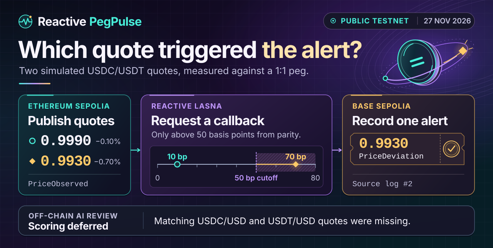
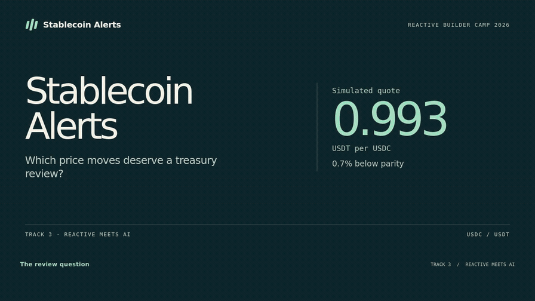

# Reactive PegPulse

**English** · [简体中文](README.zh-CN.md)

<picture>
  <source media="(max-width: 860px)" srcset="track3/visual/hero/mobile.svg">
  
</picture>

**One quote. Three chains. Anyone can verify.**

Sunshine · Sunshine Swarm Superintelligence (3S) Lab · Reactive Builder Camp 2026 · Track 3, Reactive Meets AI

When a simulated USDC/USDT quote moves more than 0.5% from parity, a contract on Reactive Lasna requests a callback and Base Sepolia records an alert. A community treasury can trace the alert back to Ethereum Sepolia. An off-chain model uses independent dollar prices and recent pair history to decide whether the alert warrants human review.

**[Review the signed alert on GitHub](track3/PROOF.md)** · [Watch the 2:30 competition film](https://cdn.jsdelivr.net/gh/sunshineluyao/reactive-builder-camp-2026@e3793927f18683f811bf17db4ec07589045ea14d/track3/video/public/demo.mp4) · [Three contracts and transactions](track3/README.en.md) · [Market evidence and evaluation](track3/evidence/market/README.md) · [Submission links](assignments/hackathon-submission.en.txt)

[Demo Day presentation and simulated Q&A · one 4 min 40 sec recording](track3/demo-day/README.en.md) · [Download the slides](track3/demo-day/Reactive-PegPulse-Demo-Day.en.pptx) · [English transcript](track3/demo-day/script.en.md)

On November 27, 2026, Sunshine signed six testnet transactions. The 0.9990 control quote stayed on the source chain. The 0.9930 quote triggered one alert on Base. The original run withheld its score. When replayed with independently archived Bitstamp, Coinbase and Binance prices from before the event, the frozen model recommended **continue observing**. On 208 historical crossings with complete follow-up, the model referred 200 cases, including 10 short-lived moves. It assigned three persistent moves to observation and withheld judgment on one more.

[Follow the quote into human review](track3/README.en.md#from-quote-to-human-review) · [Portrait cover for phones](track3/visual/hero/mobile.svg)

Watch the local three-chain replay (2 min 30 sec, Chinese captions)

[Audio, captions and stills from the local replay](track3/video/README.md) · [MIT license for the project code](track3/LICENSE)

## Camp assignments

Sunshine’s field notes, exercises and submission evidence for Reactive Builder Camp 2026.

- [Participant handbook](docs/handbook.en.md)
- [Day 0 · Test wallet, Foundry and lREACT](assignments/d0-environment-setup.en.md) · [Submission text](assignments/d0-environment-setup-submission.en.txt)
- [Day 1 · A cross-chain stablecoin price alert](notes/d1-use-case.en.md)
- [Day 2 · Understand Lasna fees](assignments/d2-lasna-fees.en.md)
- [Day 3 · Watch Sepolia token transfers](assignments/d3-sepolia-transfer-monitor.en.md) · [Submission text](assignments/d3-sepolia-transfer-monitor-submission.en.txt) · [Browser walkthrough](experiments/sepolia-transfer-monitor/README.en.md)
- [Day 4 · Trace a cross-chain callback](assignments/d4-cross-chain-callback.en.md) · [Submission text](assignments/d4-cross-chain-callback-submission.en.txt) · [Browser walkthrough](experiments/cross-chain-callback/README.en.md)
- [Day 5 · Stop after two Cron100 callbacks](assignments/d5-cron100.en.md) · [Submission text](assignments/d5-cron100-submission.en.txt) · [Reproduction guide and fee flow](experiments/cron100/README.en.md)
- [Day 6 · Project direction and evidence plan](assignments/d6-project-direction.en.md)
- [Automation safeguards](track3/README.en.md#automation-safeguards) · [Foundry screenshot](track3/evidence/forge-guards.png) · [Failure and recovery](track3/README.en.md#failure-and-recovery) · [Submission text](assignments/automation-guards-submission.en.txt)
