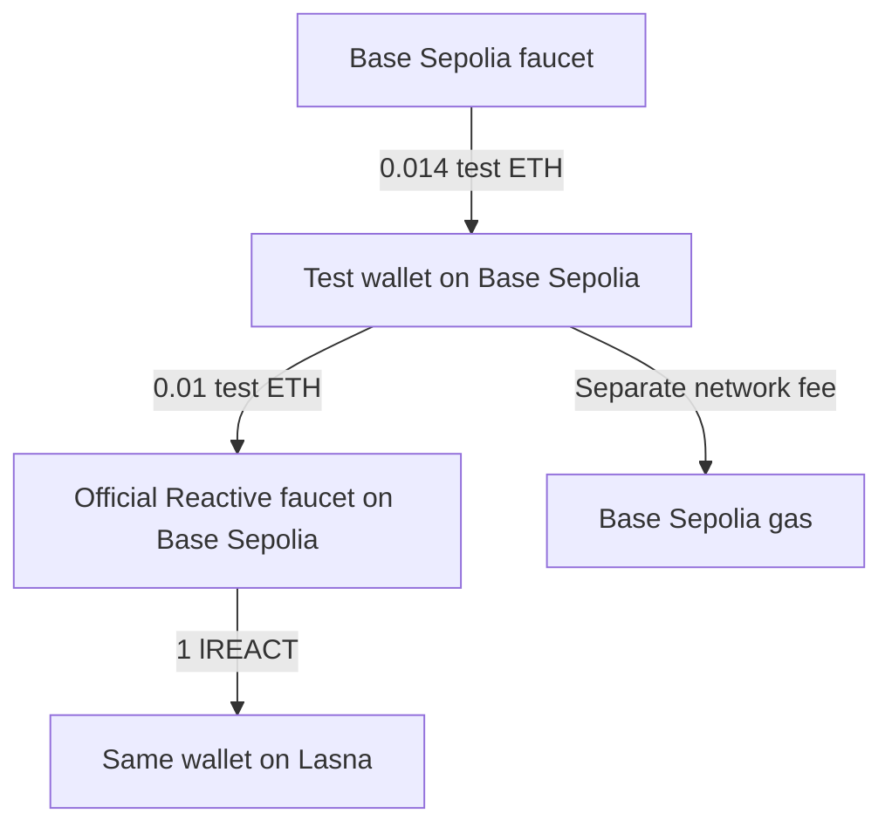
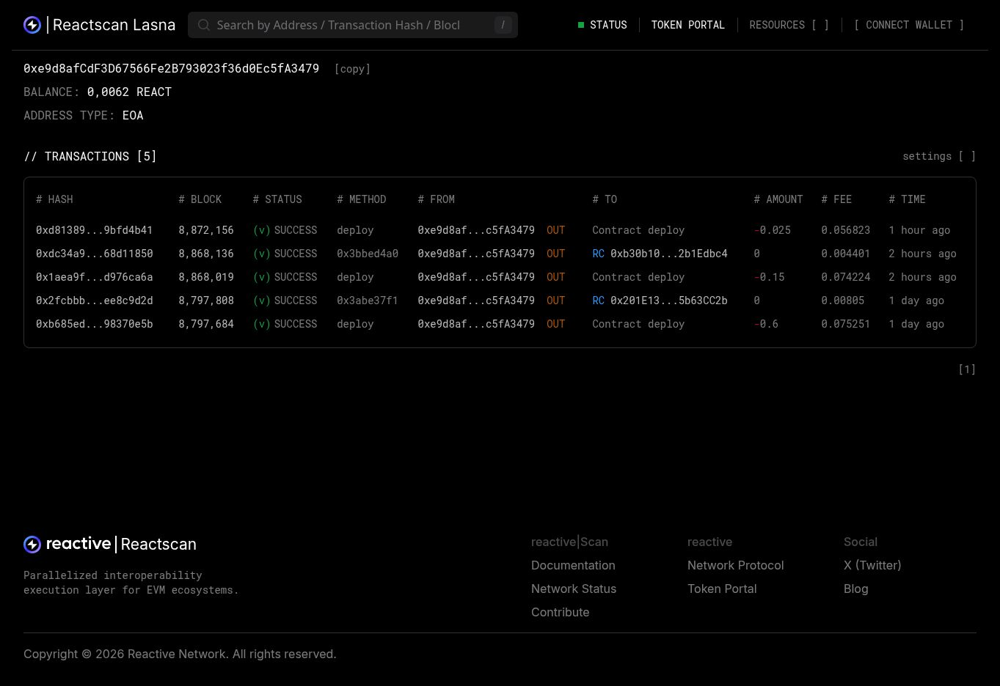
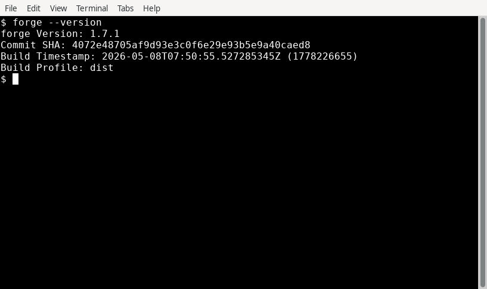

# Day 0 · Set up the test environment

**English** · [简体中文](d0-environment-setup.md)

The camp’s dedicated test wallet was checked at Lasna block 8,875,988 on November 21, 2026 at 15:33:36 (UTC+8).

| Submission item | Evidence |
| --- | --- |
| Test-only wallet | `0xe9d8afCdF3D67566Fe2B793023f36d0Ec5fA3479` |
| Lasna balance | 0.006248999998380720 lREACT · [Reactscan](https://lasna.reactscan.net/address/0xe9d8afCdF3D67566Fe2B793023f36d0Ec5fA3479) · [Balance screenshot](d0-lasna-balance.jpg) |
| Public learning repository | [reactive-builder-camp-2026](https://github.com/sunshineluyao/reactive-builder-camp-2026) |
| Foundry version | `forge --version` returned 1.7.1 · [Terminal screenshot](d0-forge-version.jpg) |

[Copy-ready submission](d0-environment-setup-submission.en.txt)

## Test-token exchange

1. The wallet received 0.014 test ETH on Base Sepolia. [Faucet receipt](https://sepolia.basescan.org/tx/0xbaf09a3b591d8bad4299da988656aee1c92a5e703974024428c5437564bd57f4)
2. It called `request(address)` on the official Reactive faucet on Base Sepolia with 0.01 test ETH, naming itself as the recipient. [Exchange receipt](https://sepolia.basescan.org/tx/0xd22bdf121fa66fece4e0820052803afd5621ad133eeac5e5166709ba0ed3579b)
3. At Lasna block 8,797,683 the balance was 1 lREACT. Later camp experiments used the wallet. The table gives the subsequent submission snapshot. Reactscan displays Lasna test tokens as `REACT` and rounds the displayed balance to `0,0062`. [Lasna account](https://lasna.reactscan.net/address/0xe9d8afCdF3D67566Fe2B793023f36d0Ec5fA3479)



## Submission screenshots





```text
$ forge --version
forge Version: 1.7.1
Commit SHA: 4072e48705af9d93e3c0f6e29e93b5e9a40caed8
Build Timestamp: 2026-05-08T07:50:55.527285345Z (1778226655)
Build Profile: dist
```

## Reproduce in a browser

1. In MetaMask, select a test-only account and copy its public address. Switch to **Base Sepolia** (chain ID 84532) and request test ETH from a faucet listed by Base. [Base test-token guide](https://docs.base.org/get-started/get-funds#testnet-base-sepolia)
2. On Base Sepolia, follow Reactive’s MetaMask instructions to send 0.01 test ETH to `0x2afaFD298b23b62760711756088F75B7409f5967`. Allow extra for gas. The camp reference also gives the Ethereum Sepolia route and its matching address. [Reactive faucet](https://dev.reactive.network/reactive-mainnet#reactive-faucet) · [Camp reference, section 3](https://github.com/ethpanda-org/reactive-builder-camp/blob/main/docs/cheatsheet.md#3-领测试币)
3. Search for the wallet in [Reactscan Lasna](https://lasna.reactscan.net/). Capture the full address and funded balance. Open or create your public GitHub learning repository and copy its homepage URL.
4. Use **Add file → Create new file** on GitHub to create `.github/workflows/d0-forge-version.yml`. Commit the example to the default branch. Under **Actions → D0 Forge version → Run workflow**, start the workflow, open the successful run and capture **Show Forge version**. [Foundry GitHub Action](https://github.com/foundry-rs/foundry-toolchain)

```yaml
name: D0 Forge version
on: workflow_dispatch
permissions: {}
jobs:
  version:
    runs-on: ubuntu-latest
    steps:
      - uses: foundry-rs/foundry-toolchain@v1
      - name: Show Forge version
        run: forge --version
```

Alternatively, open GitHub Codespaces, install Foundry and run `forge --version` in its terminal. The same terminal can query balances at historical Lasna blocks. [Codespaces quickstart](https://docs.github.com/en/codespaces/quickstart) · [Foundry installation](https://www.getfoundry.sh/introduction/installation)

```bash
cast balance 0xe9d8afCdF3D67566Fe2B793023f36d0Ec5fA3479 \
  --rpc-url https://lasna-rpc.rnk.dev/ --block 8875988 --ether
```
