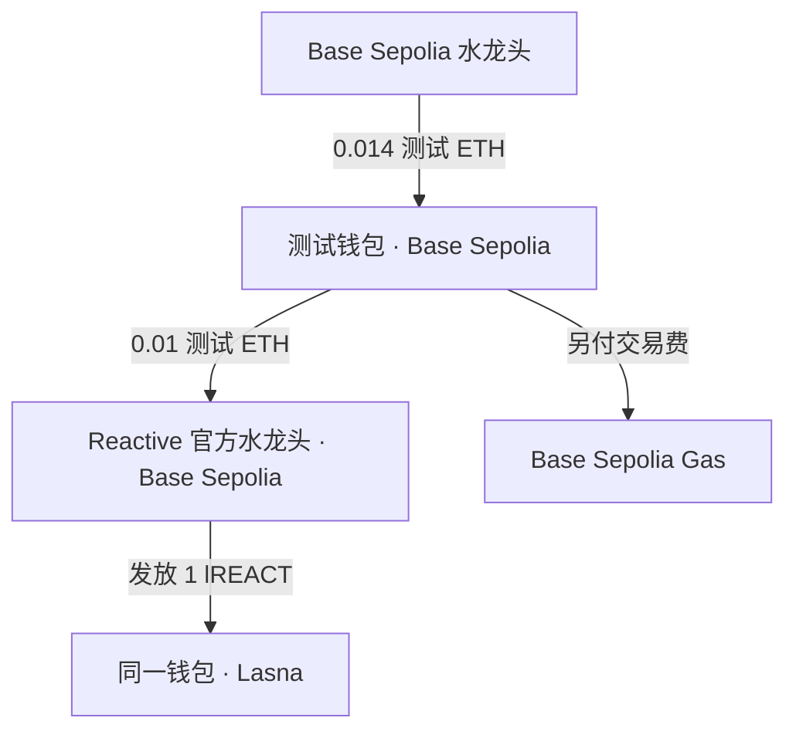
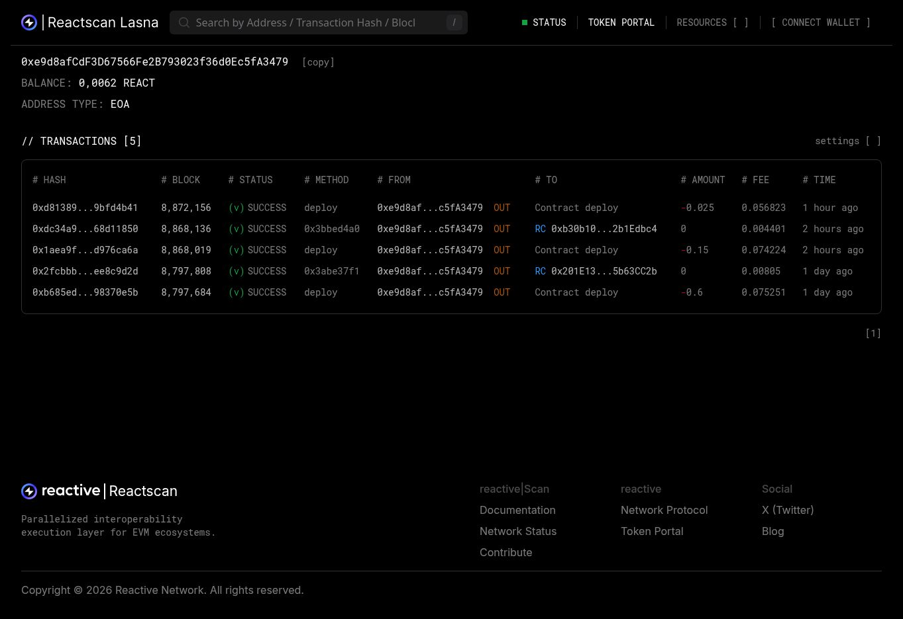
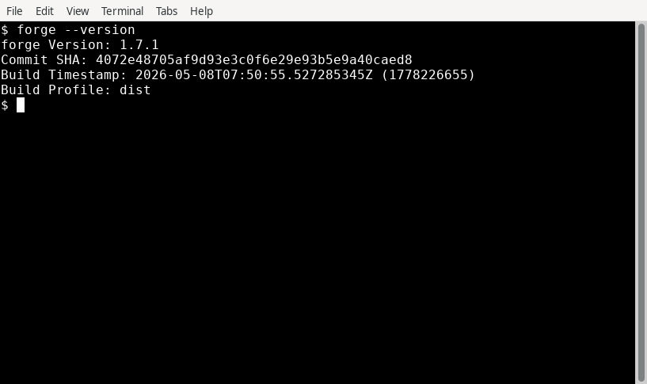

# Day 0 · 环境准备

沿用训练营的测试专用钱包。链上余额以 Lasna 区块 8,875,988 为准，区块时间为 2026 年 11 月 21 日 15:33:36（UTC+8）。

| 提交项 | 证据 |
| --- | --- |
| 测试专用钱包地址 | `0xe9d8afCdF3D67566Fe2B793023f36d0Ec5fA3479` |
| Lasna lREACT 余额 | 0.006248999998380720 lREACT · [Reactscan](https://lasna.reactscan.net/address/0xe9d8afCdF3D67566Fe2B793023f36d0Ec5fA3479) · [余额截图](d0-lasna-balance.jpg) |
| 公开学习仓库 | [reactive-builder-camp-2026](https://github.com/sunshineluyao/reactive-builder-camp-2026) |
| Foundry 版本 | `forge --version` 输出 1.7.1 · [云端终端截图](d0-forge-version.jpg) |

[可直接粘贴的提交文字](d0-environment-setup-submission.txt)

## 测试币兑换记录

1. 测试钱包先在 Base Sepolia 收到 0.014 测试 ETH。[领币回执](https://sepolia.basescan.org/tx/0xbaf09a3b591d8bad4299da988656aee1c92a5e703974024428c5437564bd57f4)
2. 钱包向 Base Sepolia 的 Reactive 官方水龙头调用 `request(address)`，支付 0.01 测试 ETH 并将收款人填为同一钱包。[兑换回执](https://sepolia.basescan.org/tx/0xd22bdf121fa66fece4e0820052803afd5621ad133eeac5e5166709ba0ed3579b)
3. Lasna 区块 8,797,683 记录的余额为 1 lREACT。后续使用该钱包进行了训练营实验，当前提交采用表中的余额快照。Reactscan 将 Lasna 测试币显示为 `REACT`，截图里的 `0,0062` 是四位小数显示。[Lasna 查询页](https://lasna.reactscan.net/address/0xe9d8afCdF3D67566Fe2B793023f36d0Ec5fA3479)



## 两张提交截图





```text
$ forge --version
forge Version: 1.7.1
Commit SHA: 4072e48705af9d93e3c0f6e29e93b5e9a40caed8
Build Timestamp: 2026-05-08T07:50:55.527285345Z (1778226655)
Build Profile: dist
```

## 只用浏览器复现

1. 在 MetaMask 中选择或创建测试专用账户，复制公开地址。选择 **Base Sepolia**（链 ID 84532），从 Base 的测试币水龙头列表领取测试 ETH。[Base 测试币指南](https://docs.base.org/get-started/get-funds#testnet-base-sepolia)
2. 保持 MetaMask 在 **Base Sepolia**。按 Reactive 官方的 MetaMask 转账方式，向 Base Sepolia 水龙头 `0x2afaFD298b23b62760711756088F75B7409f5967` 发送 0.01 测试 ETH，余额还要覆盖该笔交易的 Gas。课程速查表也提供 Ethereum Sepolia 路线及相应合约地址。[Reactive 官方水龙头](https://dev.reactive.network/reactive-mainnet#reactive-faucet) · [课程速查表第 3 节](https://github.com/ethpanda-org/reactive-builder-camp/blob/main/docs/cheatsheet.md#3-领测试币)
3. 在 [Reactscan Lasna](https://lasna.reactscan.net/) 搜索刚才的账户地址。余额到账后，截取同时包含完整地址和余额的画面。在 GitHub 网页创建或打开公开学习仓库，复制仓库首页链接。
4. 在 GitHub 网页通过 **Add file → Create new file** 创建 `.github/workflows/d0-forge-version.yml`，粘贴下方内容并提交到默认分支。在 **Actions → D0 Forge version → Run workflow** 手动运行，打开成功的运行记录，展开 **Show Forge version**，截取命令和输出。[Foundry 官方 GitHub Action](https://github.com/foundry-rs/foundry-toolchain)

```yaml
name: D0 Forge version
on: workflow_dispatch
permissions: {}
jobs:
  version:
    runs-on: ubuntu-latest
    steps:
      - uses: foundry-rs/foundry-toolchain@v1
      - name: Show Forge version
        run: forge --version
```

也可以在浏览器打开 GitHub Codespaces，按 Foundry 官方说明安装工具，在云端终端运行 `forge --version`。装好后可以用同一终端查询 Lasna 历史区块余额。[Codespaces 快速入门](https://docs.github.com/en/codespaces/quickstart) · [Foundry 安装说明](https://www.getfoundry.sh/introduction/installation)

```bash
cast balance 0xe9d8afCdF3D67566Fe2B793023f36d0Ec5fA3479 \
  --rpc-url https://lasna-rpc.rnk.dev/ --block 8875988 --ether
```
