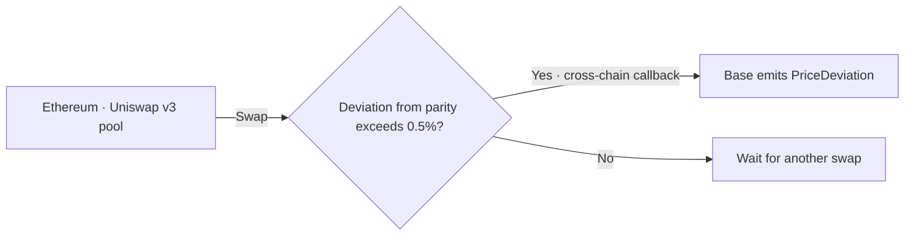

# Use-case card · Cross-chain stablecoin price alerts

**English** · [简体中文](d1-use-case.md)

> The [Day 1 use-case card](../notes/d1-use-case.en.md) is the formal submission.

The proposed Base risk dashboard alerts when the Ethereum USDC/USDT pool moves beyond a threshold around parity. A reader can trace the Base alert to the original transaction.

## 1. Which chain, contract and event?

Watch `Swap` on the Ethereum mainnet (chain ID 1) Uniswap v3 USDC/USDT 0.01% pool at `0x3416cF6C708Da44DB2624D63ea0AAef7113527C6`. Each event contains the post-swap `sqrtPriceX96`. [Pool](https://www.geckoterminal.com/eth/pools/0x3416cf6c708da44db2624d63ea0aaef7113527c6) · [Verified Swap at log index 906](https://etherscan.io/tx/0x08be604cced2000dfecae34acb01009104c6d277bd27b56fa636ca54246f68d3#eventlog) · [Event specification](https://github.com/Uniswap/v3-core/blob/main/contracts/interfaces/pool/IUniswapV3PoolEvents.sol)

## 2. What triggers a callback?

Compute the post-swap quote `p` in USDT per USDC from `sqrtPriceX96` inside `react()`. Request a callback if `p < 0.995` or `p > 1.005`. At this example threshold, 0.993 triggers and 0.999 stays under observation. The ratio measures the spread between the two tokens. Independent dollar prices are needed to identify which token moved against USD. [Uniswap v3 price math](https://blog.uniswap.org/uniswap-v3-math-primer)

## 3. What happens on the destination?

Reactive requests a callback to the proposed `StablecoinAlert.recordAlert()` contract on Base mainnet (8453). A `PriceDeviation` event retains the quote, Ethereum transaction hash and source log index for display and verification. [Supported networks](https://dev.reactive.network/origins-and-destinations) · [Callbacks](https://dev.reactive.network/callback-contracts)

## 4. What does Reactive simplify, and what does it cost?

- **Self-hosted alternative.** A persistent service subscribes to Ethereum logs, applies the threshold, signs Base transactions, backfills missed logs and retries failed submissions.
- **Reactive implementation.** The network delivers matching source events and submits the destination callback. The contracts define the rule and the destination action.
- **Operating costs.** REACT pays for event processing and Base ETH pays for callback execution. Delivery time depends on cross-chain processing and confirmation. [Fees](https://dev.reactive.network/callback-contracts)

## Event flow

