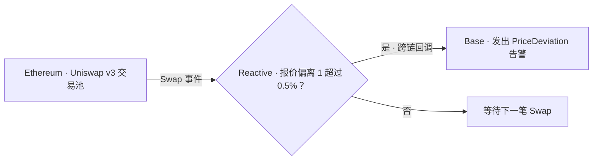

# 用例拆解卡 · 稳定币价差的跨链预警

[English](d1-use-case.en.md) · **简体中文**

> 正式提交链接见 [D1 用例拆解卡](../notes/d1-use-case.md)。

我想给 Base 上的稳定币风险仪表板添加一条预警。Ethereum 上的 USDC/USDT 报价偏离 1:1 超过设定阈值时，仪表板可以从 Base 上读到告警，并追溯到原始交易。

## 1. 监听哪条链、哪个合约的什么事件？

监听 Ethereum 主网（链 ID `1`）上 Uniswap v3 的 USDC/USDT 交易池（费率 0.01%，地址 `0x3416cF6C708Da44DB2624D63ea0AAef7113527C6`）发出的 `Swap` 事件。每次交换后，事件中的 `sqrtPriceX96` 记录了该池的价格信息。[交易池](https://www.geckoterminal.com/eth/pools/0x3416cf6c708da44db2624d63ea0aaef7113527c6) · [已核验的 Swap 日志（索引 906）](https://etherscan.io/tx/0x08be604cced2000dfecae34acb01009104c6d277bd27b56fa636ca54246f68d3#eventlog) · [Uniswap 事件定义](https://github.com/Uniswap/v3-core/blob/main/contracts/interfaces/pool/IUniswapV3PoolEvents.sol)

## 2. 满足什么条件时触发？

Reactive 合约的 `react()` 从 `sqrtPriceX96` 算出交换后的池内报价 `p`，也就是 1 USDC 值多少 USDT。当 `p < 0.995` 或 `p > 1.005` 时，发起跨链回调。以 0.5% 为示例阈值，`0.993` 会触发预警，`0.999` 则继续监听。这个信号衡量的是两种币之间的相对价差。确认哪种币偏离美元锚定价，需要查独立的美元报价。[Uniswap v3 价格计算](https://blog.uniswap.org/uniswap-v3-math-primer)

## 3. 在哪条链做什么动作？

Reactive 向 Base 主网（链 ID `8453`）发起回调，调用拟部署的 `StablecoinAlert` 合约的 `recordAlert()`。合约发出 `PriceDeviation` 事件，记录报价、Ethereum 交易哈希和源日志索引，供仪表板展示和溯源。[Reactive 支持的网络](https://dev.reactive.network/origins-and-destinations) · [Reactive 回调说明](https://dev.reactive.network/callback-contracts)

## 4. 不用 Reactive 怎么做？它简化了哪里，代价是什么？

- **自己跑机器人**。用常驻服务订阅 Ethereum 的 `Swap` 日志，判断阈值，再用服务钱包签发 Base 交易。还要处理掉线后的日志补读和交易失败重试。
- **Reactive 简化的部分**。网络负责传递源链事件并提交目标链回调。我在合约里定义触发条件和收到回调后的动作，省去维护常驻机器人。
- **代价**。需要用 REACT 支付事件处理开销，用 Base 上的 ETH 支付回调费用。预警的时效也取决于跨链事件处理和回调确认。[Reactive 费用说明](https://dev.reactive.network/callback-contracts)

## 流程图

