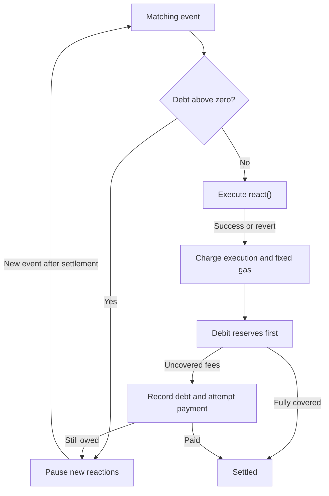

# Day 2 · Understanding Lasna fees

**English** · [简体中文](d2-lasna-fees.md)

With `cast 1.7.1`, read Lasna system contract `0x8888888888888888888888888888888888888888` on chain 5318007. All three calls used block **8,872,816**, timestamp **November 21, 2026 at 14:37:33, Singapore time**.

## Three cast calls and raw output

```console
$ cast call 0x8888888888888888888888888888888888888888 '_gasPriceCoeffPer1000()(uint256)' --rpc-url https://lasna-rpc.rnk.dev/ --block 8872816
1000

$ cast call 0x8888888888888888888888888888888888888888 '_extraGas()(uint256)' --rpc-url https://lasna-rpc.rnk.dev/ --block 8872816
100000 [1e5]

$ cast call 0x8888888888888888888888888888888888888888 '_maxChargeGas()(uint256)' --rpc-url https://lasna-rpc.rnk.dev/ --block 8872816
50000 [5e4]
```

| Parameter | Measured value | Meaning |
| --- | ---: | --- |
| `_gasPriceCoeffPer1000()` | 1,000 | The coefficient is expressed in thousandths, giving a multiplier of 1. |
| `_extraGas()` | 100,000 gas | Fixed gas added per charge. |
| `_maxChargeGas()` | 50,000 gas | Gas limit for the system’s attempt to collect a debt via `pay()`. |

## 1. Calculating the cost of a reaction

Take the higher of `tx.gasprice` and `block.basefee`, add the fixed gas to measured execution gas, and apply the price coefficient.

```text
Fee (wei) = max(tx.gasprice, block.basefee) × (_gasPriceCoeffPer1000() / 1000) × (measured execution gas + _extraGas())
```

At 100 gwei with 50,000 gas measured, these parameters give 150,000 billable gas and a fee of 0.015 lREACT. Actual fees depend on the transaction’s gas price and usage. [Reactive fee formula](https://dev.reactive.network/economy#fee-model)

## 2. Balance, reserves and debt

| Item | Where to read it | Meaning |
| --- | --- | --- |
| `balance` | Monitored contract address | lREACT held directly by the contract, including deployment funding. |
| `reserves` | Lasna system ledger | Prepaid service credit for the contract, charged first. |
| `debt` | Lasna system ledger | Unsettled fees. Once reserves run out, the system records the remainder and may attempt collection through `pay()`. |

Before delivering a reaction, the system checks that `debt == 0`. Even a small debt pauses new delivery. Funds held by the contract settle debt through the payment mechanism. A system `depositTo(contractAddress)` first settles debt, then credits the remainder to reserves. [Ledger and funding](https://dev.reactive.network/economy)



## 3. Does a reverted reaction cost gas?

Yes. A revert rolls back state changes but execution consumed gas. The system catches the revert, records `ReactiveContractReverted` and charges execution gas plus fixed gas. [Revert charging](https://dev.reactive.network/economy#fee-model)

Narrow the subscription by chain, token and event signature. Check topics and data length early in `react()`. Return promptly for expected events that fail the condition. Early returns still use gas, which makes subscription filters valuable. Cap valid triggers, unsubscribe at the limit and pre-fund execution. [Day 3 monitor](d3-sepolia-transfer-monitor.en.md)
