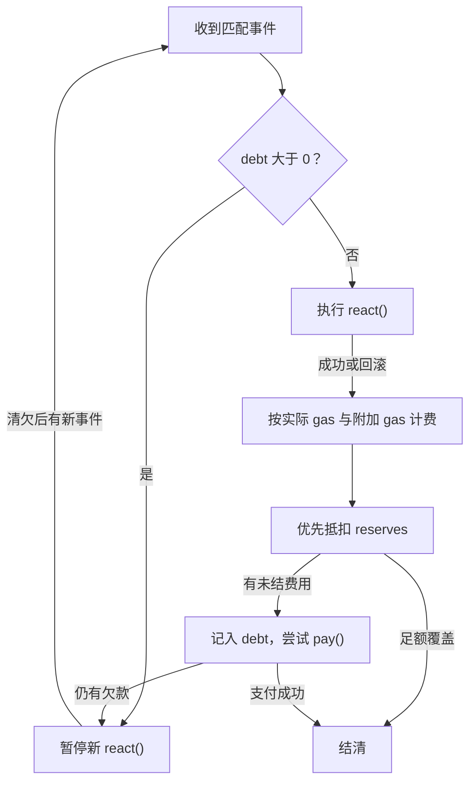

# D2 作业 · 读懂 Lasna 费用

[English](d2-lasna-fees.en.md) · **简体中文**

使用 `cast 1.7.1` 在 Lasna 测试网（链 ID `5318007`）读取系统合约 `0x8888888888888888888888888888888888888888`。三条命令均固定在区块 **8,872,816**，区块时间为 **2026-11-21 14:37:33（新加坡时间）**。

## 三条 cast 命令及原始输出

```console
$ cast call 0x8888888888888888888888888888888888888888 '_gasPriceCoeffPer1000()(uint256)' --rpc-url https://lasna-rpc.rnk.dev/ --block 8872816
1000

$ cast call 0x8888888888888888888888888888888888888888 '_extraGas()(uint256)' --rpc-url https://lasna-rpc.rnk.dev/ --block 8872816
100000 [1e5]

$ cast call 0x8888888888888888888888888888888888888888 '_maxChargeGas()(uint256)' --rpc-url https://lasna-rpc.rnk.dev/ --block 8872816
50000 [5e4]
```

| 参数 | 实测值 | 用途 |
| --- | ---: | --- |
| `_gasPriceCoeffPer1000()` | 1,000 | 以千分数保存的计费系数，换算后为 1 倍 |
| `_extraGas()` | 100,000 gas | 每次计费时加入的固定 gas |
| `_maxChargeGas()` | 50,000 gas | 系统合约调用 `pay()` 尝试结清欠款时的 gas 上限 |

## 1. 一次 react() 的费用怎么算

系统先取 `tx.gasprice` 与 `block.basefee` 中较高的值作为基础 gas 价格，再将系统计量的执行 gas 与固定附加 gas 相加，最后乘上计费系数。

```text
费用（wei）= max(tx.gasprice, block.basefee) × (_gasPriceCoeffPer1000() / 1000) × (实际执行 gas + _extraGas())
```

例如，假设基础 gas 价格为 100 gwei，系统计量到 50,000 gas。代入这次查到的参数，计费 gas 为 150,000，费用是 0.015 lREACT。真正的交易费用取决于当笔的 gas 价格与实际消耗。[Reactive 官方计费公式](https://dev.reactive.network/economy#fee-model)

## 2. balance、reserves、debt 分别是什么

| 项目 | 记录位置 | 含义 |
| --- | --- | --- |
| `balance` | 监控合约地址 | 合约自己持有的 lREACT，可用于支付费用。部署时带入的资金进入这项余额。 |
| `reserves` | Lasna 系统合约账本 | 为某个合约预存的费用额度，系统计费时优先扣用。 |
| `debt` | Lasna 系统合约账本 | 已经产生且尚未结清的费用。储备扣完后，未覆盖的费用会记入欠款，系统会尝试通过合约的 `pay()` 清偿。 |

系统在调用 `react()` 之前检查 `debt`。系统只有在 `debt == 0` 时才投递新反应。欠款很小也会暂停执行，恢复前要把系统账本上的欠款清零。合约地址里的余额需要经过清偿流程才能抵扣欠款。通过系统合约的 `depositTo(合约地址)` 充值时，资金先清欠，剩余才进入 `reserves`。[Reactive 账本与充值方式](https://dev.reactive.network/economy)



## 3. react() 回滚了还收费吗

会。`react()` 回滚会撤销这次调用里的状态写入，执行期间消耗的 gas 已经用掉。系统捕获回滚并记录 `ReactiveContractReverted`，随后按执行 gas 和固定附加 gas 计费。[Reactive 回滚计费说明](https://dev.reactive.network/economy#fee-model)

我的设计做法是先把订阅的链、代币合约和事件签名收紧。在 `react()` 中先检查主题与数据长度，对预期内但不符合条件的事件尽早 `return`。提前返回仍会消耗本次调用所用的 gas，因此订阅层过滤也有价值。对有效触发设置处理次数上限，计满后退订，并在部署时预留执行资金。[D3 监控实验](d3-sepolia-transfer-monitor.md)
