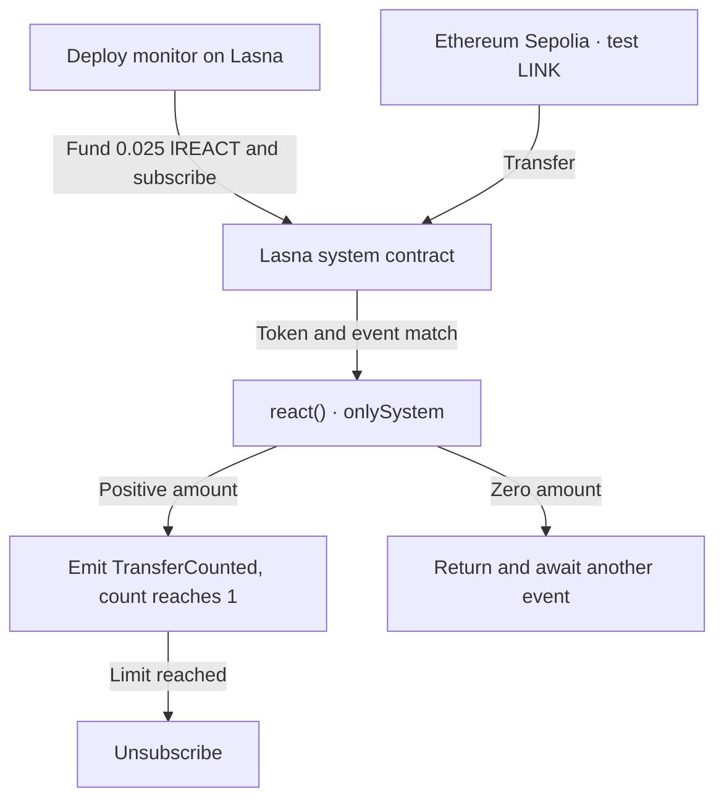

# Day 3 · Deploy a Sepolia token-transfer monitor

**English** · [简体中文](d3-sepolia-transfer-monitor.md)

On November 21, 2026, the Lasna `BoundedTransferMonitor` was deployed with 0.025 lREACT. A public Ethereum Sepolia transfer of 25 test LINK triggered `react()`. The Lasna receipt contained the count event and the system unsubscribe event. At verification, `count() = 1`, `subscribed() = false`, and debt was zero.

- [Copy-ready submission](d3-sepolia-transfer-monitor-submission.en.txt)
- [MetaMask and Remix walkthrough](../experiments/sepolia-transfer-monitor/README.en.md)

## Event flow

## On-chain evidence

| Evidence | Network | Verified result |
| --- | --- | --- |
| [Monitor address](https://lasna.reactscan.net/address/0x86f87a011E240F5480495553c75bc0ca6F6628B6) | Lasna | `0x86f87a011E240F5480495553c75bc0ca6F6628B6` |
| [Deployment](https://lasna.reactscan.net/tx/0xd81389a23ce2adb06da3190867b12d827f3ccad4540659c6399714af9bfd4b41) | Lasna | Constructor subscribed to test LINK transfers with 0.025 lREACT. |
| [Source transfer](https://sepolia.etherscan.io/tx/0x750bf3a2a4fc7c4f8a6e672401e63887e43402e09722d09cecc34f653defe2d0) | Ethereum Sepolia | Block 12,180,138 emitted a 25 LINK transfer. |
| [Reactive execution](https://lasna.reactscan.net/tx/0x6cde9b2ea78204a1aed76970acbb1a37fcc702bf1f56c3479f644b43ed9913aa) | Lasna | Block 8,872,323 emitted TransferCounted, then unsubscribed. |

The source hash, sender, recipient and amount decoded from `TransferCounted` match the source `Transfer` log. The Lasna subscription and unsubscription logs have identical filters.

## Subscription filter

Subscribe only to ERC-20 transfers from test LINK at 0x779877A7B0D9E8603169DdbD7836e478b4624789 on Ethereum Sepolia (11155111). Count positive amounts and unsubscribe after the first.

The constructor calls six-argument `SYSTEM.subscribe()` with `REACTIVE_IGNORE` for the last three topics. `onlySystem` restricts `react()`, which checks the chain, token, signature and ERC-20 log layout. After a qualifying amount reaches the limit, it calls `SYSTEM.unsubscribe()` with the same arguments. [Source](../experiments/sepolia-transfer-monitor/remix/SepoliaTransferMonitor.sol) · [Omni Xfers example](https://github.com/Reactive-Network/reactive-smart-contract-demos/blob/d1d854b4d8ded359d73dcd85cda882ec5c9aab49/src/micro-demos/Xfers.sol) · [LINK addresses](https://docs.chain.link/resources/link-token-contracts)
