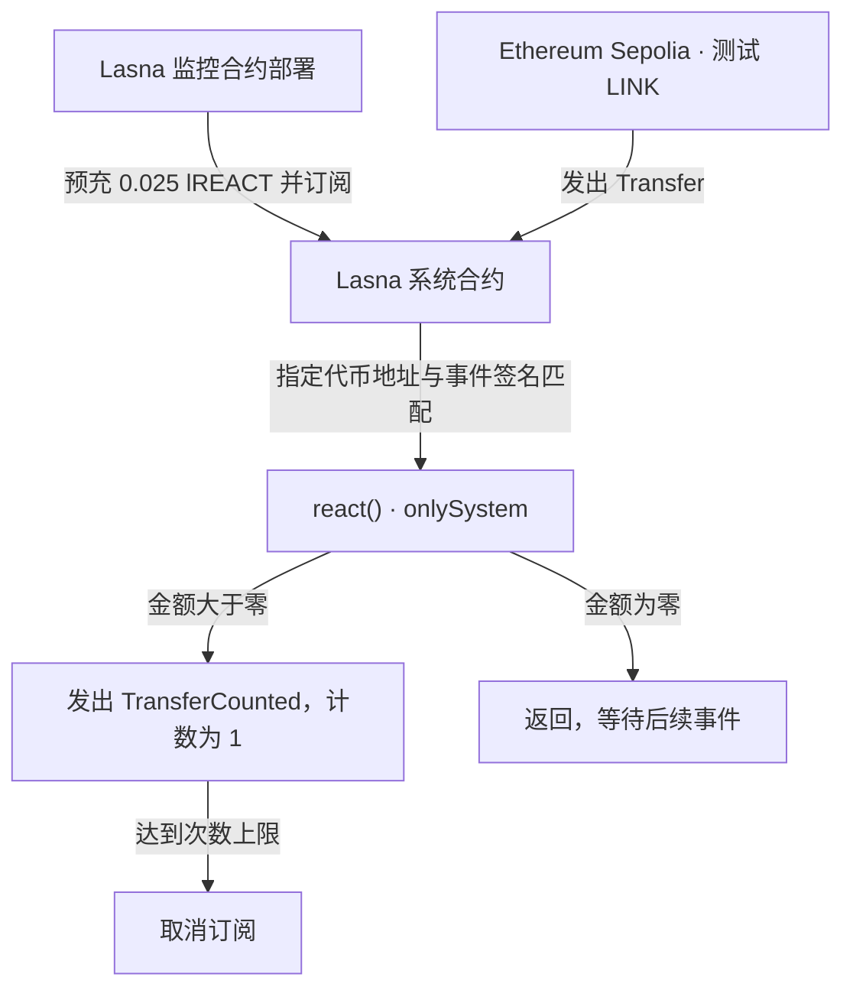

# D3 必做 · 第一次部署，监控 Sepolia 上的代币转账

2026 年 11 月 21 日在 Lasna 部署了 `BoundedTransferMonitor` 并预充 `0.025 lREACT`。Ethereum Sepolia 上一笔公开的 25 LINK 测试代币转账成功触发 `react()`。Lasna 回执同时记录了计数事件与系统退订事件，核验时 `count() = 1`、`subscribed() = false`，欠款为 0。

- [可直接粘贴的提交文本](d3-sepolia-transfer-monitor-submission.txt)
- [MetaMask 与 Remix 浏览器复现指南](../experiments/sepolia-transfer-monitor/README.md)

## Mermaid 工作流

## 链上凭证

| 凭证 | 网络 | 核验结果 |
| --- | --- | --- |
| [监控合约地址](https://lasna.reactscan.net/address/0x86f87a011E240F5480495553c75bc0ca6F6628B6) | Lasna | `0x86f87a011E240F5480495553c75bc0ca6F6628B6` |
| [部署交易](https://lasna.reactscan.net/tx/0xd81389a23ce2adb06da3190867b12d827f3ccad4540659c6399714af9bfd4b41) | Lasna | 构造函数订阅测试 LINK 的 Transfer，交易携带 0.025 lREACT |
| [源链转账](https://sepolia.etherscan.io/tx/0x750bf3a2a4fc7c4f8a6e672401e63887e43402e09722d09cecc34f653defe2d0) | Ethereum Sepolia | 区块 12,180,138，发出 25 LINK 的 Transfer |
| [react() 执行交易](https://lasna.reactscan.net/tx/0x6cde9b2ea78204a1aed76970acbb1a37fcc702bf1f56c3479f644b43ed9913aa) | Lasna | 区块 8,872,323，成功发出 TransferCounted，随后退订 |

从 `TransferCounted` 解出的源交易哈希、发送方、接收方和金额均与 Ethereum Sepolia 的 `Transfer` 日志一致。Lasna 系统的订阅和退订日志也记录了同一组过滤参数。

## 订阅过滤条件

仅订阅 Ethereum Sepolia（链 ID 11155111）上测试 LINK 合约 0x779877A7B0D9E8603169DdbD7836e478b4624789 的 ERC-20 Transfer 事件，金额大于 0 才计数，计满 1 次后自动取消订阅。

构造函数使用六参数 `SYSTEM.subscribe()`，以 `REACTIVE_IGNORE` 通配不关心的后三个 topic。`react()` 由 `onlySystem` 限制，仅处理匹配链、代币地址、事件签名及 ERC-20 日志布局的记录。金额符合条件后记数，并在达到上限时用同一组参数调用 `SYSTEM.unsubscribe()`。[合约源码](../experiments/sepolia-transfer-monitor/remix/SepoliaTransferMonitor.sol) · [Omni Xfers 示例](https://github.com/Reactive-Network/reactive-smart-contract-demos/blob/d1d854b4d8ded359d73dcd85cda882ec5c9aab49/src/micro-demos/Xfers.sol) · [Chainlink LINK 地址表](https://docs.chain.link/resources/link-token-contracts)
