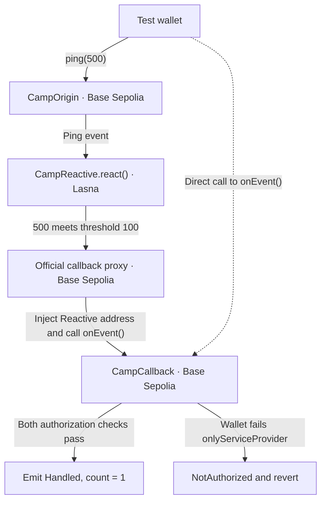
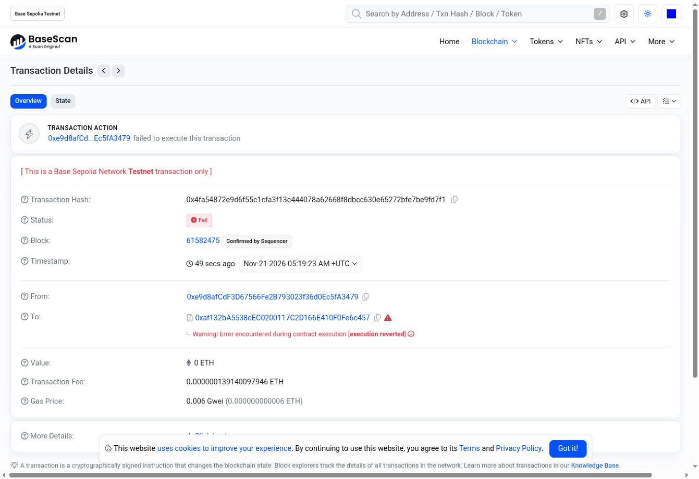

# Day 4 · Trace a cross-chain callback in three steps

**English** · [简体中文](d4-cross-chain-callback.md)

On November 21, 2026, the test wallet completed **Base Sepolia → Lasna → Base Sepolia**. Three successful receipts identify the same `ping(500)`. The receiver reported `lastValue() = 500`, `count() = 1` and a matching `lastOriginTxHash()`.

- [Copy-ready submission](d4-cross-chain-callback-submission.en.txt)
- [MetaMask and Remix walkthrough](../experiments/cross-chain-callback/README.en.md)

## Event flow

## Three successful transactions

| Stage | Network | Block | Verification | Receipt |
| --- | --- | ---: | --- | --- |
| 1 · Source | Base Sepolia | 61,581,247 | CampOrigin emitted `Ping` with value `500` | [Transaction](https://sepolia.basescan.org/tx/0xd762648adca1999553c18986bb08588c35269f372f7910976e4aedc37710e9db) |
| 2 · Reactive execution | Lasna | 8,868,168 | `react()` emitted `Seen` and `CallbackRequested` | [Transaction](https://lasna.reactscan.net/tx/0xcc498be24f04699e4af51def4561b61f90454c96ba4d59e92e80a9b6356e3de0) |
| 3 · Destination callback | Base Sepolia | 61,581,255 | Official proxy called CampCallback, which emitted `Handled` | [Transaction](https://sepolia.basescan.org/tx/0xc665874798405beee6a879354ce874c3fa182748dfdf89b561f6f658c9f8e2a4) |

The Lasna `Seen` and Base `Handled` logs carry the same source hash. `CallbackRequested` specifies destination chain 84532 and the deployed CampCallback address.

## Direct wallet call that failed

The test wallet `0xe9d8afCdF3D67566Fe2B793023f36d0Ec5fA3479` directly called `CampCallback.onEvent(authorized CampReactive address, 84532, 0, 500)` on Base Sepolia with zero value. The transaction reverted at block 61,582,475 with status `0x0`. A call with the same address and arguments decoded `NotAuthorized(address,address)`. The count remained 1. [Failed transaction](https://sepolia.basescan.org/tx/0x4fa54872e9d6f55c1cfa3f13c444078a62668f8dbcc630e65272bfe7be9fd7f1)

The receiver inherits `AbstractCallback`, takes an address as its first argument and checks `onlyServiceProvider` and `onlyCallbackSender`. A direct call has the wallet as `msg.sender`. Only the official Base Sepolia proxy passes the first check. [Callback authorization](https://dev.reactive.network/callback-contracts)

## Deployed contracts

| Contract | Network | Address | Deployment |
| --- | --- | --- | --- |
| CampOrigin | Base Sepolia | `0xb30b10Fb1e57cC48397ADD24aA6A39782b1Edbc4` | [Deployment](https://sepolia.basescan.org/tx/0x777bcefc2241fcc3770d5e5d562fe5fcf2dcd5ce84560c9399c63e83535954af) |
| CampReactive | Lasna | `0xb30b10Fb1e57cC48397ADD24aA6A39782b1Edbc4` | [Deployment](https://lasna.reactscan.net/tx/0x1aea9f8c0990c83205dc3a0fdb083d4fa69fe2a409fe993fbd6888abd976ca6a) |
| CampCallback | Base Sepolia | `0xaf132bA5538cEC0200117C2D166E410F0Fe6c457` | [Deployment](https://sepolia.basescan.org/tx/0xc36d94824e48ecd41235c8aef573c63b33b7e8ec0c27ff0fd7350a12cf26823c) |

CampOrigin on Base and CampReactive on Lasna share an address in this deployment. Distinguish them by network and transaction hash. CampReactive used threshold 100, a one-event limit and 0.15 lREACT in funding. CampCallback received 0.001 Base Sepolia ETH. After success, `remaining() = 0`. [Lasna binding transaction](https://lasna.reactscan.net/tx/0xdc34a96af57f85b4b62dee909a32162fd453edfbe7c66c9c655ddefe68d11850) · [Official proxies](https://dev.reactive.network/origins-and-destinations#testnet-chains)
