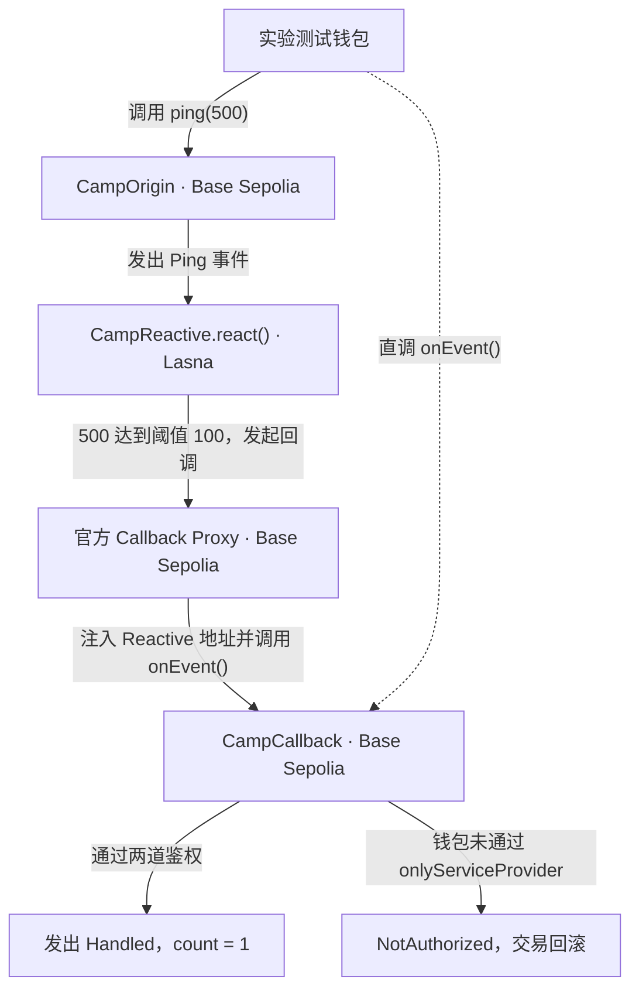
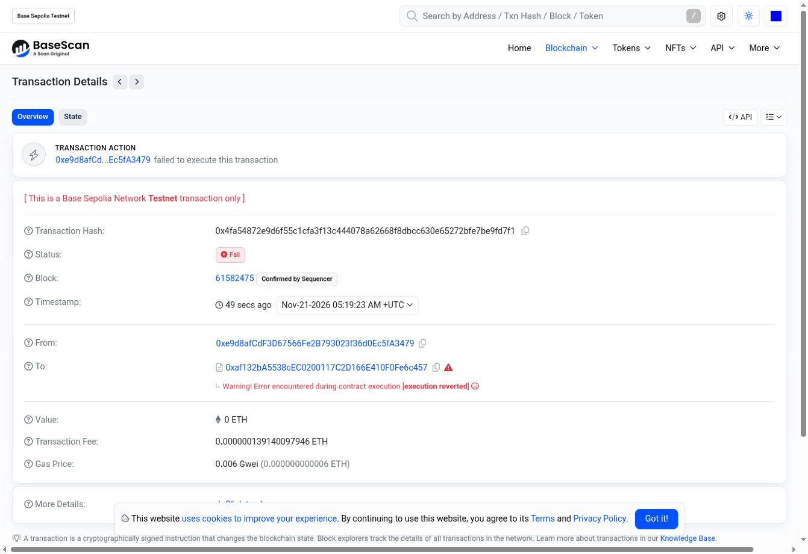

# D4 必做 · 跨链回调三步走

2026 年 11 月 21 日用实验专用钱包完成 **Base Sepolia → Lasna → Base Sepolia**。三笔成功回执指向同一次 `ping(500)`。目标合约读到 `lastValue() = 500`、`count() = 1`，其 `lastOriginTxHash()` 与源交易哈希一致。

- [可直接粘贴的提交文本](d4-cross-chain-callback-submission.txt)
- [MetaMask 与 Remix 浏览器复现指南](../experiments/cross-chain-callback/README.md)

## Mermaid 工作流

## 三笔成功交易

| 步骤 | 网络 | 区块 | 验证结果 | 链上回执 |
| --- | --- | ---: | --- | --- |
| ① 源链事件 | Base Sepolia | 61,581,247 | CampOrigin 发出 `Ping`，值为 `500` | [查看交易](https://sepolia.basescan.org/tx/0xd762648adca1999553c18986bb08588c35269f372f7910976e4aedc37710e9db) |
| ② Reactive 执行 | Lasna | 8,868,168 | `react()` 发出 `Seen` 和 `CallbackRequested` | [查看交易](https://lasna.reactscan.net/tx/0xcc498be24f04699e4af51def4561b61f90454c96ba4d59e92e80a9b6356e3de0) |
| ③ 目标链回调 | Base Sepolia | 61,581,255 | 官方 Proxy 调用 CampCallback，发出 `Handled` | [查看交易](https://sepolia.basescan.org/tx/0xc665874798405beee6a879354ce874c3fa182748dfdf89b561f6f658c9f8e2a4) |

Lasna 的 `Seen` 和 Base Sepolia 的 `Handled` 都携带源交易哈希。`CallbackRequested` 的目标链 ID 为 `84532`，目标地址与实验的 CampCallback 一致。

## 钱包直调失败实验

在 Base Sepolia 用实验钱包 `0xe9d8afCdF3D67566Fe2B793023f36d0Ec5fA3479` 直接调用 `CampCallback.onEvent(已授权的 CampReactive 地址, 84532, 0, 500)`，发送值为 0。交易在区块 61,582,475 回滚，回执状态为 `0x0`。对相同地址和参数的链上调用解码得到 `NotAuthorized(address,address)`，回滚后 `count()` 仍为 1。[失败交易](https://sepolia.basescan.org/tx/0x4fa54872e9d6f55c1cfa3f13c444078a62668f8dbcc630e65272bfe7be9fd7f1)

接收合约继承 `AbstractCallback`，以 `address` 为第一个参数，同时应用 `onlyServiceProvider` 和 `onlyCallbackSender`。实验测试钱包直接调用 onEvent 时，msg.sender 是该钱包地址。onlyServiceProvider 只允许 Base Sepolia 官方 Callback Proxy 调用，因此交易触发 NotAuthorized 并回滚。[官方回调鉴权文档](https://dev.reactive.network/callback-contracts)

## 实测部署

| 合约 | 网络 | 地址 | 部署交易 |
| --- | --- | --- | --- |
| CampOrigin | Base Sepolia | `0xb30b10Fb1e57cC48397ADD24aA6A39782b1Edbc4` | [部署](https://sepolia.basescan.org/tx/0x777bcefc2241fcc3770d5e5d562fe5fcf2dcd5ce84560c9399c63e83535954af) |
| CampReactive | Lasna | `0xb30b10Fb1e57cC48397ADD24aA6A39782b1Edbc4` | [部署](https://lasna.reactscan.net/tx/0x1aea9f8c0990c83205dc3a0fdb083d4fa69fe2a409fe993fbd6888abd976ca6a) |
| CampCallback | Base Sepolia | `0xaf132bA5538cEC0200117C2D166E410F0Fe6c457` | [部署](https://sepolia.basescan.org/tx/0xc36d94824e48ecd41235c8aef573c63b33b7e8ec0c27ff0fd7350a12cf26823c) |

Base Sepolia 的 CampOrigin 和 Lasna 的 CampReactive 在本次部署中恰好有相同的 `0x` 地址，核验时以网络和交易哈希区分。CampReactive 的阈值为 100，处理上限为 1 次，预付 0.15 lREACT。CampCallback 预付 0.001 Base Sepolia 测试 ETH。成功回调后 `remaining() = 0`。[Lasna 绑定交易](https://lasna.reactscan.net/tx/0xdc34a96af57f85b4b62dee909a32162fd453edfbe7c66c9c655ddefe68d11850) · [官方 Proxy 表](https://dev.reactive.network/origins-and-destinations#testnet-chains)
