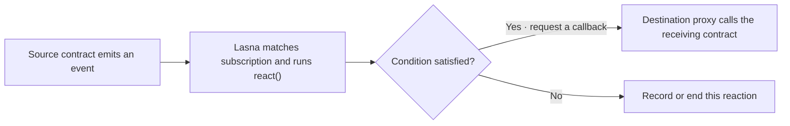

# Reactive Builder Camp

**English** · [简体中文](handbook.md)

## Participant handbook

**November 16–29, 2026 · Two weeks of camp followed by the Buildathon submission**

Start with one testnet event and follow the **source event → Lasna execution → destination callback**. By Demo Day, use that verifiable chain of evidence to explain the user’s problem, the automation and its failure behavior.

### Course route

| Stage (UTC+8) | Goal | Evidence to keep |
|---|---|---|
| Before camp | Set up a test wallet, Foundry, test tokens and a learning repository | Tool versions and network checks |
| Week 1 · Nov 16–22 | Deploy a Reactive contract, complete a callback, choose a project | Three transaction records and the project direction card |
| Week 2 · Nov 23–29 | Build a reproducible project you can explain | Public repository, tests and Demo Day presentation |
| After camp · Platform week 5 | Revise from feedback and submit to DoraHacks | Verified materials and submission confirmation |

### Find a task

| Task | Section |
|---|---|
| Install tools, obtain test tokens or brief an AI assistant on Omni | [01 Before camp](#01-before-camp) |
| Understand subscriptions, permissions, fees or a missing callback | [02 Execution path](#02-execution-path) · [03 Fees and troubleshooting](#03-fees-and-troubleshooting) |
| Find today’s task and acceptance evidence | [04 Week one](#04-week-one) · [05 Week two](#05-week-two) |
| Choose a topic or compare tracks | [06 Scenarios 1–3](#06-scenarios-13) · [07 Scenarios 4–6](#07-scenarios-46) |
| Prepare the demo, submit or copy a template | [08 Demo and submission](#08-demo-and-submission) · [09 Templates](#09-templates) |

Obtain a real destination result before adding more conditions, networks or AI. Use testnets and a dedicated test wallet throughout.

<!-- page -->

## 01 Before camp

### Five environment checks

1. **Test wallet.** Create a dedicated account in MetaMask or another wallet. Publish addresses and example configuration. Keep keys, recovery phrases, private RPC URLs and `.env` local and ignored by Git.
2. **Foundry.** Follow the official `foundryup` installation. Windows users can use WSL or Git Bash. Reopen the terminal and check the two version commands below. [Installation guide][foundry]
3. **Test tokens.** Obtain Sepolia ETH and use the faucet on the selected Sepolia network to receive Lasna lREACT. The documented exchange is 100 lREACT per test ETH. The example sends 0.1 test ETH. The per-transaction limit is 5 test ETH, and excess is lost. Confirm the official address for your network and reserve native test tokens for deployment and callbacks. [Lasna and faucet][lasna]
4. **Public learning repository.** Put a README at the root. Keep daily notes, failed attempts and explorer links in `notes/`. A `notes/README.md` makes the directory visible to Git.
5. **Optional AI coding tools.** Supply the Omni context below. Check critical APIs against the official branch and run `forge build` and `forge test`.

```bash
forge --version
cast --version
cast chain-id --rpc-url https://lasna-rpc.rnk.dev/
```

Lasna should report chain ID 5318007. Check the origin and destination RPCs against the [network table](#practice-networks) as well.

### Copyable prompt for an AI assistant

> I am using Reactive Network Omni following the October 28, 2026 mainnet migration. Target Lasna and Solidity 0.8.29. Use Reactive Contracts, Callback Contracts, Economy and the GitHub omni/src/micro-demos examples for the interfaces. Treat vm, ReactVM and emit Callback as legacy. Use 0x…fffFfF only to subscribe to Cron. Protect react(LogRecord) with onlySystem and request callbacks with requestCallbackV_1_0. The first destination argument is the proxy-injected address. Verify both the callback proxy and authorized Reactive sender. List changed files, verification commands and expected output.

[Reactive Contracts][rc] · [Callback Contracts][cb] · [Economy][econ] · [Omni examples][micro] · [Migration][migration]

<!-- page -->

## 02 Execution path

### From event to business result



| Stage | Implementation | Explorer evidence |
|---|---|---|
| **Origin** | Identify the log by chain, emitting contract and topic0, normally the event signature hash. | Source transaction, event and logIndex |
| **Lasna** | Inherit AbstractReactive, call SYSTEM.subscribe and evaluate the threshold in react() protected by onlySystem. | Execution transaction, matched log and callback request or expected state |
| **Destination** | requestCallbackV_1_0 takes the chain, receiver, gas limit and ABI payload. The receiver inherits AbstractCallback. | Callback transaction, proxy call and business event or state change |

**Subscriptions use exact matching.** Use address(0) for a wildcard emitter and REACTIVE_IGNORE for a wildcard topic. Put amount thresholds in react(). Before decoding, check topic0, opCode (the number of original topics) and the data layout. Unsubscribe with the same six arguments used to subscribe.

**Two authorization checks.** Put address(0) in the first payload slot. The proxy replaces it with the requesting Reactive contract address. onlyServiceProvider checks the destination proxy and onlyCallbackSender(reactive_) checks the permitted sender. Confirm the proxy for your network and fund execution on both sides.

**Practice in two stages.** Use the official ping() → pong() example to check connectivity and deployment. For Day 4, match an actual source event, request the callback in react(), and inspect the destination result. [Sender][sender] · [Receiver][recipient]

### Practice networks

| Testnet | Chain ID | Camp role |
|---|---:|---|
| [Ethereum Sepolia][sep-explorer] | `11155111` | ERC-20 transfers, controlled events and faucet |
| [Reactive Lasna][lasna-explorer] | `5318007` | Deploy Reactive contracts and execute react() |
| [Base Sepolia][base-explorer] | `84532` | Callback destination and optional Track 1 network |
| [Unichain Sepolia][uni-explorer] | `1301` | Callback destination and optional Track 1 network |

Confirm current IDs, proxy addresses and support in the official table. Use testnets on both sides for camp. [Origins and destinations][chains] · [Omni contract API][rc]

<!-- page -->

## 03 Fees and troubleshooting

The Lasna system bills react() execution. The destination proxy bills callback execution. Inspect each payer on its own network. A reaction that executes and reverts still consumes gas. [Economy][econ]

### Read the three balances

| Field | Where to find it | Interpretation |
|---|---|---|
| balance | Native balance of the application contract | A direct transfer increases the balance. Contract payment logic spends it. |
| reserves | Prepaid credit on the system or destination proxy | Charged first. depositTo() settles debt before crediting the remainder. |
| debt | Outstanding fees on the system or destination proxy | Positive debt pauses that side. A direct contract deposit alone increases balance. Verify settlement via depositTo() or the contract’s payment method. |

### Start with the first missing stage

| Symptom | Check first | Verify after repair |
|---|---|---|
| Missing source event | RPC, chain ID, source receipt, actual emitter | Find the expected event, topic0 and log index. |
| Source event present, no Lasna execution | Subscription, exact address/topics, Reactive debt | Publish a fresh controlled event and find its Lasna execution. |
| Execution present, expected callback missing | Revert, ABI decoding, threshold, target chain, receiver, gas | Trace the Lasna execution to the destination transaction or failure record. |
| Destination transaction present, no business result | Proxy, authorized sender, first payload argument, fees and preconditions | Check the contract call and expected event or state. |
| Replays or expenses grow | Event ID, subscription scope, Cron frequency and unsubscription arguments | Replay once and confirm a single effect. Check the stop limit. |

**Look up callbacks.** Query the system’s getCallbacks with the Lasna execution hash. Each entry carries the destination chain ID, transaction hash and error data. Retry after delivery if the array is empty. [Lookup procedure][econ]

**Day 2 self-check.** An address has funds but positive debt. Find the correct settlement method, confirm debt reaches zero, and use a fresh test event to verify recovery.

### Minimum test cases

- **Success.** An authorized, qualifying source event records exactly one expected result on the destination.
- **Rejection.** A direct or unauthorized callback is rejected and leaves business state intact.
- **Additional cases.** Replay a source log, exceed a cap, and test failed callbacks or debt recovery.

Use chainId + txHash + logIndex for the source log and carry its event ID across stages. Run `forge test -vv` locally and retain public testnet transactions as separate delivery evidence. [LogRecord and callbacks][rc] · [Fees and tracking][econ] · [Foundry][forge]

<!-- page -->

## 04 Week one

**Nov 16–22 · Run the Reactive path**
Finish a verifiable event-to-callback route and summarize next week’s project in one sentence.

| Date | Task | Acceptance evidence |
|---|---|---|
| Nov 16, Mon · D1 | **Use-case card.** Explain event, condition and action, and when Reactive can replace a persistent listener. Opening online session. | Source chain, contract, event, condition, action and alternative. [Contracts][rc] · [Reactive Circuit][circuit] |
| Nov 17, Tue · D2 | **Fees.** Check network support. Explain balance, reserves, debt and revert charging. | Funding for both sides, debt pause and recovery. [Networks][chains] · [Economy][econ] |
| Nov 18, Wed · D3 | **First deployment.** Subscribe in the constructor, decode by opCode, cap event count, deploy to Lasna, fund and trigger. | Contract address, source transaction and Lasna execution. [Xfers][xfers] |
| Nov 19, Thu · D4 | **Three-step callback.** Verify authorization and funding before triggering Lasna. Use Base Sepolia, Unichain Sepolia or both. Technical Q&A at 20:00. | Three transactions and destination log. [Callbacks][cb] · [Sender][sender] · [Receiver][recipient] |
| Nov 20, Fri · D5 | **Scheduled or dynamic subscription.** Try Cron, pause/resume or changing subscriptions at runtime, with a count or amount cap. | One trigger and one stop or subscription change. Use timestamps for Base deadlines. [Subscriptions][rc] · [Cron][cron] |
| Nov 21, Sat · D6 | **Project direction.** Specify the subscription, condition and action. Choose a track, register on DoraHacks and share the card when recruiting. | Use case, minimum demo and expected evidence. [Rules][buildblog] · [DoraHacks][dora] |
| Nov 22, Sun · D7 | **Catch up and reflect.** Submit missed work, record the hardest step and its resolution, and send weekly feedback. | Repository check-in and outstanding questions. |

Meeting links are pinned in the study group. Include the network, address, explorer link and expected result in technical questions.

### Days 3 and 4 · Trigger an alert from a transfer

1. **Produce a controlled event.** Choose a Sepolia test token you can operate. Subscribe to its Transfer and convert the threshold to the token’s integer units.
2. **Bind the receiver.** Deploy the Reactive contract, then the destination contract using that sender. If binding later, use the official permissions. Fund both and start with a single Alert log. [Sender][sender] · [Receiver authorization][cb]
3. **Trigger and verify.** Send one below-threshold and one qualifying transfer. Check both Lasna outcomes and the Alert on the qualifying destination transaction. Enter its three transaction links in the [verification table][trace-link].

<!-- page -->

## 05 Week two

**Nov 23–29 · Build a reproducible demo**
First complete one source-to-destination route. Track 1 records times from the first successful execution. Track 3 first exercises a fixed rule, then integrates AI into the running system.

| Date | Task | Acceptance evidence |
|---|---|---|
| Nov 23, Mon · D8 | Diagram source event, Lasna decision, destination action and failure handling. Use a stable topic0 and a filterable indexed field. | Sequence diagram, scope and repository skeleton |
| Nov 24, Tue · D9 | Run the minimum path. Track 1 records three block times. Track 3 starts with a fixed rule. | Three actual transactions and a business result |
| Nov 25, Wed · D10 | Add source and threshold checks, deduplication, and per-action and lifetime caps. Project discussion at 20:00, Online Session 3. | One successful trigger and one rejection or skip |
| Nov 26, Thu · D11 | Test success and blocked paths in Foundry. Cover low balances, failed destination calls and unauthorized calls. | Commands, output and recovery behavior |
| Nov 27, Fri · D12 | Write deployment scripts and document setup, configuration, running and verification. Disclose AI-generated work and human checks. | Instructions a teammate can follow |
| Nov 28, Sat · D13 | Package the repository, contracts, three transaction hashes and a demo under three minutes. | Track 1 timing or Track 3 runtime AI decision |
| Nov 29, Sun · D14 | Demo Day, Online Session 4. Present for three minutes and take two minutes of questions. Collect rubric feedback and complete the exit survey. | Demo, feedback and pre-submission revisions |

### Repository skeleton

| Location | Contents |
|---|---|
| README.md | Use case, networks, how to run and how to verify |
| contracts/ | Reactive and callback contracts. Configure src = "contracts" in foundry.toml if using this layout. |
| script/ and test/ | Deployment and trigger scripts, success and blocked paths |
| notes/ and .env.example | Learning notes and public configuration with placeholder values |

[Foundry configuration][foundry-config] · [Buildathon rules][buildblog]

<!-- page -->

## 06 Scenarios 1–3

For each scenario, specify the event, condition and action. The GitHub omni branch contains current interfaces. Adapt examples from the older main branch to Omni.

### 1. Large transfers and token flows

**Subscribe.** Watch a specific Sepolia ERC-20 Transfer(from,to,value). Use address(0) as a wildcard only when expanding scope.

**Evaluate.** Check opCode == 3 and the ERC-20 event signature, decode the amount from data, then compare against a per-event or cumulative threshold.

**Act.** Update Lasna state or emit a log. A destination callback can emit Alert for an off-chain Telegram notifier.

**Verify.** Cap the count and pin the token. Each matched event costs fees. Test both sides of the threshold and present the destination callback.

**Track 2 · Beginner.** [Omni Xfers][xfers]

### 2. Wallet guardian

**Subscribe.** Filter a token’s Transfer by topic1 for the sender, your own test hot wallet.

**Evaluate.** Check single or short-window outflows against a threshold, limit trigger frequency and deduplicate events.

**Act.** Have a Guardian callback alert, pause a test vault or move destination test tokens to a fixed cold wallet within a preapproved allowance.

**Verify.** Fix the recipient, token and cap. Check destination balance and allowance. The original transfer has already happened. A callback can act on existing, authorized destination assets.

**Track 2 · Beginner to intermediate.** [Approval Magic, legacy design][approval]

### 3. Stop-loss or take-profit

**Subscribe.** Watch a V2-style test pool’s Sync(reserve0,reserve1), pinning its address and signature.

**Evaluate.** Normalize reserve ratios using token order and decimals. Check the order ID and stop or profit thresholds.

**Act.** The authorized executor sells within its allowance and sets a minimum output. A completion event closes the order on Lasna and removes its subscription.

**Verify.** Use test tokens and a test pool. A spot reserve ratio is manipulable. Slippage, liquidity and changing state affect execution. Repeat a trigger before confirmation and verify that the destination executes the order once.

**Tracks 1 or 2 · Intermediate.** [Stop Order, legacy design][stop] · [Stop / Take Profit, legacy design][take-profit]

<!-- page -->

## 07 Scenarios 4–6

### 4. Cross-chain spread experiment

**Subscribe.** Watch Sync from V2-style pools on Unichain Sepolia and Base Sepolia. Distinguish inputs with log.chainId.

**Evaluate.** Maintain both latest prices. Check freshness, quote units, fees, gas, safety margin and cooldown.

**Act.** Pre-position test inventory on each chain, then simulate buying low and selling high, or start with one-sided rebalancing. The two callbacks execute independently. Pause new actions if either fails and provide human recovery.

**Verify.** Record all three times and both outcomes. Each leg settles independently. Asset transfers between chains need their own design. Use timestamps for Base cooldowns. Demonstrate mechanism and measured latency.

**Track 1 · Advanced.** Extend [scenario 3](#06-scenarios-13) on testnets.

### 5. Scheduled purchases, monitoring or unlocks

**Subscribe.** Use Lasna Cron events from 0x…fffFfF. Cron100 ticks every 100 blocks, and elapsed seconds vary.

**Evaluate.** Check time, remaining attempts, budget and pause state. For a wall-clock deadline, compare timestamps.

**Act.** Schedule a test purchase, inspection or unlock. Unsubscribe to pause and resubscribe to resume.

**Verify.** Each matching tick costs fees. Choose a sufficient frequency. Record a trigger, pause/resume and automatic stop. If silent, inspect debt.

**Track 2 · Beginner to intermediate.** Cross-chain rebalancing may suit Track 1. [Omni Cron][cron] · [Liquidation protection, legacy design][aave]

### 6. Event-driven AI agent

**Subscribe.** A price or transfer event triggers Reactive. A callback emits a decision request with an event ID.

**Evaluate.** An off-chain listener supplies context to the model. A controlled service writes back its decision. Reactive checks the decision event against the request.

**Act.** The receiving contract checks authorization, allowed actions, amount caps and expiry before execution or human review.

**Verify.** Exercise the fixed rule before adding the model. Preserve the request, decision and outcome. Demonstrate rejection of an invalid output. A controlled service signs and the model decides.

**Track 3 · Advanced.** [Omni callbacks][cb] · [Reactive Meets AI rules][buildblog]

**Choose a scenario.** For a first project or limited time, try 1 or 5. With DeFi experience, build 3 before extending to 4. For runtime AI decisions, choose 6. Adapt older references for 3 and 4 to Omni and verify your implementation on testnets.

<!-- page -->

## 08 Demo and submission

### Evidence by track

| Track | Focus | Additional evidence |
|---|---|---|
| 1 · Every Second Counts | Time-sensitive DeFi using Lasna and Base Sepolia, Unichain Sepolia or both | Origin → Lasna → destination times for one event. State measurement method and sample count. |
| 2 · Set It and Forget It | Automation an individual or team would keep running | Actual user task, trigger and stop conditions, and a real callback. |
| 3 · Reactive Meets AI | AI makes a runtime decision | Input signal, decision and how the contract checks it where applicable. |

Track 1 can record t_origin, t_react and t_callback from the transaction blocks in UTC. Report both segment intervals, total elapsed time and timestamp resolution. For subsecond comparisons, separately record first-seen receipt times from the same observer. Use timestamps for Base Sepolia deadlines and cooldowns. [Official rules][buildblog]

### Demo Day · 11/29

Use about 30 seconds for the user and problem, 90 seconds for the three stages, and 60 seconds for the result, safeguards and reproduction link. Live Q&A adds two minutes. Keep the submitted hackathon video **under three minutes**.

| Official criterion | Question for the demo |
|---|---|
| Execution | Can judges inspect the actual Reactive execution and destination callback? |
| Integration | Which step does Reactive perform? |
| Usefulness | Who uses the project and what task improves? |
| Craft | Can another person understand, reproduce and verify it? |

### After camp · Platform week 5

The camp submission target is **December 6 at 04:00 Beijing/Singapore time (December 5 at 20:00 UTC)**. The official announcement lists December 5. Check the current DoraHacks countdown before submitting and allow about a day of margin. [Announcement][buildblog] · [DoraHacks][dora]

- [ ] Public open-source repository and reproducible README covering the work completed for this event. Credit earlier dependencies.
- [ ] Contract addresses, chain IDs, and source, Lasna and destination transaction hashes and explorer links.
- [ ] Demo under three minutes, plus timing or runtime AI evidence for the relevant track.
- [ ] Formal DoraHacks submission with working project page and attachments.

For other events listed by Reactive Circuit, check its rules for eligibility, deadlines and amounts after a win. [Reactive Circuit][circuit]

<!-- page -->

## 09 Templates

### Day 1 · Use-case card

```text
Use case:
1. Which chain, contract and event do you monitor?
2. What triggers it? Give the units and boundary.
3. What action occurs on which chain? Which event or state proves it?
4. How would another implementation work? Which step does Reactive simplify?
```

### Day 6 · Project direction

```text
Project and track:
For [user], when [chain, contract, event] meets [condition],
perform [action] on [destination] and verify [result].
First version:
Failure or replay behavior:
Networks, test data and teammates:
```

### Days 9 and 13 · Verify one event

| Stage | Network / chain ID | Contract | Transaction / explorer | Block time, event or result |
|---|---|---|---|---|
| 1 · Source | Fill in | Fill in | Fill in | Event and logIndex |
| 2 · Reactive | Lasna / 5318007 | Fill in | Fill in | react() and callback request |
| 3 · Destination | Fill in | Fill in | Fill in | Expected business event or state |

**Additional record.** Include the trigger command, expected and observed states and event ID. Track 1 adds the timing method. Track 3 adds redacted inputs, decision, validation and execution result.

### References

- **Start.** [Developer docs][dev] · [Foundry installation][foundry] · [Lasna and faucet][lasna]
- **Verify.** [Reactive Contracts][rc] · [Callback Contracts][cb] · [Economy][econ] · [Chains and proxies][chains]
- **Read code.** [Omni micro-demos][micro] · [Omni migration][migration]
- **Enter.** [Buildathon announcement][buildblog] · [DoraHacks][dora] · [Reactive Circuit][circuit]

Course tasks, sessions and target times follow the camp schedule. The original guide checked Omni APIs, competition rules and examples on November 20, 2026.

[dev]: https://dev.reactive.network/
[rc]: https://dev.reactive.network/reactive-contracts
[cb]: https://dev.reactive.network/callback-contracts
[econ]: https://dev.reactive.network/economy
[chains]: https://dev.reactive.network/origins-and-destinations
[lasna]: https://dev.reactive.network/reactive-mainnet
[migration]: https://blog.reactive.network/reactive-mainnet-migration-complete/
[foundry]: https://www.getfoundry.sh/introduction/installation
[foundry-config]: https://www.getfoundry.sh/config/index.html
[forge]: https://www.getfoundry.sh/forge/index.html
[buildblog]: https://blog.reactive.network/reactive-omni-buildathon-thirty-days-to-find-out-what-one-second-buys/
[dora]: https://dorahacks.io/hackathon/reactive-omni-buildathon/detail
[circuit]: https://blog.reactive.network/reactive-circuit-incentive-program-for-working-integrations/
[micro]: https://github.com/Reactive-Network/reactive-smart-contract-demos/tree/omni/src/micro-demos
[xfers]: https://github.com/Reactive-Network/reactive-smart-contract-demos/blob/omni/src/micro-demos/Xfers.sol
[cron]: https://github.com/Reactive-Network/reactive-smart-contract-demos/blob/omni/src/micro-demos/Cron.sol
[sender]: https://github.com/Reactive-Network/reactive-smart-contract-demos/blob/omni/src/micro-demos/CallbackSender.sol
[recipient]: https://github.com/Reactive-Network/reactive-smart-contract-demos/blob/omni/src/micro-demos/CallbackRecipient.sol
[approval]: https://github.com/Reactive-Network/reactive-smart-contract-demos/tree/main/src/demos/approval-magic
[stop]: https://github.com/Reactive-Network/reactive-smart-contract-demos/tree/main/src/demos/uniswap-v2-stop-order
[take-profit]: https://github.com/Reactive-Network/reactive-smart-contract-demos/tree/main/src/demos/uniswap-v2-stop-take-profit-order
[aave]: https://github.com/Reactive-Network/reactive-smart-contract-demos/tree/main/src/demos/aave-liquidation-protection
[sep-explorer]: https://sepolia.etherscan.io/
[lasna-explorer]: https://lasna.reactscan.net/
[base-explorer]: https://sepolia.basescan.org/
[uni-explorer]: https://sepolia.uniscan.xyz/
[trace-link]: #09-templates
