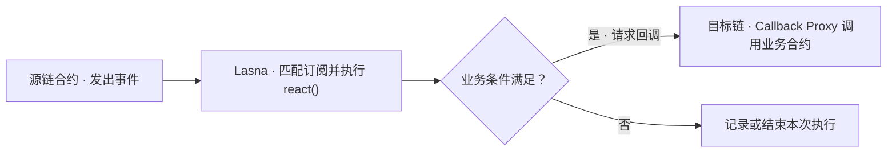

# Reactive Builder Camp

[English](handbook.en.md) · **简体中文**

## 学员实操手册

**2026 年 11 月 16–29 日共学 · 结营后冲刺 Buildathon**

从一个测试网事件开始，跑通 **源链事件 → Lasna 执行 → 目标链回调**。到 Demo Day，用一条可核验的链路讲清楚项目解决了谁的问题、自动化怎样工作，以及遇到失败会怎样。

### 课程路线

| 阶段（UTC+8） | 做成什么 | 留下什么 |
|---|---|---|
| 开营前 | 测试钱包、Foundry、测试币与学习仓库就绪 | 工具版本、网络验收记录 |
| 第 1 周 · 11/16–11/22 | 部署 Reactive 合约，跑通跨链回调，选定项目 | 三段链路的交易证据、项目方向卡 |
| 第 2 周 · 11/23–11/29 | 做一个能复现、能解释的项目 | 公开仓库、测试记录、Demo Day 演示 |
| 结营后 · 课程平台 Week 5 | 根据反馈完善作品，提交 DoraHacks | 已核验的参赛材料与提交确认 |

### 按需要翻阅

| 我现在要做什么 | 翻到 |
|---|---|
| 安装工具、领取测试币，或让 AI 按 Omni 写代码 | [01 开营前](#01-开营前) |
| 搞懂订阅、回调授权、费用，或找出为何没有回调 | [02 运行链路](#02-运行链路) · [03 费用与排错](#03-费用与排错) |
| 查当天任务与验收证据 | [04 第 1 周](#04-第-1-周) · [05 第 2 周](#05-第-2-周) |
| 想选题或比较赛道 | [06 场景 1–3](#06-场景-13) · [07 场景 4–6](#07-场景-46) |
| 准备演示、提交或复制打卡模板 | [08 演示与提交](#08-演示与提交) · [09 可复制模板](#09-可复制模板) |

**进度原则**　先拿到一次真实的目标链业务结果，再增加条件、网络或 AI。全套练习使用测试网与专用测试钱包。

<!-- page -->

## 01 开营前

### 五项环境验收

1. **建测试专用钱包。** 在 MetaMask 等钱包新建只用于本期练习的账户。公开仓库仅保留地址和配置示例。本地密钥、助记词、含密钥的 RPC URL 及 `.env` 留在本机，并写入 `.gitignore`。
2. **安装 Foundry。** 用官方 `foundryup` 流程安装。Windows 可用 WSL 或 Git Bash。安装后重开终端，确认下方两个命令均返回版本。 [Foundry 安装指南][foundry]
3. **准备两侧的测试币。** 用测试专用钱包领取 Sepolia ETH，按官方页在对应 Sepolia 网络操作 faucet，兑换 Lasna 的 `lREACT`。文档比率为 **1 测试 ETH = 100 lREACT**，示例送入 **0.1 测试 ETH**。单笔上限 **5 测试 ETH**，超出部分会丢失。发送前按所选网络核对官方 faucet 地址。为部署和目标链回调另外保留对应链的原生测试币。 [Lasna 与 faucet 文档][lasna]
4. **创建公开 GitHub 学习仓库。** 根目录放 `README.md`，用 `notes/` 记录每日打卡、失败复盘和浏览器链接。可先建 `notes/README.md`，确保目录能被 Git 记录。
5. **可选配置 AI 编程工具。** 先把下面这段 Omni 上下文存好。完成后对照官方分支检查关键 API，运行 `forge build` 和 `forge test`。

```bash
forge --version
cast --version
cast chain-id --rpc-url https://lasna-rpc.rnk.dev/
```

Lasna 的 chain ID 应为 `5318007`。源链与目标链也各检查一次 RPC，并核对[练习网络速查](#练习网络速查)。

### 给 AI 的上下文 · 可直接复制

> 我在用 Reactive Network 的 Omni 版本，主网已于 2026-10-28 迁移。合约部署在 Lasna 测试网，请采用 Solidity 0.8.29。以 Reactive Contracts、Callback Contracts、Economy 和 GitHub 的 `omni/src/micro-demos` 为接口依据。把 `vm` 修饰符、ReactVM 和 `emit Callback` 视为旧版写法。`0x…fffFfF` 仅用于订阅 Cron 事件。Reactive 合约的 `react(LogRecord)` 使用 `onlySystem`，以 `requestCallbackV_1_0` 请求回调。目标函数的第一个参数为代理注入的 `address`，同时检查 Callback Proxy 与授权的 Reactive 合约。请标明修改文件、验证命令和预期结果。

[Reactive Contracts][rc] · [Callback Contracts][cb] · [Economy][econ] · [Omni 示例][micro] · [迁移说明][migration]

<!-- page -->

## 02 运行链路

### 从事件到业务结果



| 阶段 | 代码要点 | 在浏览器找什么 |
|---|---|---|
| **源链（Origin）** | 用发送链、发出事件的合约地址和 `topic0` 定位日志。`topic0` 通常是事件签名的哈希。 | 源链交易哈希、事件、`logIndex` |
| **Lasna（Reactive）** | 继承 `AbstractReactive`。调用 `SYSTEM.subscribe`，在 `onlySystem` 保护的 `react()` 内判断阈值。 | Reactive 执行交易、匹配的源日志、回调请求或预期状态 |
| **目标链（Destination）** | `requestCallbackV_1_0` 指定链、接收方、gas 上限与 ABI payload。接收方继承 `AbstractCallback`。 | 目标链回调交易、代理调用轨迹、业务事件或状态变化 |

**订阅只做精确匹配。** `address(0)` 可放开合约地址，`REACTIVE_IGNORE` 可放开某个 topic。金额门槛写在 `react()`。解码前核对 `topic0`、`opCode`（原日志的 topic 数）和 `data` 布局。取消订阅时复用注册时的六个参数。

**回调做两道鉴权。** payload 第一个参数填 `address(0)` 占位，由代理注入发起请求的 Reactive 合约地址。`onlyServiceProvider` 核验调用者是目标链的代理，`onlyCallbackSender(reactive_)` 核验获准的 Reactive 合约。按目标链查代理地址，并为执行和回调两端都准备资金。

**分两步练习。** 用官方 `ping() → pong()` 示例验证回调通道和部署配置。做 D4 验收时，改由源链事件命中订阅，在 `react()` 中请求回调，再检查目标链业务结果。 [CallbackSender][sender] · [CallbackRecipient][recipient]

### 练习网络速查

| 测试网 | chain ID | 本营常用角色 |
|---|---:|---|
| [Ethereum Sepolia][sep-explorer] | `11155111` | ERC-20 转账、可控事件、faucet |
| [Reactive Lasna][lasna-explorer] | `5318007` | 部署 Reactive 合约、执行 `react()` |
| [Base Sepolia][base-explorer] | `84532` | 回调目标链、赛道 1 可选网络 |
| [Unichain Sepolia][uni-explorer] | `1301` | 回调目标链、赛道 1 可选网络 |

链 ID、代理地址和支持范围以官方表为准。源链与目标链选用同一环境类型，本营使用测试网。 [Origins & Destinations][chains] · [Omni 合约接口][rc]

<!-- page -->

## 03 费用与排错

系统合约收取 Lasna 上的 `react()` 费用，目标链 Callback Proxy 收取回调执行费用。**两个地址、两条链各自看账。** `react()` 已执行后回滚，消耗的 gas 仍会计费。 [Economy][econ]

### 看懂三个数

| 字段 | 在哪里 | 如何判断 |
|---|---|---|
| `balance` | 业务合约自身的原生币余额 | 直接转账会增加余额。合约依照其支付逻辑从余额付款。 |
| `reserves` | 系统合约或目标链代理中的预付余额 | 费用先从预付扣。通过 `depositTo()` 充值时，先抵欠款，余量计入预付。 |
| `debt` | 系统合约或目标链代理记录的欠款 | **大于零就暂停对应端执行。** 直接转账到合约仅增加其余额。检查欠款是否已通过 `depositTo()` 或合约公开的清欠入口结清。 |

### 从最早缺失的一段查起

| 症状 | 优先核对 | 修复后怎样验证 |
|---|---|---|
| 源链看不到事件 | RPC、链 ID、源链回执、实际发出日志的合约地址 | 找到目标事件、`topic0` 和日志索引 |
| 有事件，Lasna 无执行 | 订阅是否已加、地址与 topics 是否精确命中、Reactive 欠款 | 发一笔新的受控测试事件，取得 Lasna 执行交易 |
| 有执行，无预期回调 | `react()` 是否回滚、ABI 解码、阈值、目标链 ID、接收方、gas 配置 | 从 Lasna 执行交易追出目标链回调交易或失败线索 |
| 目标链有交易，业务未完成 | 代理地址、授权的 Reactive 合约、payload 首参数、目标端账务与业务前置条件 | 用目标合约调用和预期业务事件或状态确认结果 |
| 回调重复或费用增长太快 | 按事件 ID 去重、订阅范围、Cron 频率、是否按原参数取消订阅 | 重复触发时只生效一次，到次数上限后能停 |

**查回调交易。** 用 Lasna 执行交易哈希查询系统合约的 `getCallbacks`。记录包含目标链 ID、目标交易哈希与错误数据。若返回空数组，等递交记录产生后再查。 [查询方法][econ]

**D2 自查题**　某一端显示 `balance` 有余额，`debt` 仍为正，此时会怎样？先找到该端的清欠入口，确认欠款归零，再用新测试事件验证恢复。

### 项目最低测试组合

- **正常路径。** 正确来源、阈值满足，目标链只产生一次预期结果。
- **拦截路径。** 未授权账户直接调用回调，或授权不符，应被拦截且业务状态不变。
- **建议补测。** 同一源日志再次送达、超出额度、回调失败或欠款时的停机和恢复。

可用 `chainId + txHash + logIndex` 标识单条源日志，后续传递同一事件 ID 做核对。用 `forge test -vv` 查看本地测试，另保留测试网上的真实交易作为交付证据。 [LogRecord 与回调请求][rc] · [费用与回调查询][econ] · [Foundry 指南][forge]

<!-- page -->

## 04 第 1 周

**11/16–11/22 · 跑通 Reactive**  
本周交出一条可查证的源链事件到回调链路，并用一句话说明下周要做什么。

| 日期 | 任务与练习 | 验收时带什么 |
|---|---|---|
| **11/16 周一 · D1** | **用例拆解卡**。用「监听事件 → 判断条件 → 执行动作」解释 Reactive 何时能替代常驻监听机器人或 Keeper。开营 Online Session 1。 | 列出源链、合约、事件、条件和动作，再说明改用其他方法时会怎么做。 [合约概览][rc] · [Reactive Circuit][circuit] |
| **11/17 周二 · D2** | **读懂费用**。查源链和目标链支持范围，解释 `balance`、`reserves`、`debt`，及回滚如何计费。 | 两端的资金来源、欠款停机与清欠方法。 [网络列表][chains] · [Economy][econ] |
| **11/18 周三 · D3** | **第一次部署**。参考 Xfers，在构造函数订阅，按 `opCode` 解码并设置处理次数上限。部署到 Lasna、充值并触发。 | 合约地址、源链交易及 Lasna 的 `react()` 执行交易。 [Xfers][xfers] |
| **11/19 周四 · D4** | **跨链回调三步走（必做）**。先确认目标端鉴权与资金，再让源链事件触发 Lasna 请求回调。练习可选 Base Sepolia、Unichain Sepolia 中的一条或两条。**20:00 技术 Q&A**。 | 源链、Lasna、目标链三笔交易和目标业务日志。 [回调文档][cb] · [官方发送端][sender] · [官方接收端][recipient] |
| **11/20 周五 · D5** | **定时或动态订阅**。任选 Cron 触发、暂停与恢复，或运行时增删订阅，再加入次数或额度上限。 | 一次触发和一次停用或订阅变化的证据。Base Sepolia 的冷却与截止条件用时间戳。 [Cron / 动态订阅][rc] · [Cron 示例][cron] |
| **11/21 周六 · D6** | **项目方向卡**。写明监听、条件及动作，选赛道，在 DoraHacks 注册。需要组队可在社群分享方向卡。 | 一句话用例、最小可运行版本、预计证明材料。 [赛道规则][buildblog] · [DoraHacks][dora] |
| **11/22 周日 · D7** | **缓冲与复盘**。补交本周任务，写下最卡的一步和解决方法，填本周反馈。 | 仓库打卡、尚需解决的问题。 |

技术 Q&A 和其他会议链接见学习群置顶。问题说明建议附上链名、合约地址、浏览器链接和预期结果。

### D3–D4 联调｜让一笔测试转账触发报警

1. **做出可控事件。** 选一个自己能操作的 Sepolia 测试代币。订阅它的 `Transfer`，设一个明确的阈值，并按代币小数位换算为合约使用的整数。
2. **绑定接收端。** 可先部署 Reactive 合约，再用其地址部署目标回调合约。若接收地址后配，沿用官方示例的权限控制完成绑定。两端备好测试资金，让回调先只发一个 `Alert` 日志。 [回调示例][sender] · [接收端鉴权][cb]
3. **触发并核对。** 发一笔低于阈值、一笔满足阈值的测试转账。确认两笔的 Lasna 判断符合预期，只在满足条件的那笔看到目标链 `Alert`。将该笔的三段交易填入记录表。 [核验记录][trace-link]

<!-- page -->

## 05 第 2 周

**11/23–11/29 · 做出能演示、能复现的作品**  
先完成一条源链到一条目标链的最小实现。赛道 1 从第一次成功执行就记录时间。赛道 3 先用固定规则跑通，再把 AI 接进运行链路。

| 日期 | 今天做什么 | 验收证据 |
|---|---|---|
| **11/23 周一 · D8** | **拆解项目。** 画源链事件、Lasna 判断和目标链动作三段时序，写出失败时怎么办。自定义事件保留稳定的 `topic0`，并选一个适合过滤的 `indexed` 字段。 | 时序图、最小需求、仓库骨架 |
| **11/24 周二 · D9** | **跑通你的项目（必做）。** 先用单条链路和最简单的条件。赛道 1 记三段区块时间，赛道 3 先走固定规则。 | 三笔真实交易和目标业务结果 |
| **11/25 周三 · D10** | **加保护。** 加来源与阈值校验、去重、单次与累计额度限制。**20:00 Online Session 3 项目讨论**。 | 一次成功触发，一次按规则跳过或被拒绝 |
| **11/26 周四 · D11** | **给项目加保护。** 用 Foundry 测正常路径与拦截路径，考虑余额不足、目标链交易失败或伪造调用。 | 测试命令、结果和失败后的处理方式 |
| **11/27 周五 · D12** | **工程化。** 写部署脚本，在 README 说明安装、配置、部署、运行及验证。若有 AI 辅助开发，记录生成范围和人工验证方式。 | 一份能由队友照做的运行说明 |
| **11/28 周六 · D13** | **提交包。** 整理仓库、合约地址、源链／Lasna／目标链交易哈希及少于 3 分钟的演示视频。 | 赛道 1 附全链路延迟，赛道 3 标明 AI 在运行时做的决定 |
| **11/29 周日 · D14** | **Demo Day 展示 · Online Session 4。** 3 分钟现场演示 + 2 分钟问答。按官方四项标准收反馈并填结营反馈。 | 现场演示、反馈与提交前修订清单 |

### 项目仓库骨架

| 位置 | 保存什么 |
|---|---|
| `README.md` | 一句话用例、网络配置、运行步骤、可核验证据 |
| `contracts/` | Reactive 与 Callback 合约。采用此目录时，在 `foundry.toml` 配置 `src = "contracts"` |
| `script/` 与 `test/` | 部署与触发脚本，正常路径与拦截路径测试 |
| `notes/` 与 `.env.example` | 打卡与复盘，以及用占位符填写的公开配置示例 |

[Foundry 配置][foundry-config] · [Buildathon 规则][buildblog]

<!-- page -->

## 06 场景 1–3

每个场景按 **监听 → 判断 → 动作** 设计。GitHub `omni` 分支可查当前接口。`main` 分支列出的旧例用于理解设计，迁移时按 Omni 文档改写。

### 场景 1｜大额转账与代币流量监控

**监听**　Sepolia 上某个 ERC-20 的 `Transfer(from,to,value)`。想扩展才试 `address(0)` 通配合约地址。

**判断**　用 `opCode == 3` 和事件签名识别标准 ERC-20 转账，从 `data` 解出金额。比较单笔阈值或累计流量。

**动作**　在 Lasna 更新状态或发日志。参赛版本可让目标链回调发 `Alert`，再由链下监听器推送到 Telegram。

**验收与坑**　先限制代币地址和次数。全量订阅频繁且每个匹配事件消耗费用。做一次超阈值和一次低于阈值的测试，提交时附目标链的回调结果。

**赛道 2 · 入门。** [Omni Xfers][xfers]

### 场景 2｜钱包守护

**监听**　某个代币的 `Transfer`，用 `topic1` 锁定转出方为自己的测试热钱包。

**判断**　单笔或短时累计转出是否越过阈值。限制触发频率，并为相同事件去重。

**动作**　让 Guardian 回调报警、暂停测试金库，或依预先审批的额度把目标链的测试代币转到固定冷钱包。

**验收与坑**　固定接收方、代币和授权上限，核对目标链余额及 allowance。守护只影响之后可执行的动作，原转账已经发生。跨链回调只能操作目标链上已有且获授权的资产。

**赛道 2 · 入门至进阶。** [Approval Magic（旧版设计）][approval]

### 场景 3｜止损／止盈

**监听**　V2 风格测试池的 `Sync(reserve0,reserve1)`，固定池地址和事件签名。

**判断**　按 token 顺序和小数位把储备比换成一致单位，比较止损或止盈门槛。检查订单 ID 是否已处理。

**动作**　执行合约在授权范围内卖出并设最低成交量。目标链发完成事件，Lasna 收到后关闭该订单并取消相关订阅。

**验收与坑**　先建测试代币与池。储备现货比可被操纵，测试时作触发信号。成交受滑点、状态更新和流动性影响。补测确认回来前连续触发，确保目标端同一订单只执行一次。

**赛道 1 或 2 · 进阶。** [Stop Order（旧版设计）][stop] · [Stop / Take Profit（旧版设计）][take-profit]

<!-- page -->

## 07 场景 4–6

### 场景 4｜跨链价差实验

**监听**　订阅 Unichain Sepolia 和 Base Sepolia 的 V2 风格池 `Sync`，以 `log.chainId` 区分来源。

**判断**　分别维护两边最新价格，并检查新鲜度、统一报价单位、费用、gas、安全边际与冷却时间。

**动作**　先在两边预置测试库存，再模拟低价链买入、高价链卖出，或先做单边再平衡。两笔回调独立执行。任一边失败时停止新动作并留出人工恢复路径。

**验收与坑**　记录三段时间和两边结果。两笔执行各自结算，跨链资产调拨另行设计。Base Sepolia 上用时间戳做冷却。Demo 展示实验机制与实测延迟。

**赛道 1 · 挑战。** 在测试网上从[场景 3](#06-场景-13)扩展。

### 场景 5｜定投、巡检或到期任务

**监听**　Lasna 上由 `0x…fffFfF` 发出的 Cron 事件，例如 `Cron100` 每 100 个区块触发。区块间隔会波动。

**判断**　检查执行时刻、剩余次数、额度和暂停标记。需要墙钟截止时比较时间戳。

**动作**　做测试定投、巡检或到期解锁。用取消订阅暂停，用重新订阅恢复。

**验收与坑**　每次匹配 tick 都消耗费用。选够用的频率，记录一次触发、一次暂停／恢复和一次到上限停止。排查静默时核对欠款。

**赛道 2 · 入门至进阶。** 跨链再平衡可考虑赛道 1。 [Omni Cron][cron] · [清算保护（旧版设计）][aave]

### 场景 6｜事件驱动的 AI 代理

**监听**　价格或转账事件触发 Reactive，回调合约发出带事件 ID 的「需要决策」日志。

**判断**　链下监听器交给 AI 读取上下文。受控服务将决定写回链上，Reactive 监听决策事件并确认它与原请求对应。

**动作**　目标合约核验授权身份、动作白名单、金额上限和有效期，再执行或转人工处理。

**验收与坑**　先用固定规则跑通，再连接模型。保留原请求、决策与执行记录，展示一次违规输出被拒绝。签名由受控服务处理，模型只给出决定。

**赛道 3 · 挑战。** [Omni 回调接口][cb] · [Reactive Meets AI 规则][buildblog]

**怎么选**　初学或时间紧，可做场景 1 或 5。熟悉 DeFi，可从场景 3 进阶到 4。想研究 AI 在线上怎样做决定，可选场景 6。场景 3 和 4 的旧版参考需改写成 Omni，请在测试网上验证自己的实现。

<!-- page -->

## 08 演示与提交

### 按赛道补齐证明

| 赛道 | 项目重点 | 额外证据 |
|---|---|---|
| 1 · **Every Second Counts** | 用户在意反应时间的 DeFi。Reactive 侧用 Lasna，Base Sepolia 与 Unichain Sepolia 可选一条或两条。 | 同一事件的源链 → Lasna → 回调时间。说明测量口径与样本数。 |
| 2 · **Set It and Forget It** | 让个人或团队愿意持续运行的自动化。 | 用户的实际任务、触发和停止条件、一次真实回调。 |
| 3 · **Reactive Meets AI** | AI 成为系统运行的一环。 | 展示 AI 收到什么信号、做了什么决定、合约如何校验决定。 |

赛道 1 可从交易所在区块记录 `t_origin`、`t_react`、`t_callback`（统一 UTC）。列出两段间隔与总耗时，并写明时间戳粒度。验证亚秒差异时补充同一观测端记录的首次看到回执时间，与区块时间分开报告。Base Sepolia 的定时、冷却和截止条件用时间戳。 [官方赛道与规则][buildblog]

### Demo Day · 11/29

**现场 3 分钟讲清三件事。** 用约 30 秒说场景和用户，90 秒演示三段链路，最后 60 秒展示业务结果、保护机制与复现入口。现场另有 2 分钟问答。提交视频按 **少于 3 分钟** 准备。

| 官方评审项 | 演示里应能回答 |
|---|---|
| **Execution** | 是否真实执行？能否点开 Reactive 交易及其目标链回调？ |
| **Integration** | Reactive 在这条链路中完成了哪一步？ |
| **Usefulness** | 谁会用？替用户省去或改善了什么？ |
| **Craft** | 别人能否读懂、复现并核验？ |

### 结营后 · 课程平台 Week 5

按课程安排，提交目标为 **北京时间／新加坡时间 12/06 04:00（12/05 20:00 UTC）**。官方公告写明截止日为 12/05。开始提交前，打开 DoraHacks 核对当期页面的截止倒计时，建议至少提前一天提交。 [官方公告][buildblog] · [DoraHacks 提交页][dora]

- [ ] 公开开源仓库和可复现的 README，包含本次活动完成的作品。既有成果仅作为依赖并注明来源。
- [ ] 合约地址、chain ID，以及源链、Lasna、目标链交易哈希和浏览器链接。
- [ ] 少于 3 分钟的演示视频，按赛道附延迟数据或 AI 决策证据。
- [ ] 完成 DoraHacks 正式提交，确认项目条目和附件可打开。

其他活动若进入 Reactive Circuit 清单，可按该计划规则另行核对获奖后的申请资格、期限和金额。 [Reactive Circuit 官方说明][circuit]

<!-- page -->

## 09 可复制模板

### D1 · 用例拆解卡

```text
用例名称：
1. 听哪条链、哪个合约、什么事件？
2. 哪个条件满足时触发？单位和边界是什么？
3. 在哪条链做什么？用什么日志或状态证明？
4. 用其他方式怎么做？Reactive 简化的是哪一段？
```

### D6 · 项目方向卡

```text
项目 / 赛道：
为 [哪种用户]，当 [链、合约、事件] 满足 [条件]，
就在 [目标链] 执行 [动作]，用 [结果] 验收。
第一版只跑：
失败或重复时：
所需网络、测试数据和队友：
```

### D9 / D13 · 一条事件的核验记录

| 阶段 | 链名 / chain ID | 合约地址 | 交易哈希 / 浏览器链接 | 区块时间、事件或业务结果 |
|---|---|---|---|---|
| 1 · 源事件 | 待填 | 待填 | 待填 | 事件名、`logIndex` |
| 2 · Reactive 执行 | Lasna / `5318007` | 待填 | 待填 | `react()` 执行与回调请求 |
| 3 · 目标链回调 | 待填 | 待填 | 待填 | 预期业务事件或状态变化 |

**附加记录**　写出触发所用命令、预期状态、实际状态、关联事件 ID。赛道 1 加全链路计时口径。赛道 3 加脱敏的 AI 输入、决定、校验状态与执行结果。

### 查阅入口

- **开工**　[Reactive 开发者文档][dev] · [Foundry 安装][foundry] · [Lasna / faucet][lasna]
- **核验**　[Reactive Contracts][rc] · [Callback Contracts][cb] · [Economy][econ] · [链与代理地址][chains]
- **读代码**　[GitHub Omni micro-demos][micro] · [Omni 迁移说明][migration]
- **参赛**　[Buildathon 官方公告][buildblog] · [DoraHacks][dora] · [Reactive Circuit][circuit]

课程任务、会议和提交目标时刻依据课程安排。Omni 接口、比赛规则与示例按 2026-11-20 可查资料核对。

[dev]: https://dev.reactive.network/
[rc]: https://dev.reactive.network/reactive-contracts
[cb]: https://dev.reactive.network/callback-contracts
[econ]: https://dev.reactive.network/economy
[chains]: https://dev.reactive.network/origins-and-destinations
[lasna]: https://dev.reactive.network/reactive-mainnet
[migration]: https://blog.reactive.network/reactive-mainnet-migration-complete/
[foundry]: https://www.getfoundry.sh/introduction/installation
[foundry-config]: https://www.getfoundry.sh/config/index.html
[forge]: https://www.getfoundry.sh/forge/index.html
[buildblog]: https://blog.reactive.network/reactive-omni-buildathon-thirty-days-to-find-out-what-one-second-buys/
[dora]: https://dorahacks.io/hackathon/reactive-omni-buildathon/detail
[circuit]: https://blog.reactive.network/reactive-circuit-incentive-program-for-working-integrations/
[micro]: https://github.com/Reactive-Network/reactive-smart-contract-demos/tree/omni/src/micro-demos
[xfers]: https://github.com/Reactive-Network/reactive-smart-contract-demos/blob/omni/src/micro-demos/Xfers.sol
[cron]: https://github.com/Reactive-Network/reactive-smart-contract-demos/blob/omni/src/micro-demos/Cron.sol
[sender]: https://github.com/Reactive-Network/reactive-smart-contract-demos/blob/omni/src/micro-demos/CallbackSender.sol
[recipient]: https://github.com/Reactive-Network/reactive-smart-contract-demos/blob/omni/src/micro-demos/CallbackRecipient.sol
[approval]: https://github.com/Reactive-Network/reactive-smart-contract-demos/tree/main/src/demos/approval-magic
[stop]: https://github.com/Reactive-Network/reactive-smart-contract-demos/tree/main/src/demos/uniswap-v2-stop-order
[take-profit]: https://github.com/Reactive-Network/reactive-smart-contract-demos/tree/main/src/demos/uniswap-v2-stop-take-profit-order
[aave]: https://github.com/Reactive-Network/reactive-smart-contract-demos/tree/main/src/demos/aave-liquidation-protection
[sep-explorer]: https://sepolia.etherscan.io/
[lasna-explorer]: https://lasna.reactscan.net/
[base-explorer]: https://sepolia.basescan.org/
[uni-explorer]: https://sepolia.uniscan.xyz/
[trace-link]: #09-可复制模板
