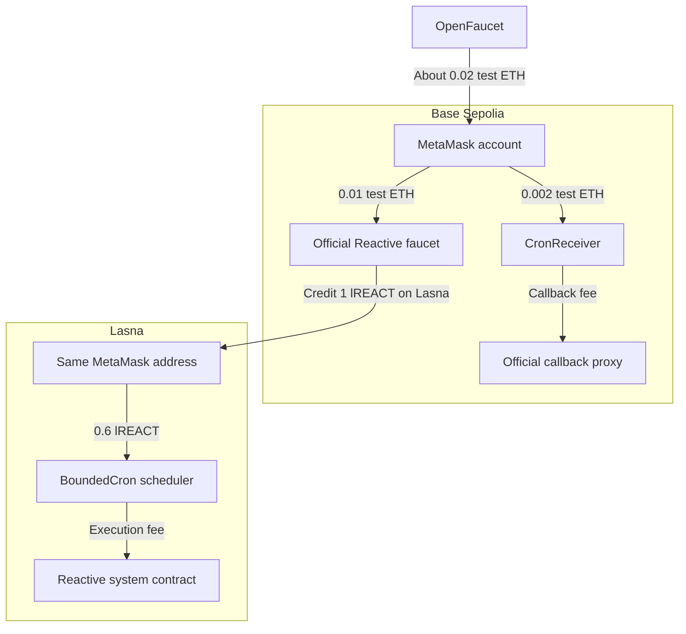

# Reproduce the Cron100 scheduler experiment

**English** · [简体中文](README.md)

Lasna emits Cron100 every 100 blocks. The scheduler requests one Base Sepolia callback on each of two different Cron blocks, then stops and unsubscribes. The Base receiver records the execution times. Both browser routes below use MetaMask for signing.

- [Beginner route](#beginner-route) uses the prepared contracts in Remix.
- [Developer route](#developer-route) edits Solidity in GitHub, tests it with Actions, and deploys through Remix.
- [Completed on-chain evidence](../../assignments/d5-cron100.en.md) · [Copy-ready submission](../../assignments/d5-cron100-submission.en.txt)
- [Glossary and references](GLOSSARY.en.md)

## How test funds move



The same address has a separate balance on each chain. The faucet takes Base Sepolia test ETH and issues lREACT on Lasna. Wallet signatures and deployments use each network’s native test gas. Cron requests carry the sequence number and block data across chains. The Base receiver funds callback execution. [Faucet](https://dev.reactive.network/reactive-mainnet#reactive-faucet) · [Fees and callbacks](https://dev.reactive.network/economy)

## Beginner route

### 1. Add the two networks to MetaMask

1. Install [MetaMask](https://metamask.com/download) or use an existing extension. Select a dedicated test account and copy its public 0x address. Forms need only that address. Keep the recovery phrase and private key under your control.
2. Enable **Show test networks** and select Base Sepolia if listed. Otherwise use **Add a custom network**. Add Lasna using its own values.

| MetaMask field | Base Sepolia | Reactive Lasna |
| --- | --- | --- |
| Network name | Base Sepolia | Reactive Lasna |
| Default RPC URL | https://sepolia.base.org | https://lasna-rpc.rnk.dev/ |
| Chain ID | 84532 | 5318007 |
| Currency symbol | ETH | lREACT |
| Block explorer URL | https://sepolia.basescan.org | https://lasna.reactscan.net/ |

If the official Base RPC rate-limits requests, add https://base-sepolia-rpc.publicnode.com and check chain ID 84532. [MetaMask network setup](https://support.metamask.io/configure/networks/how-to-add-a-custom-network-rpc/) · [Base configuration](https://docs.base.org/get-started/connect-to-base) · [Lasna configuration](https://dev.reactive.network/reactive-mainnet#reactive-lasna-testnet)

### 2. Fund each network

1. Select **Base Sepolia** on [OpenFaucet](https://openfaucet.org/), paste your public address and use **Start Mining**. When the balance reaches about 0.02 ETH, choose **Claim** and wait for confirmation. Verify in MetaMask or [BaseScan](https://sepolia.basescan.org/).
2. On **Base Sepolia**, send **0.01 test ETH** to the Reactive faucet at **0x2afaFD298b23b62760711756088F75B7409f5967**. Reserve the rest for the receiver and Base gas.
3. After confirmation, switch the same account to Lasna and wait for **1 lREACT**. The cross-chain credit can arrive later. Check the address on [Lasna Reactscan](https://lasna.reactscan.net/). [Official faucet instructions](https://dev.reactive.network/reactive-mainnet#reactive-faucet)

The recorded experiment claimed [0.014 test ETH](https://sepolia.basescan.org/tx/0xbaf09a3b591d8bad4299da988656aee1c92a5e703974024428c5437564bd57f4) and obtained 1 lREACT through the [faucet exchange](https://sepolia.basescan.org/tx/0xd22bdf121fa66fece4e0820052803afd5621ad133eeac5e5166709ba0ed3579b). The 0.02 suggestion leaves more deployment margin. Test LINK from Chainlink is distinct from the native ETH required for gas.

### 3. Compile in Remix

1. [Open the Cron100 file in Remix](https://app.remix.live/#url=https://github.com/sunshineluyao/reactive-builder-camp-2026/blob/main/experiments/cron100/remix/BoundedCronRemix.sol&lang=en&optimize=true&runs=200&evmVersion=cancun&version=soljson-v0.8.29+commit.ab55807c.js). Select **BoundedCronRemix.sol** after the file loads. If asked about AI and analytics, use **Manage Preferences**. If only the homepage appears, import the [GitHub file URL](remix/BoundedCronRemix.sol). The two contracts share a pinned Reactive SDK revision.
2. Open **Solidity Compiler**, confirm **0.8.29**, **cancun**, optimizer enabled and **200 runs**. Click **Compile** and wait for **Compiled**.
3. In **Deploy & Run Transactions**, select **Browser Extension → MetaMask** and connect your test account. Value is the native currency sent to the contract. Wei is its smallest unit. [Remix imports](https://remix-ide.readthedocs.io/en/latest/import.html) · [Deployment panel](https://remix-ide.readthedocs.io/en/latest/run.html)

### 4. Deploy and start

Before each deployment select the correct network, contract, arguments and Value. Confirm in MetaMask and copy the successful address from **Deployed Contracts**.

| Order | Network | Remix contract | Value in wei | Constructor argument |
| --- | --- | --- | --- | --- |
| 1 | Reactive Lasna | BoundedCron | 600000000000000000 (0.6 lREACT) | minimumReserve_ = 100000000000000000 (0.1 lREACT) |
| 2 | Base Sepolia | CronReceiver | 2000000000000000 (0.002 test ETH) | reactive_ = Lasna scheduler address from step 1 |

1. Copy both addresses, return to Lasna and select BoundedCron. If necessary reload it through **Deployed Contracts → Add Contract** (older Remix calls this **At Address**).
2. Set **Value = 0**, expand **arm**, enter the new Base receiver in **recipient_**, and confirm. A successful start sets **subscribed** to **true**.
3. Wait for two Cron100 events. Delivery may take a few minutes. Check **attempts = 2**, **stopped = true** and **subscribed = false** on Lasna. On Base, **executedAt(1)** and **executedAt(2)** should return nonzero Unix timestamps. [Cron events](https://dev.reactive.network/reactive-contracts#cron) · [Load a deployed contract](https://remix-ide.readthedocs.io/en/latest/run.html)

### 5. Collect transaction links and submit

1. Search [Lasna Reactscan](https://lasna.reactscan.net/) for BoundedCron. Open **Reactive Executions** and copy the two post-start Lasna transaction URLs in block order. [Example executions](https://lasna.reactscan.net/address/0x201E13106fDf34Fb8FEc9174D4e3DFd95b63CC2b?screen=reactive_executions)
2. In **Callbacks**, locate each Base Sepolia (84532) transaction. Open the hash in [BaseScan](https://sepolia.basescan.org/). Check success and the receiver address. For raw logs, CronRecorded topic 0 is **0xfccd98ba298b0a68896e3903923ecfe0d7593803cf2c0f12ebe2eefd30343547**. Topic 1 ends in 01 or 02. Pair the Lasna requests with the corresponding Base records. [Example callbacks](https://lasna.reactscan.net/address/0x201E13106fDf34Fb8FEc9174D4e3DFd95b63CC2b?screen=callbacks)
3. Open the [submission text](../../assignments/d5-cron100-submission.en.txt) and copy its raw contents. Substitute the addresses, transactions and measured interval from your reproduction.

For low funds, check the Lasna scheduler and Base receiver separately. Top up the relevant native tokens before starting. A stopped experiment needs a fresh instance to repeat. If **stopped = true** and **subscribed = true**, its deployer can retry **stop()** on Lasna with **Value = 0**. If both requests exist but callbacks are pending, check their delivery status. [Callback and fee diagnostics](https://dev.reactive.network/economy)

## Developer route

### 1. Create a lab branch on GitHub

1. Open the [repository](https://github.com/sunshineluyao/reactive-builder-camp-2026). Contributors with write access can branch there. Other readers can fork it. In the fork’s **Actions**, enable workflows if prompted.
2. From main, create **cron100-lab**. Edit **experiments/cron100/src/BoundedCron.sol** with the pencil or press **.** to use github.dev. [Reference source](src/BoundedCron.sol) · [Tests](test/BoundedCron.t.sol) · [Web editor](https://docs.github.com/en/codespaces/the-githubdev-web-based-editor)

### 2. Write Solidity and inspect the tests

1. On the local test branch, exercise receipt replay in **CronReceiver.record**. With its recorded-timestamp guard omitted solely for the regression test, **testTwoDistinctTicksRecordTimestampsAndStop** should fail at **original timestamps**. Inspect **Actions → Cron100 tests and Remix source → Run Foundry tests**.
2. Restore the implementation. Require attempt 1 or 2, return for an already recorded sequence, save the first block.timestamp and emit CronRecorded with sequence, block and time. Keep proxy and sender authorization. The branch should pass six tests.
3. In **BoundedCron.react**, check the subscription, source event, new block number and reserve. Count the attempt before requesting the callback, cap callback gas at **300000**, and call **_stop** after two attempts. Inspect success, insufficient reserve, failed request and failed unsubscription cases.

If enabled for your account, [GitHub Copilot Chat](https://docs.github.com/en/copilot/how-tos/copilot-on-github/chat-with-copilot/chat-in-github) can use the Solidity file and tests as context. Try the following prompt.

```text
Explain the inputs and assertions of testTwoDistinctTicksRecordTimestampsAndStop one at a time. How should I implement CronReceiver.record so it preserves the first block timestamp? List three boundary conditions to check manually. Keep the function signatures and both callback authorization checks.
```

### 3. Generate Remix-ready code with Actions

1. A Solidity commit triggers **Cron100 tests and Remix source**. To run manually, select **Run workflow** on **cron100-lab**. The workflow compiles and tests. MetaMask confirms any subsequent deployment in Remix. [Manual workflows](https://docs.github.com/en/actions/how-tos/manage-workflow-runs/manually-run-a-workflow)
2. Copy **Remix-ready Solidity** from the successful run’s **Summary** into **BoundedCronLab.sol** in [Remix](https://app.remix.live/). The workflow already substitutes pinned GitHub imports. Follow [compilation](#3-compile-in-remix), [deployment](#4-deploy-and-start), then [collect both pairs of transactions](#5-collect-transaction-links-and-submit).

Save the successful Actions URL alongside both pairs of transaction links so another reader can verify the tested source revision. [Passing baseline run](https://github.com/sunshineluyao/reactive-builder-camp-2026/actions/runs/44709692332)
