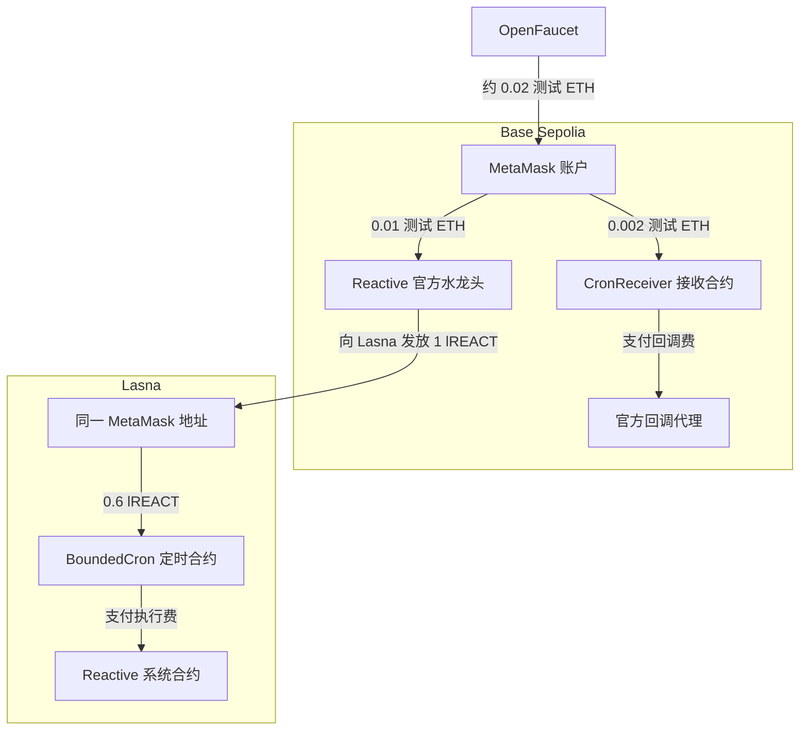

# Cron100 定时实验复现指南

Lasna 每 100 个区块产生一条 Cron100 事件。定时合约在两个不同的 Cron 区块各请求一次 Base Sepolia 回调，达到两次请求时停止订阅。Base Sepolia 接收合约记录每次回调的时间戳。两条路线都在浏览器内完成，链上交易由 MetaMask 签名。

- [零基础路线](#零基础路线)使用准备好的合约，通过 Remix 点选部署和核验。
- [开发者路线](#开发者路线)在 GitHub 网页编写 Solidity，通过 GitHub Actions 测试，再使用 Remix 部署。
- [已完成的链上证据](../../assignments/d5-cron100.md) · [提交框可粘贴的纯文本](../../assignments/d5-cron100-submission.txt)
- [分类术语表与参考资料](GLOSSARY.md)

## 测试币如何流动



同一 MetaMask 地址在两条链各有余额。Reactive 水龙头在 Base Sepolia 收取测试 ETH，并在 Lasna 发放 lREACT。两条链的部署与签名交易各用钱包在该链的原生测试币付 gas。定时合约跨链发送的是轮次和源区块等回调数据，回调费由 Base Sepolia 接收合约的钱支付。[Reactive 水龙头](https://dev.reactive.network/reactive-mainnet#reactive-faucet) · [费用与回调机制](https://dev.reactive.network/economy)

## 零基础路线

### 1. 在 MetaMask 添加两条测试网

1. 打开 [MetaMask 官方下载页](https://metamask.com/download)，安装浏览器扩展，或使用已有扩展。创建或选择一个测试专用账户，点击账户名复制公开的 0x 地址。网页表单只用公开地址，助记词和私钥由自己保管。
2. 在网络选择器打开 **Show test networks**。若列表有 **Base Sepolia**，可以直接选取。若没有，点击 **Add a custom network** 按下表添加。用相同方式添加 **Reactive Lasna**。

| MetaMask 字段 | Base Sepolia | Reactive Lasna |
| --- | --- | --- |
| Network name | Base Sepolia | Reactive Lasna |
| Default RPC URL | https://sepolia.base.org | https://lasna-rpc.rnk.dev/ |
| Chain ID | 84532 | 5318007 |
| Currency symbol | ETH | lREACT |
| Block explorer URL | https://sepolia.basescan.org | https://lasna.reactscan.net/ |

如果 Base 官方公共 RPC 限流，可在 MetaMask 增加 https://base-sepolia-rpc.publicnode.com 并核对链 ID 仍为 84532。[MetaMask 添加网络](https://support.metamask.io/configure/networks/how-to-add-a-custom-network-rpc/) · [Base 网络参数](https://docs.base.org/get-started/connect-to-base) · [Lasna 网络参数](https://dev.reactive.network/reactive-mainnet#reactive-lasna-testnet)

### 2. 领取两条链的测试币

1. 打开 [OpenFaucet](https://openfaucet.org/)，在页面的网络选择器选 **Base Sepolia**。粘贴刚才复制的公开地址，点击 **Start Mining**，保持页面打开直到累计约 **0.02 ETH**。点击 **Claim**，若页面先停止计算，等确认按钮出现后再点 **Claim**。领取后，切到 MetaMask 的 **Base Sepolia** 看余额，或在 [BaseScan 测试网浏览器](https://sepolia.basescan.org/) 搜索该地址。
2. 保持 MetaMask 在 **Base Sepolia**，点击 **Send**，收款地址填 Reactive 官方水龙头 **0x2afaFD298b23b62760711756088F75B7409f5967**，核对网络和金额 **0.01 ETH** 后发送。剩余测试 ETH 用于接收合约及 Base Sepolia gas。
3. 等交易成功，保持原账户并切换到 **Reactive Lasna**，等余额显示 **1 lREACT**。跨链发放可能晚于 Base 交易确认。可以在 [Lasna Reactscan](https://lasna.reactscan.net/) 搜索同一个公开地址核对发放。[Reactive 官方领币说明](https://dev.reactive.network/reactive-mainnet#reactive-faucet)

已完成的实验领取了 [0.014 测试 ETH](https://sepolia.basescan.org/tx/0xbaf09a3b591d8bad4299da988656aee1c92a5e703974024428c5437564bd57f4)，并通过 [Reactive 水龙头交易](https://sepolia.basescan.org/tx/0xd22bdf121fa66fece4e0820052803afd5621ad133eeac5e5166709ba0ed3579b) 获得 1 lREACT。约 0.02 ETH 是复现时留有更多部署余量的建议值。如果之前在 Chainlink 领取了 Base Sepolia LINK，按本节另领原生测试 ETH 来付 gas。

### 3. 在 Remix 编译合约

1. [在官方 Remix 打开 Cron100 文件](https://app.remix.live/#url=https://github.com/sunshineluyao/reactive-builder-camp-2026/blob/main/experiments/cron100/remix/BoundedCronRemix.sol&lang=en&optimize=true&runs=200&evmVersion=cancun&version=soljson-v0.8.29+commit.ab55807c.js)。等待左侧 **File Explorer** 显示文件，再打开 **BoundedCronRemix.sol**。首次打开如果出现 **AI and Analytics Preferences**，可从 **Manage Preferences** 选择设置后继续。如果链接只打开了主页，从 Remix 首页点 **GitHub** 导入并粘贴 [该文件的 GitHub URL](remix/BoundedCronRemix.sol)。文件包含两份合约，依赖固定到一个 Reactive SDK 提交。
2. 点击左侧 **Compile** 打开 **Solidity Compiler**。导入链接已带编译设置。核对编译器为 **0.8.29**，在 **Settings**（旧版称 **Advanced Configurations**）里核对 **EVM Version = cancun**、**Optimizer = 开启**、**Runs = 200**。点击 **Compile**，等待显示 **Compiled**。
3. 打开 **Deploy & Run Transactions**，将 **Environment** 设为 **Browser Extension**，选择 **MetaMask** 并允许 Remix 连接测试账户。部署时 Remix 的 **Value** 是同时发给合约的原生币数量，**wei** 表示当前链的最小单位。[Remix 导入说明](https://remix-ide.readthedocs.io/en/latest/import.html) · [Remix 部署面板](https://remix-ide.readthedocs.io/en/latest/run.html)

### 4. 部署并启动

每次点 **Deploy** 前先切换 MetaMask 网络，再检查 Remix 的网络、合约下拉框、构造参数和 **Value**。在 MetaMask 确认交易，等待成功后，从 Remix **Deployed Contracts** 的实例复制新合约地址。

| 顺序 | MetaMask 网络 | Remix 合约 | Value，单位选 wei | 构造参数 |
| --- | --- | --- | --- | --- |
| 1 | Reactive Lasna | BoundedCron | 600000000000000000（0.6 lREACT） | minimumReserve_ 填 100000000000000000（0.1 lREACT） |
| 2 | Base Sepolia | CronReceiver | 2000000000000000（0.002 测试 ETH） | reactive_ 填第 1 步得到的 Lasna 定时合约地址 |

1. 复制两份合约地址后切回 **Reactive Lasna**。在 Remix 选择 **BoundedCron** 实例。若切网后实例不在列表，在 **Deploy** 的合约下拉框选 **BoundedCron**，进入 **Deployed Contracts → Add Contract**，在 **Contract address** 粘贴该地址并确认。旧版界面将同一操作标为 **At Address**。
2. 将 **Value** 改为 **0**。展开 **arm**，在 **recipient_** 输入刚部署的 Base Sepolia 接收合约地址，点击调用并在 MetaMask 确认。启动交易成功后，点 **subscribed** 应读到 **true**。Cron100 此后会自动触发。
3. 等两次 Cron100，通常是几分钟，区块时间和回调确认可能有波动。在 Lasna 上用 Remix 读取 **attempts = 2**、**stopped = true**、**subscribed = false**。切到 **Base Sepolia**，在 **CronReceiver** 上分别查询 **executedAt(1)** 和 **executedAt(2)**，预期各有一个非零 Unix 秒数。[Cron 定时事件](https://dev.reactive.network/reactive-contracts#cron) · [加载已部署合约](https://remix-ide.readthedocs.io/en/latest/run.html)

### 5. 找到交易链接并提交

1. 在 [Lasna Reactscan](https://lasna.reactscan.net/) 搜索新部署的 **BoundedCron** 地址。打开 **Reactive Executions**，点开启动后两条执行记录的 Lasna 交易哈希。按区块顺序复制两个交易页面的 URL。[本次实验的执行记录示例](https://lasna.reactscan.net/address/0x201E13106fDf34Fb8FEc9174D4e3DFd95b63CC2b?screen=reactive_executions)
2. 在同一个地址页打开 **Callbacks**，查看相应的两个目的链回调，目标链为 **Base Sepolia（84532）**。点击目的链交易哈希，若界面仅显示哈希，可复制到 [BaseScan 测试网](https://sepolia.basescan.org/) 搜索。核对 **Success** 和 **Logs** 中的接收合约地址。若浏览器把事件显示为原始 topic，CronRecorded 的 topic 0 为 **0xfccd98ba298b0a68896e3903923ecfe0d7593803cf2c0f12ebe2eefd30343547**，topic 1 的末尾 01 或 02 对应轮次。以 Lasna 请求交易与 Base 回调记录的关联配对两组链接。[本次实验的回调记录示例](https://lasna.reactscan.net/address/0x201E13106fDf34Fb8FEc9174D4e3DFd95b63CC2b?screen=callbacks)
3. 打开 [提交文本](../../assignments/d5-cron100-submission.txt)，用 **Raw** 或复制文件内容按钮取得纯文本。若提交自己的复现，换成自己的两个地址、两组交易链接和实测间隔，并按实际结果保留防失控说明。

如果费用不足，请分别检查 Lasna 定时合约和 Base Sepolia 接收合约的余额。启动前可补充相应链的原生测试币。如果定时合约已自动停止，需重新部署新合约复现。若 **stopped = true** 而 **subscribed = true**，部署者可在 Lasna 用 **Value = 0** 调用 **stop()** 重试取消订阅。若两次请求已发出而目的链记录尚未出现，先查看 **Callbacks** 的投递状态，再按结果整理证据。[Reactive 回调与费用诊断](https://dev.reactive.network/economy)

## 开发者路线

### 1. 在 GitHub 网页建立实验分支

1. 登录 GitHub，打开 [原仓库](https://github.com/sunshineluyao/reactive-builder-camp-2026)。有写权限的读者可直接在这个仓库练习，其他读者点 **Fork** 创建自己的副本。打开 **Actions**。如果 GitHub 提示 fork 的工作流未启用，点击页面上的启用按钮。
2. 在 **Code** 页的分支选择器，从 **main** 创建 **cron100-lab** 并切到它。打开 fork 对应分支下的 **experiments/cron100/src/BoundedCron.sol**，可以点击铅笔编辑，或在仓库键入 **.** 打开 **github.dev** 再编辑和提交。[参考源码](src/BoundedCron.sol) · [测试代码](test/BoundedCron.t.sol) · [GitHub 网页编辑器](https://docs.github.com/en/codespaces/the-githubdev-web-based-editor)

### 2. 写 Solidity 并看测试结果

1. 在 **CronReceiver.record** 中临时去掉检查 **executedAt[attempt]** 是否已写入的条件，保留代理和来源限制，提交到实验分支。打开 fork 的 **Actions → Cron100 tests and Remix source → 本次分支运行**。展开 **Run Foundry tests**，**testTwoDistinctTicksRecordTimestampsAndStop** 应在 **original timestamps** 断言处失败。这个阶段只在 Actions 里运行。
2. 自己重写 **record** 的函数体。先检查 **attempt** 取值只能是 1 或 2，再从 **executedAt** 读取该轮是否写过。已有记录就直接返回。首条回调读取当前 **block.timestamp**，存入 **executedAt[attempt]**，并发出带轮次、源区块号、时间戳的 **CronRecorded**。提交后在 **Actions** 查看同一分支的新运行，预期 6 项测试通过。
3. 可以用相同方式练习重写 **BoundedCron.react**。检查订阅状态、来源事件以及 **LogRecord.blockNumber**，再检查储备。用新的区块号去重，在调用 **requestCallbackV_1_0** 前增加尝试次数，保留 **300000** 回调 gas 上限，在两次尝试后调用 **_stop**。分别在成功和失败路径保留事件，观察余额过低、请求失败和取消失败的测试结果。

如果账号已启用 [GitHub Copilot Chat](https://docs.github.com/en/copilot/how-tos/copilot-on-github/chat-with-copilot/chat-in-github)，可打开 fork 的 Solidity 文件，使用 GitHub 网页上的 Copilot 图标，并给它合约和测试作为上下文。示例提示词如下。

```text
请用中文逐条解释 testTwoDistinctTicksRecordTimestampsAndStop 的输入与断言。指出我应该怎样写 CronReceiver.record 才能保留第一次的区块时间戳，并列出三个需要手动检查的边界条件。保留函数签名和两个回调权限检查。
```

### 3. 用 Actions 生成 Remix 源码

1. 提交 Solidity 变更会自动触发 **Cron100 tests and Remix source**。想先跑基线或重新运行时，在 fork 中进入该工作流，点击 **Run workflow**，选 **cron100-lab** 并再次点 **Run workflow**。该工作流只编译和测试，钱包交易在 Remix 中由 MetaMask 确认。[手动运行 GitHub Actions](https://docs.github.com/en/actions/how-tos/manage-workflow-runs/manually-run-a-workflow)
2. 在成功运行的 **Summary** 页找到 **Remix-ready Solidity** 代码块，使用复制按钮。打开 [Remix](https://app.remix.live/)，在 **File Explorer** 新建 **BoundedCronLab.sol**，粘贴经过测试的源码。它已将依赖路径换成 Remix 支持的固定 GitHub URL。选中刚粘贴的文件，沿用上文[编译步骤](#3-在-remix-编译合约)第 2、3 项的设置，编译 **BoundedCronLab.sol**。之后[部署并启动](#4-部署并启动)，最后[查交易并提交](#5-找到交易链接并提交)。

开发者复现时可把成功的 Actions 运行 URL 与自己的两组链上交易一起保留，方便他人核验实际测试过的源码版本。[本仓库通过的基线运行](https://github.com/sunshineluyao/reactive-builder-camp-2026/actions/runs/44709692332)
