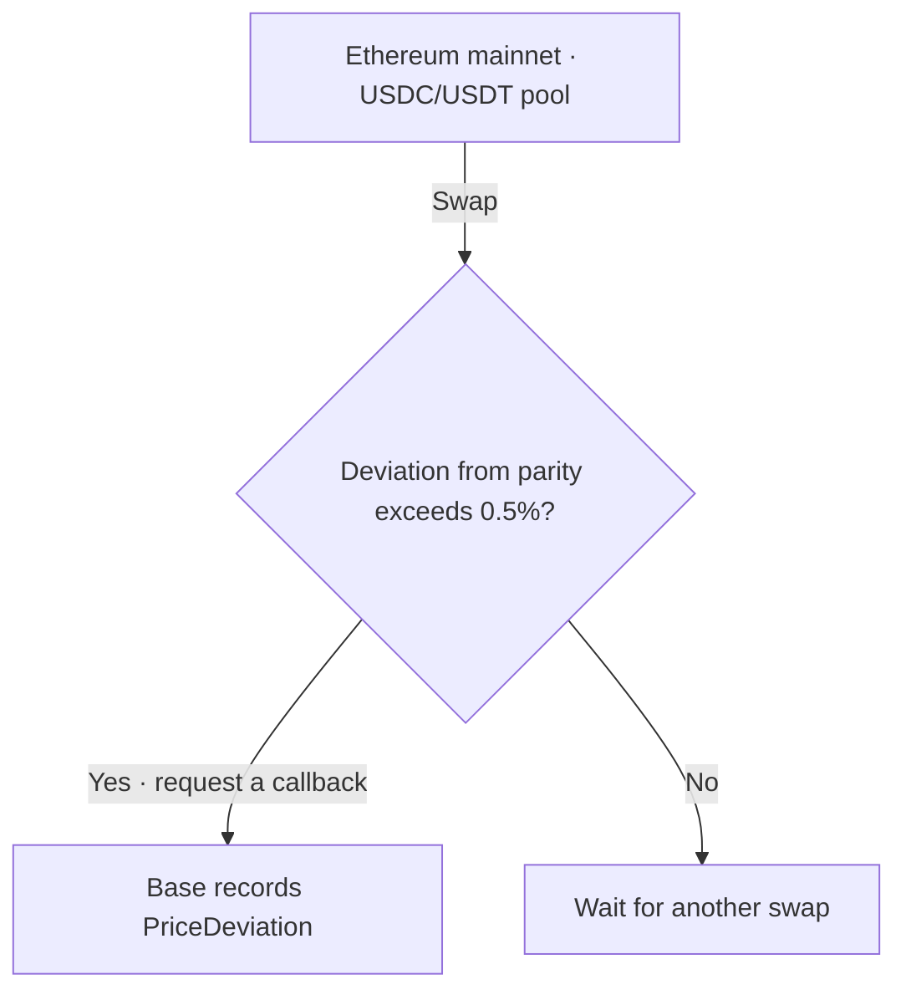

# Day 1 use case · Cross-chain stablecoin price alerts

**English** · [简体中文](d1-use-case.md)

The proposed Base risk dashboard reads an alert when the Ethereum USDC/USDT pool quote moves more than 0.5% from parity. The alert points to the original transaction.

## 1. Which chain, contract and event?

Watch `Swap` events from the Ethereum mainnet (chain ID 1) Uniswap v3 USDC/USDT 0.01% pool at `0x3416cF6C708Da44DB2624D63ea0AAef7113527C6`. Read its post-swap quote from `sqrtPriceX96`. [Pool](https://www.geckoterminal.com/eth/pools/0x3416cf6c708da44db2624d63ea0aaef7113527c6) · [Swap event](https://github.com/Uniswap/v3-core/blob/main/contracts/interfaces/pool/IUniswapV3PoolEvents.sol) · [Verified log 906](https://etherscan.io/tx/0x08be604cced2000dfecae34acb01009104c6d277bd27b56fa636ca54246f68d3#eventlog)

## 2. What triggers a callback?

The pool’s `token0` is USDC and `token1` is USDT. Both use six decimals. In `react()`, `(sqrtPriceX96 / 2^96)^2` gives `p` in USDT per USDC.

Request a cross-chain callback for `p < 0.995` or `p > 1.005`. A quote of 0.993 deviates by 0.7% and triggers an alert. At 0.999 the contract continues listening. Independent USD prices are needed to tell which token moved against its peg. [Uniswap v3 price conversion](https://blog.uniswap.org/uniswap-v3-math-primer)

## 3. What happens on the destination?

On Base mainnet (8453), the official callback proxy calls the proposed `StablecoinAlert.recordAlert()`. Its `PriceDeviation` log includes the quote, source chain ID, transaction hash and log index. The last three identify one source event, so the dashboard records it once and can find the original swap. [Networks and proxies](https://dev.reactive.network/origins-and-destinations) · [Callback mechanism](https://dev.reactive.network/callback-contracts)

## 4. What does Reactive simplify, and what does it cost?

- **Self-hosted implementation.** A persistent service reads Ethereum RPC logs, evaluates the rule and signs Base transactions. It must checkpoint progress, backfill after disconnects, manage signing and retry failures.
- **With Reactive.** The network delivers subscribed events and submits the Base callbacks requested by the Reactive contract. The trigger lives in `react()` and the alert format lives on Base.
- **Operating costs.** Reactive execution consumes REACT and Base callbacks consume ETH. Fund both sides. Source confirmation and destination delivery affect arrival time. [Fee mechanism](https://dev.reactive.network/economy) · [Day 2 measurements](../assignments/d2-lasna-fees.en.md)

## Source, Reactive and destination

Day 6 adapts the concept to a testnet demo with simulated quotes. [Project direction](../assignments/d6-project-direction.en.md)
