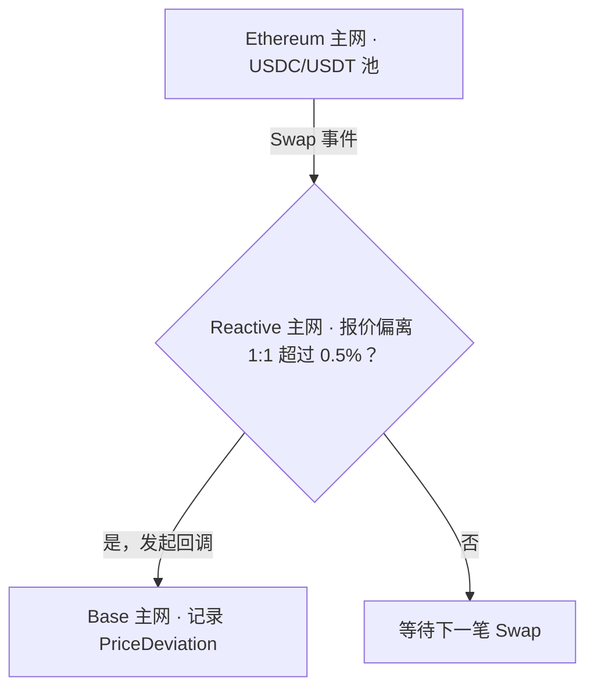

# D1 用例拆解卡 · 稳定币价差的跨链预警

[English](d1-use-case.en.md) · **简体中文**

我想给 Base 上的稳定币风险仪表板添加一条预警。Ethereum 上 USDC/USDT 池的相对报价偏离 1:1 超过 0.5% 时，仪表板从 Base 读取告警，并能追溯到原始交易。

## 1. 监听哪条链、哪个合约的什么事件？

监听 **Ethereum 主网（链 ID 1）** 上 Uniswap v3 的 **USDC/USDT 0.01%** 交易池 `0x3416cF6C708Da44DB2624D63ea0AAef7113527C6` 发出的 `Swap` 事件。使用事件里的 `sqrtPriceX96` 读取交换完成后的池内报价。[交易池](https://www.geckoterminal.com/eth/pools/0x3416cf6c708da44db2624d63ea0aaef7113527c6) · [Swap 事件定义](https://github.com/Uniswap/v3-core/blob/main/contracts/interfaces/pool/IUniswapV3PoolEvents.sol) · [已核验的 Swap 日志（索引 906）](https://etherscan.io/tx/0x08be604cced2000dfecae34acb01009104c6d277bd27b56fa636ca54246f68d3#eventlog)

## 2. 满足什么条件时触发？

池里的 `token0` 是 USDC，`token1` 是 USDT，两者都用 6 位小数。`react()` 用 `(sqrtPriceX96 / 2^96)^2` 算出 `p`，即 1 USDC 值多少 USDT。

当 `p < 0.995` 或 `p > 1.005` 时，请求跨链回调。例如 `0.993` 偏离 1:1 达 0.7%，会触发告警，`0.999` 则继续监听。要判断哪种币偏离美元锚定，需分别用独立的美元报价复核。[Uniswap v3 报价换算](https://blog.uniswap.org/uniswap-v3-math-primer)

## 3. 在哪条链做什么动作？

在 **Base 主网（链 ID 8453）**，由官方 Callback Proxy 调用拟部署的 `StablecoinAlert.recordAlert()`。合约发出 `PriceDeviation` 事件，记录报价、源链 ID、源交易哈希和日志索引。用后三项识别源事件，每个源事件只登记一次，仪表板可据此回查原始 `Swap`。[支持网络及回调代理](https://dev.reactive.network/origins-and-destinations) · [回调机制](https://dev.reactive.network/callback-contracts)

## 4. 不用 Reactive 怎么做？它简化了哪里，代价是什么？

- **自建方案**。运行一个常驻服务从 Ethereum RPC 读取 `Swap`，在链下判断阈值，再让服务钱包签发 Base 交易。还要保存处理进度、掉线后补读日志，以及管理签名和失败重试。
- **Reactive 简化的部分**。网络负责向我部署的 Reactive 合约投递源事件，并按合约请求提交 Base 回调。我把触发规则写进 `react()`，把告警格式写进 Base 合约，省去维护常驻监听和发交易的服务。
- **运行代价**。Reactive 执行 `react()` 消耗 REACT，Base 上执行回调消耗 ETH。需要维护两端的费用预算，告警到达时间受源链确认和目标链回调投递影响。[Reactive 计费机制](https://dev.reactive.network/economy) · [D2 费用实测笔记](../assignments/d2-lasna-fees.md)

## 源链 → Reactive → 目标链

第 6 天方向卡规划用测试网模拟报价演示同一条告警链路。[Day 6 项目方向卡](../assignments/d6-project-direction.md)
