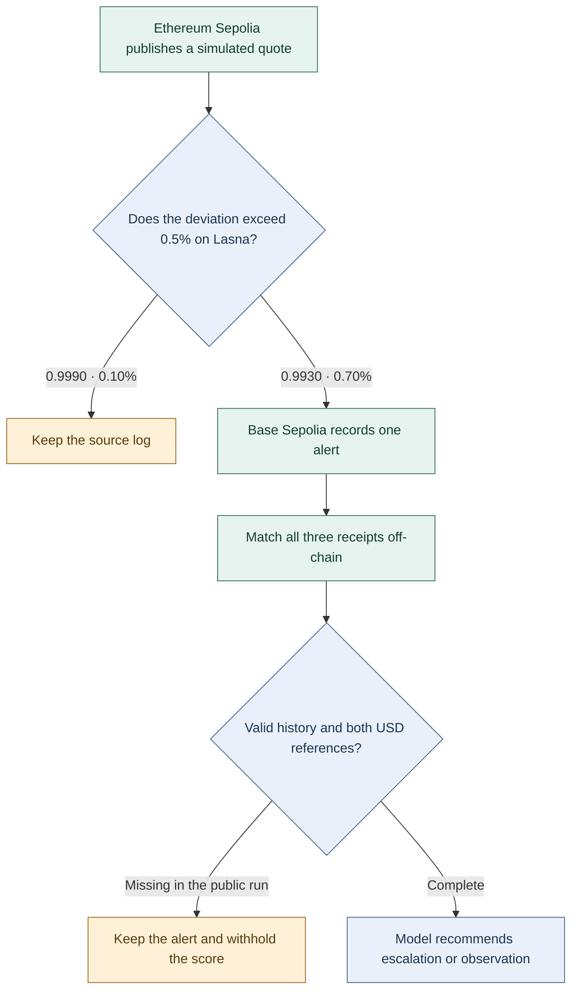

# Reactive PegPulse

**English** · [简体中文](README.md)

**One quote. Three chains. Anyone can verify.**

Sunshine · Sunshine Swarm Superintelligence (3S) Lab

**Track 3 · Reactive Meets AI · Cross-chain stablecoin alerts and evidence review**

If one USDC buys only 0.9930 USDT in a pool, should a DAO treasury investigate? PegPulse records the same alert across three chains, then checks contemporary market evidence to set its review priority. A test contract publishes the simulated quotes.

**[Watch the public testnet run · 2 min 30 sec](https://cdn.jsdelivr.net/gh/sunshineluyao/reactive-builder-camp-2026@main/track3/video/public/demo.mp4)** · [Three raw receipts](evidence/public-run.json) · [Download the flowchart](architecture.en.png) · [Narration and subtitles](video/README.md)

[November 29 Demo Day presentation and simulated Q&A · 4 min 40 sec](demo-day/README.en.md) · [Editable slides with bilingual speaker notes](demo-day/Reactive-PegPulse-Demo-Day.en.pptx)

**For judges.** The public run produced a Base alert and withheld the AI score because no reference packet was supplied. The video keeps the verified event fixed and replays two labeled synthetic market scenarios. One warrants escalation and the other stays under observation.

Members of small community treasuries can inspect the source transaction, Reactive execution and destination callback in a browser without a wallet or gas. Accessible participation and transparent decisions are design goals. [UN target 10.2](https://sdgs.un.org/goals/goal10) · [UN target 16.6](https://sdgs.un.org/goals/goal16)

## How Reactive complements price oracles

A 0.9930 quote raises two questions. Did this pool’s deviation actually trigger an alert? Do independent dollar prices corroborate it? The prototype uses a test publisher to exercise the first question.

| Component | Question | Implementation and observed result |
| --- | --- | --- |
| A price oracle such as Chainlink Price Feeds | What is each asset worth in dollars? | The model accepts sourced, timestamped USDC/USD and USDT/USD references. A live oracle adapter is future work. The public run lacked these inputs. |
| Reactive Omni contract | Which source log warrants an action on another chain? | Lasna subscribes to the specified publisher’s `PriceObserved`. Its `react()` checks the source, threshold and event identity before requesting the Base callback. The 0.9990 control stayed on the source chain. The 0.9930 quote triggered a real callback. |
| Community reviewers and off-chain AI | Which alert belongs to the quote, and does it warrant investigation? | Match the three receipts by source chain ID, transaction hash and log index 2. Missing USD references and history leave the alert visible with its score withheld. Two synthetic controls demonstrate escalation and observation. |

PegPulse adds a cross-chain response traceable to a particular log and a review recommendation with inspectable inputs. Chainlink CRE also supports event-driven workflows, and CCIP supports cross-chain messaging. This prototype demonstrates the Reactive implementation. The two seconds reported here are the endpoint block-time difference for one event. A comparison of price accuracy, cost or latency across systems would require matched runs. [Reactive contracts and callbacks](https://dev.reactive.network/reactive-contracts) · [Chainlink Price Feeds](https://docs.chain.link/data-feeds/price-feeds) · [Chainlink CRE](https://docs.chain.link/cre) · [Chainlink CCIP](https://docs.chain.link/ccip) · [Raw receipts](evidence/public-run.json)

## Public deployment and three transactions

On November 27, 2026, the project wallet signed six testnet transactions. The 0.9990 control deviated by 10 basis points and produced no callback. The 0.9930 quote deviated by 70 basis points and produced one alert. All three transactions in the table refer to that second quote.

| Network (chain ID) | Contract address | Transaction for the triggering quote | Block time (UTC) |
| --- | --- | --- | --- |
| Ethereum Sepolia (11155111) | QuoteSource [`0x738f50d330f3dab04e88c3e30127d2a749b10940`](https://sepolia.etherscan.io/address/0x738f50d330f3dab04e88c3e30127d2a749b10940) | PriceObserved [`0xd97a9579a96a20c9868dd7f759079975e2ff1603eb903e42d3fd5ddfbbcc6604`](https://sepolia.etherscan.io/tx/0xd97a9579a96a20c9868dd7f759079975e2ff1603eb903e42d3fd5ddfbbcc6604) | 13:38:12 |
| Reactive Lasna (5318007) | ReactiveAlert [`0x738f50d330f3dab04e88c3e30127d2a749b10940`](https://lasna.reactscan.net/address/0x738f50d330f3dab04e88c3e30127d2a749b10940) | QuoteRouted [`0x63639779506a135ff8cba06c4d8aff5230d029aed5dc781f8f902868f54e8d27`](https://lasna.reactscan.net/tx/0x63639779506a135ff8cba06c4d8aff5230d029aed5dc781f8f902868f54e8d27) | 13:38:12 |
| Base Sepolia (84532) | AlertSink [`0xdd5f43ab0c047014cd3ba70ddb9004f8c2f5e12e`](https://sepolia.basescan.org/address/0xdd5f43ab0c047014cd3ba70ddb9004f8c2f5e12e) | PriceDeviation [`0x5e2a48caaf7ab64dd3f25c4f4b804cf30d09aabc6f885efb44033b91ce3ce602`](https://sepolia.basescan.org/tx/0x5e2a48caaf7ab64dd3f25c4f4b804cf30d09aabc6f885efb44033b91ce3ce602) | 13:38:14 |

The first two contracts are on different networks. Their explorers show the deployed code and transactions. Source log index `2`, the source chain ID and transaction hash identify event `0x38b66270063a8a1180e269f0b633a2e3ed599d9e4f1fd370994c1f4ed38ac554`. Both Lasna and Base record this identifier, the source transaction, the quote and its observation time. The endpoint block timestamps differ by two seconds in this run. [Complete receipts](evidence/public-run.json)

The same wallet deployed three contracts, bound the receiver and published the control and trigger quotes. [Deploy QuoteSource](https://sepolia.etherscan.io/tx/0xb053216af3d5513ac0c07fed29da488e8f5c5b2b8985a877c907e2d7e7a06402) · [Deploy ReactiveAlert](https://lasna.reactscan.net/tx/0xecfb63c4a3f36f74dfd720eeec42a85948641cec233971fdbd71491961321739) · [Deploy AlertSink](https://sepolia.basescan.org/tx/0x3c57912774bd2239c7d81f2d0b10497272ed740e8813be447fcdd2e3a9f7c254) · [Bind the receiver](https://lasna.reactscan.net/tx/0x2101030cf92f84c67db2ca3bee8ed05325a481961276cf35f534e8b344e27cd0) · [0.9990 control](https://sepolia.etherscan.io/tx/0x33ce718f56820da45bf4fd48b2534df5dc199d89a5214d709187d22db9c622de) · [0.9930 trigger](https://sepolia.etherscan.io/tx/0xd97a9579a96a20c9868dd7f759079975e2ff1603eb903e42d3fd5ddfbbcc6604)

The addresses and recording correspond to the public deployment before fee caps were added. New console deployments use the capped contracts. Foundry tests exercise the limits, and three local Anvil chains reproduce the path from a quote to an alert. [Contract version used publicly](https://github.com/sunshineluyao/reactive-builder-camp-2026/blob/76acc493cf5802ebdc3f8365ec8cb1c9dab3b097/track3/contracts/StablecoinAlerts.sol) · [Foundry output](evidence/forge-guards.txt)

## From quote to human review



The public run ended with insufficient evidence. The recording then keeps that on-chain alert and supplies clearly labeled synthetic quotes to show the two possible recommendations. [Download the flowchart](architecture.en.png) · [Scalable SVG](architecture.en.svg)

## Architecture and trigger rule

| Stage | Input | Action and output |
| --- | --- | --- |
| Sepolia · QuoteSource | The publisher submits an integer quote. 10000 represents 1.0000. | Emits `PriceObserved` with the quote and block time. |
| Lasna · ReactiveAlert | The Omni system invokes `react()` with a subscribed source log. | If the absolute deviation from 1:1 strictly exceeds 50 basis points, records `QuoteRouted` and requests a Base callback. |
| Base Sepolia · AlertSink | The official callback proxy and the authorized Reactive contract. | Deduplicates by source chain ID, transaction hash and log index, then records `PriceDeviation`. |
| Off-chain AI | Three matching receipts, preceding pair history and contemporary USDC/USD and USDT/USD prices. | Produces a decision and a score or a reason for withholding it. Retains provenance and the model version. |

The 0.9990 control is 10 bp from parity. Quotes of 0.9950 and 1.0050 sit exactly on the two boundaries. All three retain a source log only. At 0.9930, the 70 bp deviation produces one alert. Replaying either delivery keeps the alert count at one. The Reactive contract unsubscribes after requesting callbacks for 20 distinct events. [Contracts](contracts/StablecoinAlerts.sol)

## Automation safeguards

| Safeguard | Contract rule | What the tests check |
| --- | --- | --- |
| Trigger only on authorized events | Only the designated publisher can post quotes. Lasna checks the system origin, Sepolia contract, event and strict 50 bp gate. Base checks the proxy and Reactive sender. | 0.9930 yields one alert. The control, both exact boundaries, wrong sources and unauthorized calls yield none. |
| Process an event once | Both Lasna and Base identify a source log by chain ID, transaction hash and log index. | Duplicate deliveries request and record at most one callback. Another log from the same transaction can be processed independently. |
| Limit spending | Each payer has per-payment and lifetime service-fee caps. `pay()` and `coverDebt()` share the same budget. | Exact caps succeed. One extra wei is rejected. A refill does not increase lifetime capacity, and a failed transfer rolls back the charge. |

The project records alerts. USDC and USDT principal moved per event and in total is **zero**. The contracts can spend the following independent test-token budgets.

| Paying contract | Maximum per payment | Lifetime maximum | Initial console funding |
| --- | ---: | ---: | ---: |
| Lasna · ReactiveAlert | 0.05 lREACT | 0.30 lREACT | 0.15 lREACT |
| Base Sepolia · AlertSink | 0.00025 ETH | 0.002 ETH | 0.001 ETH |

The project sets these test budgets. Wallet gas, protocol debt accounting and third-party protocol prepayments are accounted for separately. [Fee mechanism](https://dev.reactive.network/economy)

## Failure and recovery

- **Contract balance exhausted.** The depleted side stops requesting Lasna callbacks or recording Base alerts. Fund the appropriate `ReactiveAlert` in Lasna lREACT or `AlertSink` in Base Sepolia ETH. Maximum refill equals `remainingFeeBudget() − current contract balance`. Read `debt(contractAddress)` on its `service()`. If payable within the available caps, settle it with the payer’s `coverDebt()`. Later eligible events can proceed once debt is zero and both funds and budget are available. [Funding and recovery](https://dev.reactive.network/economy#funding-reactive-contracts)
- **Hard limit reached.** A payment exceeding its cap is rejected. Exhausting a lifetime budget stops new work, and a refill cannot extend that budget. Lasna also unsubscribes after its twentieth distinct callback request. Review spending before deploying and binding a replacement instance.
- **Destination callback fails.** A reverted Base call adds no alert. Lasna retains the request, and a callback that executes and reverts still costs gas. Search Reactscan by source hash, then check the Base receipt for `PriceDeviation` and its event ID. A request blocked by debt does not retry automatically. After recovery, the contract can handle new events. If the service redelivers the original callback, deduplication permits at most one recorded alert. [Callback status](https://dev.reactive.network/reactscan#callback-lifecycle) · [Failure costs](https://dev.reactive.network/economy#fee-model)

## Foundry tests and submission proof

Run from the repository root. Foundry uses Solidity 0.8.29, creates the three contracts locally and simulates two network services. These tests require no wallet or test tokens.

```sh
cd track3
forge test
```

**15 passed, 0 failed, 0 skipped.** Nine cases cover price gates, permissions, deduplication and callbacks. Six cover fee limits, refills and settlement. [Tests](tests/StablecoinGuards.t.sol) · [Terminal screenshot](evidence/forge-guards.png) · [Output from the same run](evidence/forge-guards.txt)

## Verify the run in two minutes

Use Git, Python 3.10+ and Node.js 20+. Reading the existing transactions requires only public data. A wallet, private key and API key are unnecessary.

```sh
git clone https://github.com/sunshineluyao/reactive-builder-camp-2026.git
cd reactive-builder-camp-2026/track3
python3 scripts/verify_receipts.py evidence/public-run.json --destination-rpc https://base-sepolia-rpc.publicnode.com
python3 -m http.server 8080 --bind 127.0.0.1
```

After successful verification, the terminal prints `Public testnet | receipts and canonical blocks match the selected RPCs`, price `9930`, and log indices `2 / 2 / 0`. Open <http://localhost:8080/review/?source=public&lang=en> to see all three receipts and the insufficient-evidence decision. Select **Corroborating evidence** and **Pool-only movement** to replay two complete sets of model inputs against the same event. The page labels both as synthetic.

Verify saved raw logs offline with `python3 scripts/verify_receipts.py evidence/public-run.json --offline`. The next section reproduces the [current local three-chain receipts](evidence/guarded-local-run.json). The earlier video retains its [original local receipts](evidence/local-run.json). The same server hosts the [video player](http://localhost:8080/video/?lang=en) and [deployment console](http://localhost:8080/site/?lang=en). For the offline threshold animation, see the [animation guide](visual/README.md).

## Run three EVMs from scratch

Install Foundry v1.7.1 (including `anvil` and `cast`) and the native Solidity compiler `solc 0.8.29+commit.ab55807c` on your PATH. The build targets Cancun with 200 optimizer runs. [Foundry version](https://github.com/foundry-rs/foundry/releases/tag/v1.7.1) · [Solidity version](https://github.com/ethereum/solidity/releases/tag/v0.8.29)

```sh
python3 scripts/build_contracts.py --check
python3 scripts/local_evm.py --out /tmp/stablecoin-local-run.json
cmp evidence/guarded-local-run.json /tmp/stablecoin-local-run.json
python3 -m unittest discover -s tests -v
node --test tests/wallet.test.js
```

The script starts three independent local chains, deploys the contracts, posts both quotes, executes the relay and callback, and tests redelivery and authorization. A successful `cmp` prints nothing, confirming byte-identical receipts. The fixture fixes the local timestamps. Public Omni timing must be measured on public blocks. This is a Track 3 submission.

## Deploy to public testnets

Start the local server above, then open <http://localhost:8080/site/?lang=en> in a browser with MetaMask. Use the same test account with Ethereum Sepolia ETH, Lasna lREACT and Base Sepolia ETH. Review each request in your wallet. Allow test gas on top of each contract’s fee reserve.

| Order | Network | Wallet action |
| --- | --- | --- |
| 1 | Sepolia | Deploy QuoteSource. |
| 2 | Lasna | Deploy ReactiveAlert with the source contract address and fund it with 0.15 lREACT. |
| 3 | Base Sepolia | Deploy AlertSink with the official proxy and the step 2 address. Fund it with 0.001 test ETH. |
| 4 | Lasna | Bind the receiver to ReactiveAlert. |
| 5–6 | Sepolia | Publish 0.9990, then 0.9930. The last transaction is the demo’s source event. |

Record the deployed addresses first. The console looks for `QuoteRouted` and `PriceDeviation` with the same source transaction hash and can export `public-run.json`. Search Reactscan for the source transaction to follow progress. **Download deployment record** saves all six signing hashes before the callback arrives. Reconnect the same account to check existing transactions. [Official callback proxies](https://dev.reactive.network/origins-and-destinations) · [Reactscan guide](https://dev.reactive.network/reactscan)

## Automated review and public evidence

Use the included deployment record with the commands below to check all six signatures. The watcher verifies the wallet, contract and call at each step, finds the Lasna and Base records for the same source event, and runs off-chain triage once the receipts match.

```sh
DESTINATION_RPC=https://base-sepolia-rpc.publicnode.com node scripts/watch.js evidence/public-deployment.json --out /tmp/stablecoin-public-run.json
python3 scripts/verify_receipts.py /tmp/stablecoin-public-run.json --destination-rpc https://base-sepolia-rpc.publicnode.com --json
```

For your own deployment, supply the console’s exported record. The watcher accepts `--context evidence.json` with the matching event ID, pair, observation time and price sources. The public deployment record contains the test address and six signed hashes. The watcher finds the two automatic transactions by source event. [Deployment record](evidence/public-deployment.json) · [Three receipts](evidence/public-run.json)

With a console-exported `public-run.json`, start with the second command. The verifier checks all three RPCs, block hashes and transaction inclusion, addresses, event signatures, source log index, quote and observation time. It prints explorer links for each leg. A timeout can be retried with the same record. Use `--timeout 1800` to wait up to 30 minutes. Configure watcher endpoints with `ORIGIN_RPC`, `REACTIVE_RPC` and `DESTINATION_RPC`. The verifier accepts `--origin-rpc`, `--reactive-rpc` and `--destination-rpc`. Public submissions need only public addresses, transactions, matching evidence and verification results.

## What the AI decides at runtime

First verify the three receipts. Valid market evidence includes USDC/USDT history preceding the event, independent USDC/USD and USDT/USD quotes, and the source and time of each observation. With valid inputs the neural network considers pool deviation, dollar deviation and persistence. It recommends escalation to a human or continued observation. Missing, stale or mismatched evidence preserves the alert and returns insufficient evidence.

| Same 0.9930 alert | Market evidence | Runtime decision |
| --- | --- | --- |
| Public run | No contemporary external evidence packet | Insufficient evidence, `inferenceRan: false`, `score: null` |
| Synthetic scenario A in the video | USDC/USD 0.9904, USDT/USD 1.0001, recent pair quotes repeatedly crossed the boundary | Model ran and recommended escalation |
| Synthetic scenario B in the video | USDC/USD 0.9999, USDT/USD 1.0001, recent quotes inside the band | Model ran and recommended observation |

The frozen network has four features and six hidden units. Holding the verified event and prior trend fixed while changing only the two dollar prices can move the decision from escalation to observation. The validator withholds a decision on missing, stale or mismatched inputs. The score prioritizes human review. The interface labels synthetic scenarios and accepts observed quotes by importing a JSON packet. [Model card, training procedure and input specification](model/MODEL_CARD.en.md)

## AI-assisted development and verification

An AI coding assistant contributed Solidity, the console, receipt validation, training and inference code, tests, documentation, animation and video scripts. The use case and threshold come from the Day 1 and Day 6 project cards. Verification included rebuilding bytecode with the pinned compiler, executing transactions and boundary cases on three EVMs, retraining the weights, comparing Python and browser inference, and checking that tampered receipts were rejected. The video captures the working interface with synthetic narration. Sunshine signed the deployments, receiver binding and two quotes in MetaMask and exported the deployment record. The verifier checks networks, contracts, logs, blocks and transaction positions. Before recording, all three RPCs were consulted again and synthetic reference data were replayed on the same event. [Project direction](../assignments/d6-project-direction.en.md) · [Video production files](video/README.md)

## License and submission

The new software and documentation in this directory use MIT. Earlier assignments and dependencies retain their respective licenses. Wanim is fetched separately at its pinned version. The submission includes the public repository, demo video, three deployment addresses and three transactions for the same event. The organizer’s announcement asks for a demo under three minutes and checks on-chain execution and the callback. [MIT license](LICENSE) · [Organizer announcement](https://blog.reactive.network/reactive-omni-buildathon-thirty-days-to-find-out-what-one-second-buys/) · [Official DoraHacks event](https://dorahacks.io/hackathon/reactive-omni-buildathon/detail)
