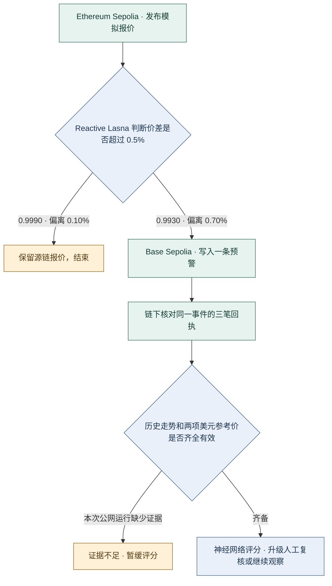

# Reactive PegPulse

[English](README.en.md) · **简体中文**

**One quote. Three chains. Anyone can verify.**　一条报价，三链共证，人人可验。

Sunshine · Sunshine Swarm Superintelligence (3S) Lab

**Reactive Meets AI（赛道 3） · 稳定币价差告警与证据核验**

DAO 财库看到 1 USDC 只能换 0.9930 USDT 时，如何判断这条报价是否值得人工复核？Reactive PegPulse 先用三条链留下同一条预警的交易证据，再由链下程序核对同期价格，为复核队列分流。本项目用测试合约发布模拟报价。

**[观看公开测试网录屏 · 2 分 30 秒](https://cdn.jsdelivr.net/gh/sunshineluyao/reactive-builder-camp-2026@main/track3/video/public/demo.mp4)** · [三笔原始回执](evidence/public-run.json) · [下载流程图 PNG](architecture.png) · [英文解说与中文字幕](video/README.zh-CN.md)

[11 月 29 日营内 Demo Day · 展示与模拟问答（4 分 40 秒）](demo-day/README.md) · [含双语备注的 PowerPoint](demo-day/Reactive-PegPulse-Demo-Day.pptx)

**给评委。** 先追踪 0.9930 测试报价的三笔回执。签名时没有独立行情，模型当场暂缓评分。事后调取事件前已收盘的两项美元报价和 15 条币安分钟线，同一模型给出**继续观察**。七个固定时段的历史对照同时报告减少的转介和漏过的持续偏离。[市场行情、财库任务与对照结果](evidence/market/README.zh-CN.md)

在本目录运行 `python3 scripts/market_evidence.py --live`，即可实时复核三链、读取事件对应行情并运行模型，无需签名钱包。

小型社区财库可以用浏览器查源交易、Reactive 执行和目标回调，无需钱包和 gas。通过公开可复核的证据和双语材料，项目以包容参与和透明问责为设计方向。[联合国目标 10.2](https://sdgs.un.org/goals/goal10) · [联合国目标 16.6](https://sdgs.un.org/goals/goal16)

## Reactive 怎样补充价格预言机

当 1 USDC 只能换 0.9930 USDT 时，社区需要核对两件事。第一，这个池子的偏离是否触发了告警？第二，独立美元报价是否也出现异常？原型用测试合约发布模拟报价。下面按证据说明哪一步已经跑通。

| 角色 | 回答的问题 | PegPulse 的做法与本次结果 |
| --- | --- | --- |
| 价格预言机，例如 Chainlink Price Feeds | 两种资产各自的美元参考价是多少？ | 模型预留 USDC/USD、USDT/USD、来源和时间戳。实时预言机适配器是后续工作。公网运行缺少这些输入。 |
| Reactive Omni 合约 | 哪条源日志应当在另一条链产生动作？ | 在 Lasna 订阅指定发布合约的 `PriceObserved`。`react()` 校验来源、阈值和重复记录，再向 Base 请求回调。0.9990 留在源链，0.9930 触发真实回调。 |
| 社区复核与链下 AI | 哪条目标告警对应这笔报价，证据足够升级调查吗？ | 以源链 ID、源交易哈希和日志索引 2 匹配三笔回执。美元报价和历史缺失时保留告警、暂缓评分。两组合成对照展示升级和观察。 |

相对只读取喂价的应用，项目增加了可以追溯到具体日志的跨链响应，以及可以检查理由的复核决定。Chainlink CRE 也能用链上事件驱动工作流，CCIP 支持跨链消息。该原型验证的是前述流程在 Reactive 上的实现。这次两秒是单个事件的首尾区块时间差。价格准确度、成本和响应延迟的跨平台比较仍待同条件实测。[Reactive 合约与回调](https://dev.reactive.network/reactive-contracts) · [Chainlink Price Feeds](https://docs.chain.link/data-feeds/price-feeds) · [Chainlink CRE](https://docs.chain.link/cre) · [Chainlink CCIP](https://docs.chain.link/ccip) · [三份公开回执](evidence/public-run.json)

## 公开部署与三笔运行交易

2026 年 11 月 27 日，项目测试钱包完成六次签名。0.9990 的对照报价偏离 10 个基点，未触发回调。0.9930 的触发报价偏离 70 个基点，目标合约记录了一条预警。下表三笔交易都属于后一笔报价。

| 网络（chain ID） | 合约地址 | 本次运行的交易哈希 | 区块时间 · UTC |
| --- | --- | --- | --- |
| Ethereum Sepolia (11155111) | QuoteSource [`0x738f50d330f3dab04e88c3e30127d2a749b10940`](https://sepolia.etherscan.io/address/0x738f50d330f3dab04e88c3e30127d2a749b10940) | PriceObserved [`0xd97a9579a96a20c9868dd7f759079975e2ff1603eb903e42d3fd5ddfbbcc6604`](https://sepolia.etherscan.io/tx/0xd97a9579a96a20c9868dd7f759079975e2ff1603eb903e42d3fd5ddfbbcc6604) | 13:38:12 |
| Reactive Lasna (5318007) | ReactiveAlert [`0x738f50d330f3dab04e88c3e30127d2a749b10940`](https://lasna.reactscan.net/address/0x738f50d330f3dab04e88c3e30127d2a749b10940) | QuoteRouted [`0x63639779506a135ff8cba06c4d8aff5230d029aed5dc781f8f902868f54e8d27`](https://lasna.reactscan.net/tx/0x63639779506a135ff8cba06c4d8aff5230d029aed5dc781f8f902868f54e8d27) | 13:38:12 |
| Base Sepolia (84532) | AlertSink [`0xdd5f43ab0c047014cd3ba70ddb9004f8c2f5e12e`](https://sepolia.basescan.org/address/0xdd5f43ab0c047014cd3ba70ddb9004f8c2f5e12e) | PriceDeviation [`0x5e2a48caaf7ab64dd3f25c4f4b804cf30d09aabc6f885efb44033b91ce3ce602`](https://sepolia.basescan.org/tx/0x5e2a48caaf7ab64dd3f25c4f4b804cf30d09aabc6f885efb44033b91ce3ce602) | 13:38:14 |

前两个合约位于不同网络，各自的区块浏览器可查看部署代码与交易。源交易日志序号为 `2`，由源链 ID、源交易哈希和日志序号计算出的事件 ID 为 `0x38b66270063a8a1180e269f0b633a2e3ed599d9e4f1fd370994c1f4ed38ac554`。Lasna 和 Base 的事件均记录了这个 ID、源交易、报价与观察时间。源链和目标链的区块时间戳相差 2 秒，这是本次运行的单次观测。[完整回执](evidence/public-run.json)

六次签名依次用于部署三个合约、绑定接收合约、发布对照报价和发布触发报价。部署与运行使用同一测试钱包。[部署 QuoteSource](https://sepolia.etherscan.io/tx/0xb053216af3d5513ac0c07fed29da488e8f5c5b2b8985a877c907e2d7e7a06402) · [部署 ReactiveAlert](https://lasna.reactscan.net/tx/0xecfb63c4a3f36f74dfd720eeec42a85948641cec233971fdbd71491961321739) · [部署 AlertSink](https://sepolia.basescan.org/tx/0x3c57912774bd2239c7d81f2d0b10497272ed740e8813be447fcdd2e3a9f7c254) · [绑定接收合约](https://lasna.reactscan.net/tx/0x2101030cf92f84c67db2ca3bee8ed05325a481961276cf35f534e8b344e27cd0) · [0.9990 对照报价](https://sepolia.etherscan.io/tx/0x33ce718f56820da45bf4fd48b2534df5dc199d89a5214d709187d22db9c622de) · [0.9930 触发报价](https://sepolia.etherscan.io/tx/0xd97a9579a96a20c9868dd7f759079975e2ff1603eb903e42d3fd5ddfbbcc6604)

上述地址和视频对应加设服务费上限前的公开部署。工作台新部署时使用带有金额上限的合约。Foundry 用例验证各项限额，三条本地 Anvil 链复现报价到告警的完整流程。[公开部署时的合约源码](https://github.com/sunshineluyao/reactive-builder-camp-2026/blob/76acc493cf5802ebdc3f8365ec8cb1c9dab3b097/track3/contracts/StablecoinAlerts.sol) · [本次 Foundry 输出](evidence/forge-guards.txt)

## 从报价到人工复核



原始运行因证据不足而暂缓评分。正式参赛录像用同期交易所行情复核同一条链上告警。浏览器另保留两组合成情景供对照。[下载流程图 PNG](architecture.png) · [可缩放的 SVG](architecture.svg)

## 架构与触发条件

| 环节 | 输入 | 动作与输出 |
| --- | --- | --- |
| Sepolia · QuoteSource | 发布者提交整数报价，10000 代表 1.0000 | 发出含报价和区块时间的 `PriceObserved`。 |
| Lasna · ReactiveAlert | Omni 系统调用 `react()`，传入订阅到的源日志 | 偏离 1:1 严格超过 50 个基点时，记录 `QuoteRouted` 并请求 Base 回调。 |
| Base Sepolia · AlertSink | 官方回调代理和获授权的 Reactive 合约 | 根据源链 ID、源交易哈希和日志索引去重，记录 `PriceDeviation`。 |
| 链下 AI | 三份相符的回执、该报价前的走势、同一时期的 USDC/USD 与 USDT/USD | 计算复核优先级，给出决定、分数或拒判原因，保留证据及模型版本。 |

0.9990 偏离 10 个基点。0.9950 和 1.0050 恰好位于两个边界。以上三种报价均保留源日志。0.9930 偏离 70 个基点，产生一条告警。重复交付同一源日志或目标回调时，告警计数仍为一。Reactive 合约最多为 20 个不同事件请求回调，达到上限时取消订阅。[合约](contracts/StablecoinAlerts.sol)

## 三条自动化保护

| 保护 | 合约执行的规则 | 测试验证了什么 |
| --- | --- | --- |
| 防误触发 | 只有指定发布者能发报价。Lasna 只接受 Omni 系统转来的指定 Sepolia 合约及事件，价差须严格超过 50 个基点。Base 同时核对代理和发送回调的 Reactive 合约。 | 0.9930 产生一条告警。0.9990、两端恰好 0.5% 的报价、错误来源和未经授权的调用均未产生告警。 |
| 防重复 | Lasna 和 Base 各自用源链 ID、源交易哈希、日志索引标识同一事件。 | 同一日志投递两次只请求一次回调，同一回调送达两次只记录一次。同笔交易的另一条日志仍能独立处理。 |
| 限金额 | 每个合约都有固定的单笔和累计服务费上限。`pay()` 和 `coverDebt()` 共用剩余额度。 | 恰好达到上限可支付，多 1 wei 会被拒绝。充值不会重置累计额度，转账失败会回滚扣额。 |

项目只记录告警，每次及累计动用的 USDC、USDT 本金都是 **0**。能够从合约转出的是以下两笔独立的测试币预算。

| 付款合约 | 单次最高 | 部署以来累计最高 | 工作台初始注资 |
| --- | ---: | ---: | ---: |
| Lasna · ReactiveAlert | 0.05 lREACT | 0.30 lREACT | 0.15 lREACT |
| Base Sepolia · AlertSink | 0.00025 ETH | 0.002 ETH | 0.001 ETH |

这些数值是项目设定的测试预算。钱包签名的 gas、协议计入的欠费以及第三方直接存入协议的预付费各自独立结算。[费用机制](https://dev.reactive.network/economy)

## 出问题怎么办

- **合约余额用完。** Lasna 停止为新事件请求回调，或 Base 停止记录新告警，取决于哪边耗尽。向对应的 `ReactiveAlert` 充 Lasna lREACT，或向 `AlertSink` 充 Base Sepolia ETH。可充金额最多为 `remainingFeeBudget() − 合约余额`。在该合约的 `service()` 上查询 `debt(合约地址)`。如果有欠费且在单次和剩余额度内，调用付款合约的 `coverDebt()` 结清。欠费归零、合约仍有余额和预算后，可处理后续合格事件。[官方充值与恢复说明](https://dev.reactive.network/economy#funding-reactive-contracts)
- **碰到硬上限。** 一笔费用超限会被拒付。累计额度用完后，该合约停止新工作，充值无法扩额。Lasna 发出第 20 个不同事件的请求后还会取消订阅。如果要继续运行，应先复核开支，重新部署并绑定新实例。
- **目标链回调失败。** Base 的失败调用不增加告警数，Lasna 保留已发出的请求。已执行并回滚的回调仍会产生费用。用源交易哈希在 Reactscan 查状态，再在 Base 回执中核对 `PriceDeviation` 及其事件 ID，确认告警已写入。欠费拦截的请求不会自动重试。排除故障后可以继续监听新事件。若服务重新投递原回调，去重逻辑最多写入一次。[回调状态](https://dev.reactive.network/reactscan#callback-lifecycle) · [失败费用](https://dev.reactive.network/economy#fee-model)

## Foundry 测试与提交凭证

在仓库根目录运行以下命令。Foundry 使用 Solidity 0.8.29，在本地创建三个项目合约并模拟两个网络服务。运行测试无需钱包或测试币。

```sh
cd track3
forge test
```

实际结果为 **15 项通过，0 项失败，0 项跳过**。其中 9 项检查报价、权限、去重和回调行为，6 项检查付款限额、充值和结算。[测试代码](tests/StablecoinGuards.t.sol) · [完整终端截图](evidence/forge-guards.png) · [同次运行的文本输出](evidence/forge-guards.txt)

## 两分钟开始复核

使用 Git、Python 3.10+ 和 Node.js 20+。复核现有交易只需读取公开数据，无需钱包、私钥或 API 密钥。

```sh
git clone https://github.com/sunshineluyao/reactive-builder-camp-2026.git
cd reactive-builder-camp-2026/track3
python3 scripts/verify_receipts.py evidence/public-run.json --destination-rpc https://base-sepolia-rpc.publicnode.com
python3 -m http.server 8080 --bind 127.0.0.1
```

验证成功时，终端显示 `Public testnet | receipts and canonical blocks match the selected RPCs`，报价为 `9930`，三条日志序号依次为 `2 / 2 / 0`。打开 <http://localhost:8080/review/?source=public&lang=zh> 查看三份回执和本次“证据不足”的结果。点击 **模拟 · 外部价格印证** 和 **模拟 · 仅池内偏离**，可以用同一事件重放两个有完整输入的模型决定。页面标明合成数据来源。

离线复核保存的原始日志可运行 `python3 scripts/verify_receipts.py evidence/public-run.json --offline`。下节命令可复现[当前合约的三链本地回执](evidence/guarded-local-run.json)。早期演练的视频保留了[录制时的本地回执](evidence/local-run.json)。同一服务还提供[视频播放器](http://localhost:8080/video/?lang=zh)和[部署工作台](http://localhost:8080/site/?lang=zh)。交互式阈值动画的离线运行方法见[动画说明](visual/README.zh-CN.md)。

## 从零运行三个 EVM

安装 Foundry v1.7.1（使用 `anvil` 和 `cast`）与原生 Solidity `solc 0.8.29+commit.ab55807c`，将可执行文件放入 PATH。编译目标是 Cancun，优化 200 次。[Foundry 版本](https://github.com/foundry-rs/foundry/releases/tag/v1.7.1) · [Solidity 版本](https://github.com/ethereum/solidity/releases/tag/v0.8.29)

```sh
python3 scripts/build_contracts.py --check
python3 scripts/local_evm.py --out /tmp/stablecoin-local-run.json
cmp evidence/guarded-local-run.json /tmp/stablecoin-local-run.json
python3 -m unittest discover -s tests -v
node --test tests/wallet.test.js
```

脚本启动三条独立本地链，部署三个合约，发布控制组及触发报价，实际执行中继和回调，再测试重复投递与调用权限。预期 `cmp` 没有输出，代表重跑产生的回执文件逐字节一致。本地时间戳由测试固定，不用于推算 Omni 公网延迟。本项目申报赛道 3。

## 部署到公开测试网

按上面的步骤启动本地服务，在装有 MetaMask 的浏览器打开 <http://localhost:8080/site/?lang=zh>。选择同一测试账户，准备 Ethereum Sepolia ETH、Lasna lREACT、Base Sepolia ETH。每一步都由钱包显示签名请求。费用储备另加相应网络测试 gas。

| 顺序 | 网络 | 钱包动作 |
| --- | --- | --- |
| 1 | Sepolia | 部署 QuoteSource。 |
| 2 | Lasna | 部署 ReactiveAlert，传入源合约地址并为合约存入 0.15 lREACT。 |
| 3 | Base Sepolia | 部署 AlertSink，传入官方代理与第 2 步的合约地址，为合约存入 0.001 测试 ETH。 |
| 4 | Lasna | 把接收合约绑定到 ReactiveAlert。 |
| 5–6 | Sepolia | 依次发布 0.9990 和 0.9930，最后一笔是演示使用的源交易。 |

先记录部署地址，再查运行交易。工作台按同一源交易哈希查找 `QuoteRouted` 和 `PriceDeviation`，可导出 `public-run.json`。在 Reactscan 搜索源交易可看到执行与回调的进展。页面的「下载部署记录」可在目标回调到达前保存六笔签名哈希。重新连接同一账户后可继续核对已提交的交易。[官方回调代理列表](https://dev.reactive.network/origins-and-destinations) · [Reactscan 追踪指南](https://dev.reactive.network/reactscan)

## 自动复核与公开证据

复查本项目的六次签名时，使用随附的公开部署记录运行下面两条命令。监听器核对每一步的钱包、合约和调用，查找同一源事件在 Lasna 与 Base 的记录，并在三份回执匹配后执行链下复核。

```sh
DESTINATION_RPC=https://base-sepolia-rpc.publicnode.com node scripts/watch.js evidence/public-deployment.json --out /tmp/stablecoin-public-run.json
python3 scripts/verify_receipts.py /tmp/stablecoin-public-run.json --destination-rpc https://base-sepolia-rpc.publicnode.com --json
```

自行部署时，换成工作台导出的六步记录。可向监听器传入 `--context evidence.json`，其中事件 ID、币对、时间和价格来源必须与该次预警对应。公开部署记录保留测试钱包地址与六次签名交易哈希。两条自动交易由监听器按源事件补齐。[六步部署记录](evidence/public-deployment.json) · [三笔运行回执](evidence/public-run.json)

若使用钱包页导出的 `public-run.json`，可直接运行第二条。验证器查询三网 RPC、区块哈希与交易包含关系、合约地址、事件签名、源日志序号、报价和观察时间，并为每条腿输出合约与交易的浏览器链接。超时可用原部署记录重跑。指定 `--timeout 1800` 可将等待期延长至 30 分钟。私有或自选 RPC 可通过环境变量 `ORIGIN_RPC`、`REACTIVE_RPC`、`DESTINATION_RPC` 传给监听器。验证脚本接受相应的 `--origin-rpc`、`--reactive-rpc`、`--destination-rpc` 参数。上传或发布的文件只需包含公开地址、交易、相符的证据与校验结果。

## AI 在运行系统里决定什么

链下程序先验证三份回执。有效的市场证据包括源事件之前的 USDC/USDT 走势、USDC/USD 和 USDT/USD 两个独立参考价，以及各自的来源和时间。证据有效时，神经网络根据价差大小、美元偏离和走势持续性，输出分数及「升级人工复核」或「继续观察」。证据缺失、过期或与事件不匹配时，程序保留告警并返回「证据不足」。

| 同一条 0.9930 预警 | 市场证据 | 运行结果 |
| --- | --- | --- |
| 本次公开运行 | 未附对应时点的外部证据包 | 证据不足，`inferenceRan: false`，`score: null` |
| 真实行情回放 | Bitstamp USDC/USD 0.999870、Coinbase USDT/USD 0.998720 及币安 15 条收盘价 | 模型运行并建议继续观察 |
| 合成对照 A | USDC/USD 为 0.9904，USDT/USD 为 1.0001，近期报价连续越界 | 模型执行并建议升级人工复核 |
| 合成对照 B | USDC/USD 为 0.9999，USDT/USD 为 1.0001，近期报价在区间内 | 模型执行并建议继续观察 |

冻结的神经网络有四个输入特征和六个隐藏单元。针对同一个已验证的 0.9930 事件，固定走势与链上证据，仅改变两种稳定币对美元的参考价，就可以把模型结果从「升级复核」变为「继续观察」。若缺少、过期或错配证据，输入校验返回「证据不足」。决策用于人工复核排序。页面上的美元示例均标为合成数据。真实报价可以按相同 JSON 格式导入，当前版本的数据接入方式为文件导入。[模型卡、训练数据生成方式和输入规范](model/MODEL_CARD.md)

## AI 辅助开发与核验说明

AI 编程助手参与了 Solidity 实现、部署界面、回执校验、训练与推理代码、测试、文档、动画和视频脚本。用例与阈值沿用仓库的 Day 1 与 Day 6 项目方向卡。验证包括固定编译器重建部署字节码、在三条独立 EVM 执行业务交易与边界用例、重新训练复现权重、交叉比较 Python 和浏览器推理、以及用被修改的回执检验校验器是否能拒绝错误记录。视频拍摄实际交互页面并使用合成旁白。项目作者通过 MetaMask 签署了部署、绑定和两次报价共六笔交易，并导出了部署记录。核验器逐笔检查链 ID、合约、事件、区块和交易位置。正式参赛录像制作前重新核验了三链 RPC，并复算真实行情及历史对照。[项目方向卡](../assignments/d6-project-direction.md) · [视频制作文件](video/README.zh-CN.md)

## 许可证与提交要求

本目录新增软件和随附文档采用 MIT。先前作业与各第三方依赖适用各自许可。Wanim 依赖按固定版本单独下载。提交时填写公开仓库、演示视频、三个公共部署地址与同一事件的三笔运行交易。主办方公告要求演示视频少于三分钟，并会查看链上执行与回调。[MIT 许可证](LICENSE) · [主办方公告](https://blog.reactive.network/reactive-omni-buildathon-thirty-days-to-find-out-what-one-second-buys/) · [DoraHacks 官方活动](https://dorahacks.io/hackathon/reactive-omni-buildathon/detail)
