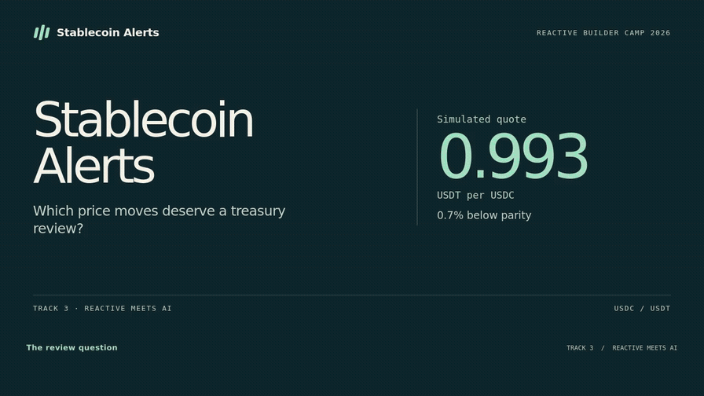

# Stablecoin Alerts with Verifiable Cross-Chain Evidence

**Reactive Meets AI（赛道 3） · 稳定币价差告警与证据核验**

DAO 财库看到 USDC/USDT 跌到 0.9930 时，需要先分清是单池报价异常，还是有独立美元报价支持的风险。项目把引发告警的源交易、Reactive 执行和目标回调串在一起，并用链下模型决定是否交由人工复核。所有链上报价均由测试报价合约发布。



[下载英文解说 MP4](https://raw.githubusercontent.com/sunshineluyao/reactive-builder-camp-2026/main/track3/video/demo.mp4) · [截图、中英文字幕与分段时间](video/README.md) · [Wanim 阈值动画](visual/README.md)

## 运行状态与地址

本仓库随附一次可重复的本地端到端运行。三条独立的 Anvil 链执行与部署页相同的生产字节码，本地合约模拟跨链消息投递及回调代理。公开测试网部署由项目所有者用 MetaMask 签名。公开部署和三笔运行交易在收到并核对后才能列入提交材料。

| 业务角色 | 公开目标网络 | 本地复现的合约地址 | 本地三笔运行交易 |
| --- | --- | --- | --- |
| `QuoteSource` | Ethereum Sepolia · 11155111 | `0x5fbdb2315678afecb367f032d93f642f64180aa3` | `0xcff2801b0c6da21aab20d4da2f2651df48bfd3d51fcc2ac96223bd2837448460` |
| `ReactiveAlert` | Reactive Lasna · 5318007 | `0x8464135c8f25da09e49bc8782676a84730c318bc` | `0x57ef76202ee24267e4722ad77d69501cf9c57cbb7e17e54e536b92005371f823` |
| `AlertSink` | Base Sepolia · 84532 | `0x663f3ad617193148711d28f5334ee4ed07016602` | `0xef8bc9707462951729ee28edd64d158a23cf08ddde620f6bee48f4916ba3c66f` |

本地链复用了测试网 chain ID。上表中的哈希仅供本地回放。原始回执记录了日志序号、部署交易、编译器版本和十项链上检查。[完整本地回执](evidence/local-run.json)

## 架构与触发条件

| 环节 | 输入 | 动作与输出 |
| --- | --- | --- |
| Sepolia · QuoteSource | 发布者提交整数报价，10000 代表 1.0000 | 发出含报价和区块时间的 `PriceObserved`。 |
| Lasna · ReactiveAlert | Omni 系统调用 `react()`，传入订阅到的源日志 | 偏离 1:1 严格超过 50 个基点时，记录 `QuoteRouted` 并请求 Base 回调。 |
| Base Sepolia · AlertSink | 官方回调代理和获授权的 Reactive 合约 | 根据源链 ID、源交易哈希和日志索引去重，记录 `PriceDeviation`。 |
| 链下 AI | 三份相符的回执、该报价前的走势、同一时期的 USDC/USD 与 USDT/USD | 计算复核优先级，给出决定、分数或拒判原因，保留证据及模型版本。 |

0.9990 偏离 10 个基点。0.9950 和 1.0050 恰好位于两个边界。以上三种报价均保留源日志。0.9930 偏离 70 个基点，产生一条告警。重复交付同一源日志或目标回调时，告警计数仍为一。Reactive 合约最多为 20 个不同事件请求回调，达到上限时取消订阅。[合约](contracts/StablecoinAlerts.sol)

## 两分钟开始复核

克隆仓库，使用 Python 3.10+、Node.js 20+。查看随附回执和运行模型无需钱包或 API 密钥。

```sh
git clone https://github.com/sunshineluyao/reactive-builder-camp-2026.git
cd reactive-builder-camp-2026/track3
python3 scripts/verify_receipts.py evidence/local-run.json
python3 model/reference.py model/cases.json
python3 -m http.server 8080 --bind 127.0.0.1
```

打开 <http://localhost:8080/review/>。页面从原始日志还原报价、时间与证据 ID。点击 **Pool-only movement** 或 **Missing USD reference** 可对同一事件更换证据，也可导入项目的 [JSON 样例](model/context-example.json)。页面提供两个 USD 输入的来源、时间和模型输出。直接运行 `python3 visual/serve.py --port 8767` 可缓存 Wanim，离线重放阈值画面。[动画复现](visual/README.md)

同一本地服务也提供[有声视频播放器](http://localhost:8080/video/)、[交互阈值动画](http://localhost:8080/visual/)和[部署工作台](http://localhost:8080/site/)。

## 从零运行三个 EVM

安装 Foundry v1.7.1（使用 `anvil` 和 `cast`）与原生 Solidity `solc 0.8.29+commit.ab55807c`，将可执行文件放入 PATH。编译目标是 Cancun，优化 200 次。[Foundry 版本](https://github.com/foundry-rs/foundry/releases/tag/v1.7.1) · [Solidity 版本](https://github.com/ethereum/solidity/releases/tag/v0.8.29)

```sh
python3 scripts/build_contracts.py --check
python3 scripts/local_evm.py --out /tmp/stablecoin-local-run.json
cmp evidence/local-run.json /tmp/stablecoin-local-run.json
python3 -m unittest discover -s tests -v
node --test tests/wallet.test.js
```

脚本启动三条独立本地链，部署三个合约，发布控制组及触发报价，实际执行中继和回调，再测试重复投递与调用权限。预期 `cmp` 没有输出，代表重跑产生的回执文件逐字节一致。本地时间戳由测试固定，不用于推算 Omni 公网延迟。本项目申报赛道 3。

## 部署到公开测试网

按上面的步骤启动本地服务，在装有 MetaMask 的浏览器打开 <http://localhost:8080/site/>。选择同一测试账户，准备 Ethereum Sepolia ETH、Lasna lREACT、Base Sepolia ETH。每一步都由钱包显示签名请求。费用储备另加相应网络测试 gas。

| 顺序 | 网络 | 钱包动作 |
| --- | --- | --- |
| 1 | Sepolia | 部署 QuoteSource。 |
| 2 | Lasna | 部署 ReactiveAlert，传入源合约地址并为合约存入 0.15 lREACT。 |
| 3 | Base Sepolia | 部署 AlertSink，传入官方代理与第 2 步的合约地址，为合约存入 0.001 测试 ETH。 |
| 4 | Lasna | 把接收合约绑定到 ReactiveAlert。 |
| 5–6 | Sepolia | 依次发布 0.9990 和 0.9930，最后一笔是演示使用的源交易。 |

先记录部署地址，再查运行交易。工作台按同一源交易哈希查找 `QuoteRouted` 和 `PriceDeviation`，可导出 `public-run.json`。在 Reactscan 搜索源交易可看到执行与回调的进展。页面的「下载部署记录」可在目标回调到达前保存六笔签名哈希。重新连接同一账户后可继续核对已提交的交易。[官方回调代理列表](https://dev.reactive.network/origins-and-destinations) · [Reactscan 追踪指南](https://dev.reactive.network/reactscan)

## 自动复核与公开证据

签名后，下载部署记录到本目录。让只读进程等待这笔报价对应的回调。进程先在正确的网络核对六笔签名、金额、字节码或调用参数，再按两端日志查询三笔业务交易。三份回执通过同源校验后，进程立即运行 AI，并原子写入 JSON。可以向 `--context` 传入与本次真实事件 ID 和时间相匹配的证据包。没有证据时，结果是“证据不足”。

```sh
node scripts/watch.js deployment-progress.json --out public-run.json
python3 scripts/verify_receipts.py public-run.json --json
```

若使用钱包页导出的 `public-run.json`，可直接运行第二条。验证器查询三网 RPC、区块哈希与交易包含关系、合约地址、事件签名、源日志序号、报价和观察时间，并为每条腿输出合约与交易的浏览器链接。超时可用原部署记录重跑。指定 `--timeout 1800` 可将等待期延长至 30 分钟。私有或自选 RPC 可通过环境变量 `ORIGIN_RPC`、`REACTIVE_RPC`、`DESTINATION_RPC` 传给监听器。验证脚本接受相应的 `--origin-rpc`、`--reactive-rpc`、`--destination-rpc` 参数。上传或发布的文件只需包含公开地址、交易、相符的证据与校验结果。

## AI 在运行系统里决定什么

冻结的神经网络有四个输入特征和六个隐藏单元。针对同一个已验证的 0.9930 事件，固定走势与链上证据，仅改变两种稳定币对美元的参考价，就可以把模型结果从「升级复核」变为「继续观察」。若缺少、过期或错配证据，输入校验返回「证据不足」。决策用于人工复核排序。页面上的美元示例均标为合成数据。真实报价可以按相同 JSON 格式导入，当前版本的数据接入方式为文件导入。[模型卡、训练数据生成方式和输入规范](model/MODEL_CARD.md)

## AI 辅助开发与核验说明

AI 编程助手参与了 Solidity 实现、部署界面、回执校验、训练与推理代码、测试、文档、动画和视频脚本。用例与阈值沿用仓库的 Day 1 与 Day 6 项目方向卡。验证包括固定编译器重建部署字节码、在三条独立 EVM 执行业务交易与边界用例、重新训练复现权重、交叉比较 Python 和浏览器推理、以及用被修改的回执检验校验器是否能拒绝错误记录。视频拍摄实际交互页面并使用合成旁白。公网签名、回执核验与本人查看演示的状态应按实际提交情况填写。[项目方向卡](../assignments/d6-project-direction.md) · [视频制作文件](video/)

## 许可证与提交要求

本目录新增软件和随附文档采用 MIT。先前作业与各第三方依赖适用各自许可。Wanim 依赖按固定版本单独下载。提交时填写公开仓库、演示视频、三个公共部署地址与同一事件的三笔运行交易。主办方公告要求演示视频少于三分钟，并会查看链上执行与回调。[MIT 许可证](LICENSE) · [主办方公告](https://blog.reactive.network/reactive-omni-buildathon-thirty-days-to-find-out-what-one-second-buys/) · [DoraHacks 官方活动](https://dorahacks.io/hackathon/reactive-omni-buildathon/detail)
