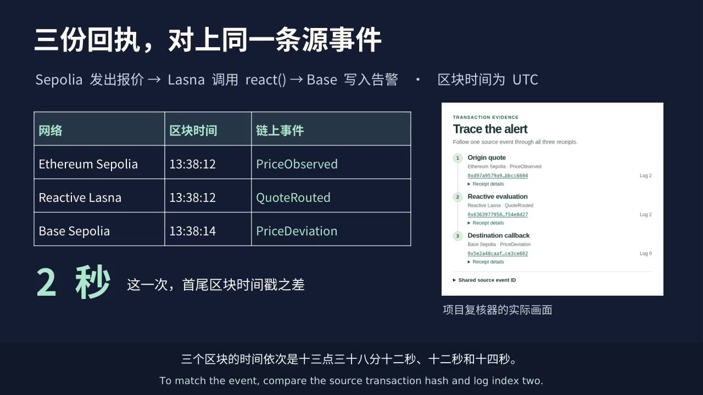

# Reactive PegPulse

**English** · [简体中文](README.md)

**One quote. Three chains. Anyone can verify.**

Sunshine · Sunshine Swarm Superintelligence (3S) Lab

**[Play the complete Demo Day recording · 4 min 40 sec](https://cdn.jsdelivr.net/gh/sunshineluyao/reactive-builder-camp-2026@main/track3/demo-day/Reactive-PegPulse-Demo-Day.mp4)**

PegPulse is a Reactive Omni Buildathon **Reactive Meets AI** project. Ethereum Sepolia publishes simulated quotes, Lasna evaluates the threshold, and Base Sepolia records the alert. Anyone can check each transaction in its explorer. The November 29 camp recording has Mandarin narration, Chinese and English captions, and a prerecorded simulated Q&A beginning at 02:50.

**Camp submission materials** · [Presentation PDF](Reactive-PegPulse-Demo-Day.en.pdf) · [Editable PowerPoint with bilingual speaker notes](Reactive-PegPulse-Demo-Day.en.pptx) · [Screenshot from the recording](demo-screenshot.jpg)

The English and Chinese slide editions follow the same ten scenes and contain bilingual speaker notes. The shared recording has Mandarin narration and subtitles in both languages.

### Playback instructions for the host

On November 29, during the 15:00–16:00 Beijing time session (07:00–08:00 UTC), Sunshine will be presenting in person at another conference. Please play the file from **00:00** during the team’s slot and share computer audio. The simulated Q&A starts at **02:50** and the video ends at **04:40**. The host can collect audience questions for Sunshine to answer in writing afterward. Download the same MP4 before the session for offline playback.

| Time | Segment | What judges can verify |
| --- | --- | --- |
| 00:00 | A community volunteer sees 0.9930 | Check the on-chain alert first, then the market evidence. |
| 00:28 | Three quotes in Wanim | 0.9990 and the exact 0.9950 boundary stay under observation. A quote of 0.9930 requests a callback. |
| 00:54 | Three public testnet receipts | Source quote, Lasna execution and Base callback refer to the same log. |
| 01:29 | Change the market evidence | The public run withheld its score. Two synthetic inputs demonstrate the other decisions. |
| 02:00 | Replay protection and fee limits | The updated contracts passed 15 local Foundry tests. |
| 02:28 | Who can verify? | Reading receipts takes no wallet. Downloadable materials and bilingual transcripts support independent review. |
| **02:50** | **Simulated Q&A begins** | **Execution.** How can a viewer confirm the destination really recorded an alert? |
| 03:15 | Integration | What does Reactive add when price oracles already exist? |
| 03:42 | Usefulness | Can a quote in one pool establish a stablecoin depeg? |
| 04:12 | Craft | What happens on replay, a failed callback or budget exhaustion? |

### What does Reactive add to a price oracle?

An oracle can supply independent dollar prices. PegPulse subscribes to a specific quote event. At 0.9930, Lasna’s `react()` requested a Base alert. The three receipts share a source transaction hash and log index 2. These simulated prices produced a real testnet callback. Without matching contemporary references, the AI kept the alert and withheld scoring. The simulated Q&A demonstrates this distinction. [Implementation and comparison](../README.en.md#how-reactive-complements-price-oracles)

### How community members can verify

Students, small DAO treasuries and community volunteers can inspect receipts on a phone without an account, signature or gas. Bilingual captions and downloadable transcripts support independent checks. Publishing the raw logs and the reason for withholding a score supports the design goals of participation (SDG 10.2) and accountability (SDG 16.6). The planned user study will measure completion, time and difficulties matching the event independently. [UN target 10.2](https://sdgs.un.org/goals/goal10) · [UN target 16.6](https://sdgs.un.org/goals/goal16)

### Registration and production

[Copy-ready registration answers](registration.en.txt) · [Production diagram and tools](production.en.md#video-production-workflow) · [Host script and simulated Q&A](script.en.md) · [Chinese subtitles](captions.zh.srt) · [English subtitles](captions.en.srt)

The digital presenter was generated from Sunshine’s supplied blue-cap photo and uses a separate synthetic Mandarin voice. The four prepared questions follow the judging criteria. The public transactions and contract addresses can be verified independently. [Source quote](https://sepolia.etherscan.io/tx/0xd97a9579a96a20c9868dd7f759079975e2ff1603eb903e42d3fd5ddfbbcc6604) · [Lasna execution](https://lasna.reactscan.net/tx/0x63639779506a135ff8cba06c4d8aff5230d029aed5dc781f8f902868f54e8d27) · [Base callback](https://sepolia.basescan.org/tx/0x5e2a48caaf7ab64dd3f25c4f4b804cf30d09aabc6f885efb44033b91ce3ce602) · [Judging criteria](https://blog.reactive.network/reactive-omni-buildathon-thirty-days-to-find-out-what-one-second-buys/)
