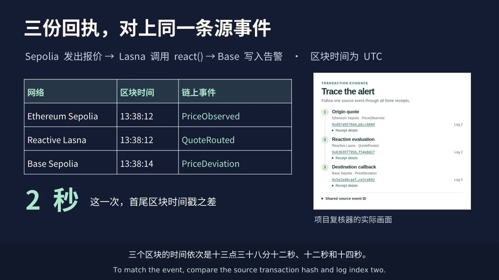

# Reactive PegPulse

**One quote. Three chains. Anyone can verify.**　一条报价，三链共证，人人可验。

Sunshine · Sunshine Swarm Superintelligence (3S) Lab

**[播放 Demo Day 完整预录（4 分 40 秒）](https://cdn.jsdelivr.net/gh/sunshineluyao/reactive-builder-camp-2026@main/track3/demo-day/Reactive-PegPulse-Demo-Day.mp4)**

Reactive Omni Buildathon 的 **Reactive Meets AI** 赛道项目。Ethereum Sepolia 发布模拟报价，Reactive Lasna 判断是否越过阈值，Base Sepolia 写入告警。任何人都能打开区块浏览器逐笔核对。2026 年 11 月 29 日的营内演示使用普通话旁白和中英字幕，02:50 自动进入预录模拟问答。

**训练营提交材料**　[演示幻灯片 PDF](Reactive-PegPulse-Demo-Day.pdf) · [可编辑 PowerPoint，含双语讲者备注](Reactive-PegPulse-Demo-Day.pptx) · [预录演示截图](demo-screenshot.jpg)

### 主持人播放说明

11 月 29 日 15:00–16:00（北京时间）期间，讲者将在另一场学术会议现场作报告，无法实时出席。烦请主持人在本组时段从 **00:00** 播放视频并共享电脑声音。**02:50** 会自动进入模拟问答，**04:40** 结束。新增的现场问题可由主持人记录，讲者会后书面回复。网络不稳时，可以事先将同一 MP4 下载到播放电脑。

| 视频时间 | 内容 | 评委可以核对什么 |
| --- | --- | --- |
| 00:00 | 社区志愿者面对 0.9930 的报价 | 先确认告警上链，再检查市场证据 |
| 00:28 | Wanim 演示三种报价 | 0.9990 和边界 0.9950 继续观察，0.9930 请求回调 |
| 00:54 | 三份公开测试网回执 | 源报价、Lasna 执行、Base 回调对应同一日志 |
| 01:29 | 复核器切换价格证据 | 公网运行暂缓评分，两组合成输入展示另外两个决定 |
| 02:00 | 防重复与费用保护 | 新版合约 15 项本地 Foundry 测试通过 |
| 02:28 | 谁能核验？ | 只读回执无需钱包，双语稿和可下载材料方便独立复核 |
| **02:50** | **预录模拟问答开始** | **Execution**　如何核对目标链真正写入？ |
| 03:15 | Integration | 已有价格预言机，Reactive 还做什么？ |
| 03:42 | Usefulness | 一个池子的报价足以证明脱锚吗？ |
| 04:12 | Craft | 回调重放、失败和预算耗尽如何处理？ |

### 有了价格预言机，Reactive 做什么？

价格预言机可提供两种币的独立美元参考价。PegPulse 订阅的是一条具体报价事件。0.9930 越界时，Lasna 的 `react()` 请求 Base 写入告警，三笔回执可用源交易哈希与日志序号 2 对上。公开测试使用模拟报价并产生真实回调。由于缺少同期参考价，AI 复核流程保留告警、暂缓评分。现场模拟问答会解释这个区别。[实现与对照](../README.md#reactive-怎样补充价格预言机)

### 社区成员怎样参与核验

学生、小型 DAO 财库和社区志愿者都能用手机浏览器读三笔回执，免登录、免签名，也无需支付 gas。双语字幕和可下载的文字稿方便逐项核查。公开原始日志以及 AI 暂缓评分的理由，对应 SDG 10.2 的包容参与和 SDG 16.6 的透明问责。两者是设计方向。下一步计划邀请社区成员独立匹配同一事件，记录完成率、用时和遇到的困难。[联合国目标 10.2](https://sdgs.un.org/goals/goal10) · [联合国目标 16.6](https://sdgs.un.org/goals/goal16)

### 登记与制作材料

[登记表四栏可复制答案](registration.txt) · [科学动画与数字讲者制作手册](production.md) · [主持人中英讲稿和模拟问答](script.md) · [中文字幕](captions.zh.srt) · [English subtitles](captions.en.srt)

讲者数字分身依据本人提供的蓝帽照片生成，普通话由独立的合成声音朗读。四道模拟问题是针对评审标准准备的预设问题。项目的公链回执和合约地址可独立核对。[源报价交易](https://sepolia.etherscan.io/tx/0xd97a9579a96a20c9868dd7f759079975e2ff1603eb903e42d3fd5ddfbbcc6604) · [Lasna 执行交易](https://lasna.reactscan.net/tx/0x63639779506a135ff8cba06c4d8aff5230d029aed5dc781f8f902868f54e8d27) · [Base 回调交易](https://sepolia.basescan.org/tx/0x5e2a48caaf7ab64dd3f25c4f4b804cf30d09aabc6f885efb44033b91ce3ce602) · [主办方评审标准](https://blog.reactive.network/reactive-omni-buildathon-thirty-days-to-find-out-what-one-second-buys/)
