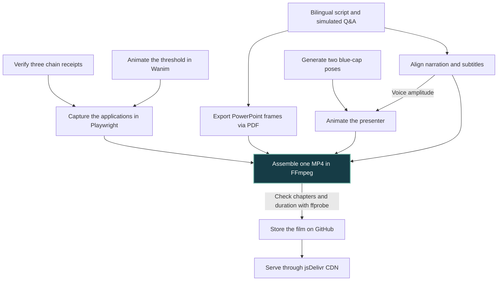

# Producing a scientific animation that viewers can verify

**English** · [简体中文](production.md)

Sunshine presents **Reactive PegPulse** for Sunshine Swarm Superintelligence (3S) Lab. Its English tagline is **One quote. Three chains. Anyone can verify.** Its Chinese tagline is **一条报价，三链共证，人人可验。**

Which quote triggers an alert as the price moves from 0.9990 to 0.9950 and then to 0.9930? The animation explains the threshold before the recording shows actual program output. Captions, narration, slides and host cues use the same values. The presentation and simulated Q&A share one video.

## Video production workflow



Check two cue points before sharing. The prerecorded Q&A starts at **02:50**, and the film ends at **04:40**. [MP4 on GitHub](Reactive-PegPulse-Demo-Day.mp4) · [Host playback link](https://cdn.jsdelivr.net/gh/sunshineluyao/reactive-builder-camp-2026@main/track3/demo-day/Reactive-PegPulse-Demo-Day.mp4)

## What each shot demonstrates

| Shot | Source | What the viewer can conclude |
| --- | --- | --- |
| Green band and three quote markers | Wanim runs the project’s Python scene. Integer basis points determine the classification. | Both boundaries are inside the band. Motion between samples is interpolation. The 0.9950 sample illustrates the boundary. |
| Three transactions | The reviewer checks the receipts and their blocks on all three chains. The source log index is 2. | All three records trace the same simulated 0.9930 quote. The first and last block timestamps differ by two seconds on this run. |
| Three AI outcomes | The public event lacks matching reference prices. Two labeled synthetic packets replay it in the reviewer. | The public score was withheld. Escalation and continued observation are two controlled demonstrations using the same event. |
| Fee limits and recovery | Fifteen independent Foundry tests exercise the revised Solidity contracts. | These tests cover the added protections. The public transactions came from the earlier deployment. |
| Presenter and questions | The presenter supplied a reference photo. Two generated poses use a generic synthetic Mandarin voice. Questions were scripted. | The avatar is authorized by the presenter. The host can collect audience questions separately. |

[Wanim scene](../visual/threshold.py) · [Raw receipts](../evidence/public-run.json) · [Model card](../model/MODEL_CARD.en.md) · [Safeguard tests](../tests/StablecoinGuards.t.sol)

## Software, inputs and outputs

| Stage | Tools or materials used | Input and output |
| --- | --- | --- |
| Verify public evidence | Python 3.12.14, project RPC verifier, Foundry 1.7.1, Solidity 0.8.29 | Check the source hash, canonical blocks, event ID, amounts and log index. Test the revised contracts independently. |
| Draw the scientific animation | Wanim 0.1.3, numpy-ts 1.7.0 | The browser compiles a Manim-style Python scene to Canvas. Position, color and trigger state use the same quote. SHA-512 pins the runtime packages. |
| Capture the working apps | Python Playwright 1.62.0, Chrome for Testing 158.0.8127.88 | Drive the controls through two transitions and three review outcomes. Capture the review app after all three public receipts pass verification. |
| Create the avatar | ChatGPT image generation, FFmpeg cropping | The presenter’s chosen blue-cap photograph guided a two-pose illustration. The distributed images show closed and slightly open mouths. |
| Record Mandarin narration | sherpa-onnx 1.12.30, bilingual single-speaker MeloTTS, INT8 ONNX | Synthesize each Mandarin cue with pronunciations for dates, prices and token names. The same generic voice reads the simulated questions and answers. |
| Author the slides | ChatGPT Spaces, Artifact Tool 2.8.194, python-pptx 1.0.2 | One layout supplies the online draft and offline PowerPoint. Text, tables, speaker notes and links are editable. The open-source Python writer rebuilds the offline deck. |
| Export PDF and still frames | LibreOffice Impress 26.8 development build, PyMuPDF 1.26.6 | Export ten pages from the offline PPTX and rasterize them at 1280 × 720 for the film. |
| Align audio, picture and captions | NumPy 2.3.5, Pillow 13.0.0, FFmpeg/ffprobe 7.1.5, libx264, AAC, libass, Fontconfig | Combine the poses, recordings and bilingual captions. The projection fonts are Noto Sans CJK SC and DejaVu Sans. Export a chaptered H.264/AAC MP4. |

[Wanim documentation](https://wanim.org/docs/usage/) · [Playwright for Python](https://playwright.dev/python/) · [Chrome for Testing](https://googlechromelabs.github.io/chrome-for-testing/) · [MeloTTS](https://github.com/myshell-ai/MeloTTS) · [Converted ONNX model](https://huggingface.co/csukuangfj/vits-melo-tts-zh_en/tree/a0d5c6a264c0ef92d70d8661d8cc502d79627cd6) · [sherpa-onnx](https://k2-fsa.github.io/sherpa/onnx/tts/) · [python-pptx](https://python-pptx.readthedocs.io/) · [FFmpeg](https://ffmpeg.org/documentation.html)

## Production steps

1. **Write for the judges.** The opening six slides follow a community treasury volunteer who sees 0.9930. Explain the threshold, execution, review, fee safeguards and wallet-free verification. The final four slides cover Execution, Integration, Usefulness and Craft. Mandarin is spoken and English accompanies it in captions and notes. [Bilingual script](source/story.json)
2. **Verify before capture.** The rule is `abs(priceBps - 10000) > 50`. Capture the control, boundary, trigger and two transitions. Verify the public receipts and capture insufficient evidence, escalation and continued observation. The recorder checks the visible states and all three transaction links. [Capture script](source/capture.py)
3. **Prepare two presenter poses.** Keep the chosen photograph’s facial features, blue baseball cap and violet rim light. A navy workbench and casual jacket set the hacker-house scene. Keep the camera, eyes and shoulders fixed between poses and change the mouth. Reuse these exported assets in later cuts. [Resting pose](media/avatar.jpg) · [Speaking pose](media/avatar-speaking.jpg)
4. **Time the speech, then animate.** Synthesize each cue, trim long silences and set playback speed with FFmpeg. Apply two-pass normalization targeting −16 LUFS. Allow longer pauses between slides. Sample and smooth voice energy 24 times per second to blend the mouth poses. This approximates mouth opening by amplitude. An on-screen disclosure identifies the avatar and synthetic voice. [Audio and subtitles](source/audio.py) · [Compositing](source/film.py)
5. **Export the deck and film.** The host receives editable PowerPoint slides and a linked PDF. The video combines slides, Wanim frames, the review application and the avatar with both subtitle languages. The presentation runs 00:00–02:50 and the simulated Q&A runs 02:50–04:40. [Offline slide writer](source/layout.py) · [Online layout adapter](source/native.mjs)
Slide six connects public receipts, an explicit insufficient-evidence outcome and bilingual transcripts to SDG targets 10.2 and 16.6. A future user study would measure how often community members complete verification independently. [UN target 10.2](https://sdgs.un.org/goals/goal10) · [UN target 16.6](https://sdgs.un.org/goals/goal16)

6. **Check the deliverables and share.** Inspect all ten PDF pages, screenshots, data versions, quote labels, caption margins, duration, audio, chapters and seeking. The camp assignment accepts slides. The registration form needs only one playback link. [Registration copy](registration.en.txt)

## Rebuild locally

Start at the repository root. Install Python 3.12, FFmpeg with libass, libx264 and AAC, LibreOffice, Fontconfig and the fonts listed above. Use Foundry for the contract tests. The first build downloads the browser, Wanim packages and voice model. The published MP4, PPTX and PDF work offline.

```sh
cd track3
forge test
python3 scripts/verify_receipts.py evidence/public-run.json --destination-rpc https://base-sepolia-rpc.publicnode.com
cd demo-day
python3 -m venv /tmp/alerts-venv
. /tmp/alerts-venv/bin/activate
python -m pip install -r source/requirements.txt
python -m playwright install chromium
WORK="$(mktemp -d)"
mkdir -p "$WORK/pdf"
python source/get_voice.py "$WORK/melo"
DESTINATION_RPC=https://base-sepolia-rpc.publicnode.com python source/capture.py "$WORK/capture"
python source/audio.py "$WORK/sound" "$WORK/melo"
python source/layout.py "$WORK/Reactive-PegPulse-Demo-Day.pptx"
soffice --headless --convert-to pdf --outdir "$WORK/pdf" "$WORK/Reactive-PegPulse-Demo-Day.pptx"
python source/film.py "$WORK" "$WORK/pdf/Reactive-PegPulse-Demo-Day.pdf" "$WORK/Reactive-PegPulse-Demo-Day.mp4"
ffprobe -v error -show_entries format=duration:stream=codec_name,width,height -show_chapters "$WORK/Reactive-PegPulse-Demo-Day.mp4"
```

To rebuild the English slides, run the following from `track3/demo-day/`. The English labels share the same layout, receipt links, numerical inputs and bilingual notes. The recording used the Chinese slide faces.

```sh
python source/layout.py --lang en "$WORK/Reactive-PegPulse-Demo-Day.en.pptx"
soffice --headless --convert-to pdf --outdir "$WORK/pdf" "$WORK/Reactive-PegPulse-Demo-Day.en.pptx"
```

Pass `--chrome /path/to/chrome-headless-shell` to capture with an existing browser. Select read-only RPCs with `ORIGIN_RPC`, `REACTIVE_RPC` and `DESTINATION_RPC`. The audio stage produces bilingual SRT and the film stage exports the demo screenshot. To update the deck with new captures, copy `chart-2.png`, `trace.png` and `model-insufficient.png` to `media/wanim-still.png`, `media/trace.png` and `media/decision.png` respectively, then export. Different voice, browser, encoder or font builds can change the file bytes. Verify the duration, quote classifications and three review states.

The voice downloader pins the ONNX revision and SHA-256. The script and newly written project code use the project MIT license. MeloTTS and the converted model carry MIT licenses. The presenter authorized the likeness for this demo. Keep the avatar disclosure with redistributed footage. [Voice model license](https://huggingface.co/csukuangfj/vits-melo-tts-zh_en/blob/a0d5c6a264c0ef92d70d8661d8cc502d79627cd6/LICENSE) · [Project license](../LICENSE)
