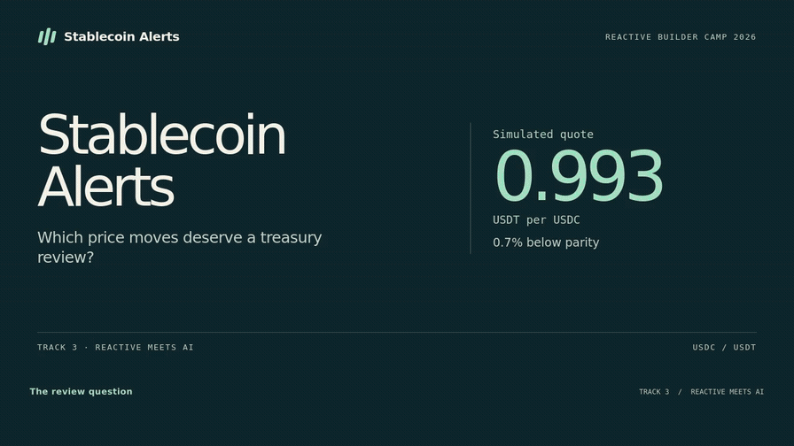
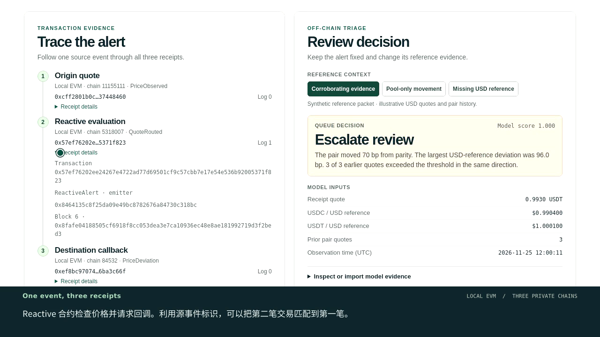

# Stablecoin Alerts walkthrough

**English** · [简体中文](README.zh-CN.md)

## Hackathon submission · public testnets

**[Watch the 2:30 narrated recording](https://cdn.jsdelivr.net/gh/sunshineluyao/reactive-builder-camp-2026@main/track3/video/public/demo.mp4)** · [Download MP4](https://raw.githubusercontent.com/sunshineluyao/reactive-builder-camp-2026/main/track3/video/public/demo.mp4) · [English subtitles](public/demo.en.srt) · [中文字幕](public/demo.zh.srt)

The film opens on the three actual testnet transactions. It shows what was known at signing, replays the same event with prices from three exchanges, then compares the frozen model with two simpler review policies. [Raw receipts](../evidence/public-run.json) · [Observed prices and comparison](../evidence/market/README.md)

| Start | On screen |
|---|---|
| 00:00 | Sepolia quote, Lasna execution and Base callback for one simulated quote. |
| 00:45 | The original alert is retained and the model withholds its score. |
| 01:00 | Archived prices from three venues and the resulting decision to continue observation. |
| 01:34 | Referrals, missed persistent moves and abstentions across 208 comparable crossings. |
| 02:05 | A judge completes the treasury review task on the public page. |

[](https://cdn.jsdelivr.net/gh/sunshineluyao/reactive-builder-camp-2026@main/track3/video/public/demo.mp4)

## Local Anvil walkthrough



[Download the narrated MP4 (2:30)](https://raw.githubusercontent.com/sunshineluyao/reactive-builder-camp-2026/main/track3/video/demo.mp4) · [English audio only](demo.en.m4a) · [English subtitles](demo.en.srt) · [中文字幕](demo.zh.srt) · [Wanim animation and source](../visual/README.md)

The GIF loops inline when your GitHub motion settings allow it. The [original MP4](demo.mp4) includes English narration and the same burned-in Chinese captions. Both files play offline after cloning the repository.

The recording follows a simulated 0.9930 USDT/USDC quote through three private Anvil chains and into the review queue. It shows each application's receipt and three outcomes from the same fixed alert. Corroborating USD references escalate review, near-par USD references support continued observation, and a missing reference withholds the score. The runtime uses the actual Solidity rehearsal and frozen model. The USD reference packets and the transport between these private chains are simulated.

| Time | What to look for |
| --- | --- |
| 00:07 | Wanim draws a quote inside the band, one on its boundary, and one 70 basis points below parity. |
| 00:36 | The review application matches three receipts. Expand each leg to see its transaction and emitter. |
| 01:19 | The reviewer changes the synthetic reference context and compares all three decisions. |
| 02:13 | Source, evidence and model files needed to reproduce the example. |

## Screenshots

**00:30 · A quote of 0.9930 crosses the 50-basis-point threshold.**


**01:04 · Three local EVM receipts lead to a model decision.**



## Rebuild

The capture script starts private loopback HTTP servers, records the running Wanim player and receipt-review application in Chromium, and asserts the visible outcomes. It uses the Wanim player's pinned package cache. On first use, the player downloads the two packages into `~/.cache/reactive-wanim`. Temporary footage and synthesized audio are written to the directory supplied on the command line.

From the `track3` directory, install Python 3, FFmpeg with libx264, libass, libwebp, Flite and AAC, and the Noto Sans CJK SC font. Install the Python browser driver and its Chromium build, then capture the screen.

```bash
python3 -m pip install playwright
python3 -m playwright install chromium
python3 video/capture.py /tmp/stablecoin-film
python3 video/render.py /tmp/stablecoin-film
```

The renderer writes the full-length README GIF, the Wanim chapter GIF, and an M4A copy of the original narration next to the MP4. To export those three assets from the checked-in recording, run this command from `track3/`. This step uses Python 3 and FFmpeg.

```bash
python3 video/render.py /tmp/stablecoin-media --media-only
```

The default encoder uses FFmpeg's `slt` text-to-speech voice. The original local cut used Piper's `en_US-ljspeech-medium` voice and `piper-tts==1.3.0`. To use that voice, download the two files below into the same directory, install `piper-tts==1.3.0`, and pass `--voice-model /path/to/en_US-ljspeech-medium.onnx` to `render.py`. The model card identifies the underlying speech recordings as public domain. [Voice model](https://huggingface.co/rhasspy/piper-voices/resolve/main/en/en_US/ljspeech/medium/en_US-ljspeech-medium.onnx) · [Voice configuration](https://huggingface.co/rhasspy/piper-voices/resolve/main/en/en_US/ljspeech/medium/en_US-ljspeech-medium.onnx.json) · [Model card](https://huggingface.co/rhasspy/piper-voices/blob/main/en/en_US/ljspeech/medium/MODEL_CARD)

The current competition cut uses Python, Playwright/Chromium, Pillow, Piper and FFmpeg. Playwright operates the real reviewer and captures the receipt details, evidence switches and task feedback. Cards draw from the checked-in evidence and model outputs. Piper's Lessac English voice narrates the film. FFmpeg aligns speech and Chinese captions, exports English and Chinese subtitle files, and encodes 150 seconds of H.264/AAC. The older `capture.py --public-manifest` and `render.py --public` workflow reproduces the earlier teaching cut. [Bilingual script](judges-cues.json) · [Frame design](judges-frame.html) · [Capture and encode](make_judges_cut.py) · [Lessac voice model card](https://huggingface.co/rhasspy/piper-voices/blob/main/en/en_US/lessac/medium/MODEL_CARD)

```bash
python3 scripts/market_evidence.py
python3 scripts/market_benchmark.py
python3 video/make_judges_cut.py --work /tmp/pegpulse-film --browser /path/to/chromium --voice /path/to/en_US-lessac-medium.onnx
```
