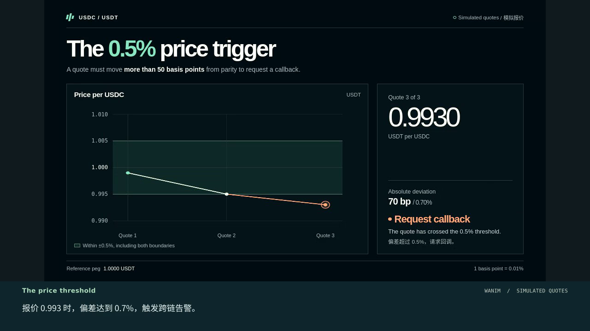

# Stablecoin Alerts walkthrough


[Download the narrated MP4 (2:30)](https://raw.githubusercontent.com/sunshineluyao/reactive-builder-camp-2026/main/track3/video/demo.mp4) · [English audio only](demo.en.m4a) · [English subtitles](demo.en.srt) · [中文字幕](demo.zh.srt) · [Wanim animation and source](../visual/README.md)

The GIF loops inline when your GitHub motion settings allow it. The [original MP4](demo.mp4) includes English narration and the same burned-in Chinese captions. Both files play offline after cloning the repository.

The recording follows a simulated 0.9930 USDT/USDC quote through three private Anvil chains and into the review queue. It shows each application's receipt and three outcomes from the same fixed alert. Corroborating USD references escalate review, near-par USD references support continued observation, and a missing reference withholds the score. The runtime uses the actual Solidity rehearsal and frozen model. The USD reference packets and the transport between these private chains are simulated.

| Time | What to look for |
| --- | --- |
| 00:07 | Wanim draws a quote inside the band, one on its boundary, and one 70 basis points below parity. |
| 00:36 | The review application matches three receipts. Expand each leg to see its transaction and emitter. |
| 01:19 | The reviewer changes the synthetic reference context and compares all three decisions. |
| 02:13 | Source, evidence and model files needed to reproduce the example. |

## Screenshots

**00:30 · A quote of 0.9930 crosses the 50-basis-point threshold.**



**01:04 · Three local EVM receipts lead to a model decision.**


## Rebuild

The capture script starts private loopback HTTP servers, records the running Wanim player and receipt-review application in Chromium, and asserts the visible outcomes. It uses the Wanim player's pinned package cache. On first use, the player downloads the two packages into `~/.cache/reactive-wanim`. Temporary footage and synthesized audio are written to the directory supplied on the command line.

From the `track3` directory, install Python 3, FFmpeg with libx264, libass, libwebp, Flite and AAC, and the Noto Sans CJK SC font. Install the Python browser driver and its Chromium build, then capture the screen.

```bash
python3 -m pip install playwright
python3 -m playwright install chromium
python3 video/capture.py /tmp/stablecoin-film
python3 video/render.py /tmp/stablecoin-film
```

The renderer writes the full-length README GIF, the Wanim chapter GIF, and an M4A copy of the original narration next to the MP4. To export those three assets from the checked-in recording, run this command from `track3/`. This step uses Python 3 and FFmpeg.

```bash
python3 video/render.py /tmp/stablecoin-media --media-only
```

The default encoder uses FFmpeg's `slt` text-to-speech voice. The published cut uses Piper's `en_US-ljspeech-medium` voice and `piper-tts==1.3.0`. To use that voice, download the two files below into the same directory, install `piper-tts==1.3.0`, and pass `--voice-model /path/to/en_US-ljspeech-medium.onnx` to `render.py`. The model card identifies the underlying speech recordings as public domain. [Voice model](https://huggingface.co/rhasspy/piper-voices/resolve/main/en/en_US/ljspeech/medium/en_US-ljspeech-medium.onnx) · [Voice configuration](https://huggingface.co/rhasspy/piper-voices/resolve/main/en/en_US/ljspeech/medium/en_US-ljspeech-medium.onnx.json) · [Model card](https://huggingface.co/rhasspy/piper-voices/blob/main/en/en_US/ljspeech/medium/MODEL_CARD)

For a 0.9930 run signed on public testnets, pass `--public-manifest /path/to/public-run.json` to `capture.py`. The camera waits for live RPC validation of three matching receipts. Render that capture with `--public --out /path/to/public-cut/demo.mp4` after creating the output directory. This switches the narration, on-screen provenance and still filenames. The illustrative model inputs remain labeled as synthetic. The script can also use an existing compatible Chromium via `--chrome /path/to/chrome` and an existing verified Wanim archive cache via `--cache /path/to/cache`.

`narration.json` contains the bilingual script. `cards.html` contains the opening and closing titles. `capture.py` operates the on-screen controls. `render.py` aligns the spoken cues, burns in Chinese captions, combines the screen recordings and exports H.264/AAC video, two subtitle files and two stills.
