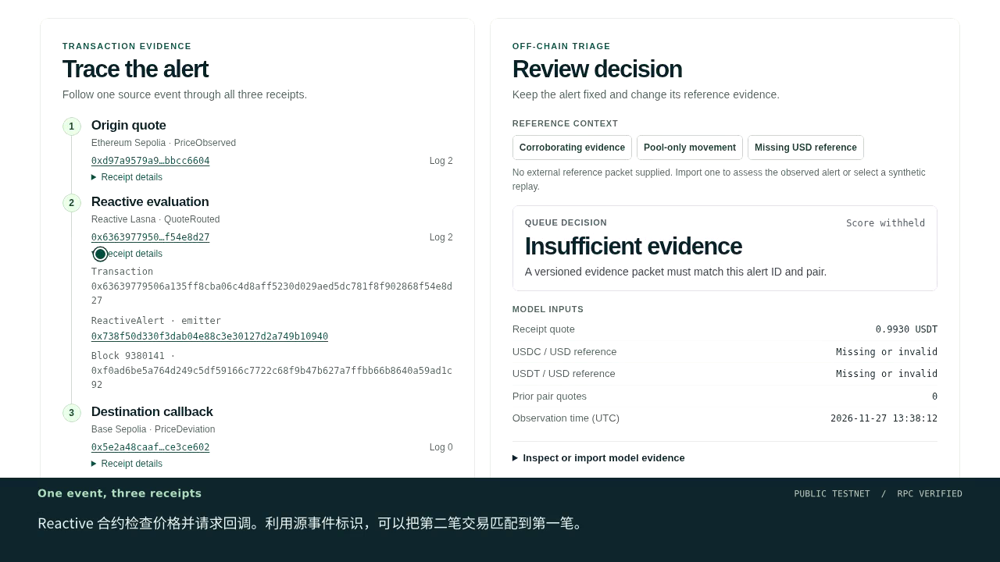
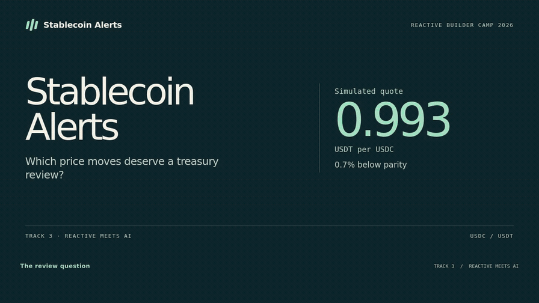
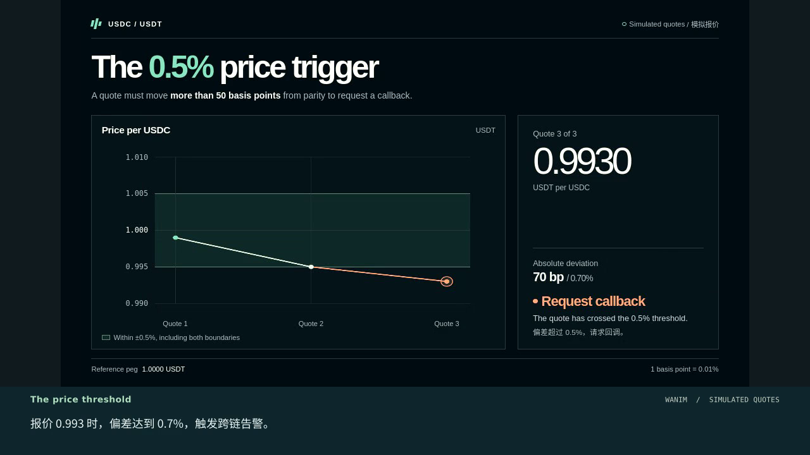
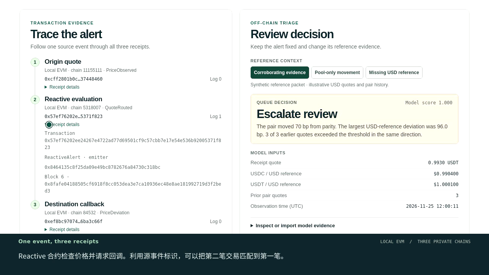

# 稳定币告警演示

[English](README.md) · **简体中文**

## 黑客松提交录像 · 公开测试网

**[观看有声演示（2 分 30 秒）](https://cdn.jsdelivr.net/gh/sunshineluyao/reactive-builder-camp-2026@main/track3/video/public/demo.mp4)** · [下载 MP4](https://raw.githubusercontent.com/sunshineluyao/reactive-builder-camp-2026/main/track3/video/public/demo.mp4) · [英文字幕](public/demo.en.srt) · [中文字幕](public/demo.zh.srt)

比赛录像从三笔真实测试网回执开始，随后展示签名时的证据不足、事后用三个交易所的历史行情运行模型，以及与两条简单规则的历史对照。[原始回执](../evidence/public-run.json) · [市场输入与结果](../evidence/market/README.zh-CN.md)

| 片段 | 画面与证据 |
|---|---|
| 00:00 | 同一条模拟报价在 Sepolia、Lasna 和 Base 的三笔交易。 |
| 00:45 | 没有独立行情，原始运行保留告警、暂缓评分。 |
| 01:00 | 三个市场的历史价格及同一模型实际给出的「继续观察」。 |
| 01:34 | 在 208 次可比较越界中衡量转介、漏报和暂缓判断。 |
| 02:05 | 评委在核验页完成财库任务。 |

[](https://cdn.jsdelivr.net/gh/sunshineluyao/reactive-builder-camp-2026@main/track3/video/public/demo.mp4)

## 本地 Anvil 演练



[下载有声 MP4（2 分 30 秒）](https://raw.githubusercontent.com/sunshineluyao/reactive-builder-camp-2026/main/track3/video/demo.mp4) · [仅英文音频](demo.en.m4a) · [英文字幕](demo.en.srt) · [中文字幕](demo.zh.srt) · [Wanim 动画与场景源码](../visual/README.zh-CN.md)

在 GitHub 允许自动播放动画时，GIF 会在页面循环播放。[原始 MP4](demo.mp4)带英文旁白和内嵌中文字幕。克隆仓库后，两份文件均可离线播放。

录像在三条本地 Anvil 链上跟踪一笔模拟报价（每枚 USDC 兑换 0.9930 USDT），直到告警进入复核队列。美元参考价也走弱时，模型建议升级复核。两项参考价接近平价时继续观察。缺少参考价时暂缓评分。演练实际运行 Solidity 合约及冻结模型，使用合成美元数据并模拟本地链间传递。

| 时间 | 核对内容 |
| --- | --- |
| 00:07 | Wanim 依次画出区间内、边界上及偏离平价 70 个基点的报价。 |
| 00:36 | 复核器配对三笔回执。展开每一步可看交易和发出事件的合约。 |
| 01:19 | 切换合成市场情景，比较三种复核决定。 |
| 02:13 | 找到复现实例所需的源码、证据和模型。 |

## 演示截图

**00:30 · 0.9930 越过 50 个基点的门槛。**



**01:04 · 三笔本地 EVM 回执对应一次模型判断。**



## 重新制作录像

采集脚本在本机回环地址启动 HTTP 服务，用 Chromium 录制实际运行的 Wanim 播放器和回执复核器，并断言界面结果。首次运行会把两个固定版本的软件包下载到 `~/.cache/reactive-wanim`。临时画面和合成音频写入命令指定的目录。

从 `track3` 目录开始。安装 Python 3、支持 libx264、libass、libwebp、Flite 和 AAC 的 FFmpeg，以及 Noto Sans CJK SC 字体。再安装 Python 浏览器驱动和 Chromium，运行采集程序。

```bash
python3 -m pip install playwright
python3 -m playwright install chromium
python3 video/capture.py /tmp/stablecoin-film
python3 video/render.py /tmp/stablecoin-film
```

渲染器会在 MP4 旁写出完整的 README 动画、Wanim 章节动画和 M4A 旁白。要从仓库已收录的录像导出这三类素材，在 `track3/` 下运行以下命令，环境需有 Python 3 和 FFmpeg。

```bash
python3 video/render.py /tmp/stablecoin-media --media-only
```

默认编码器使用 FFmpeg 的 `slt` 合成语音。发布版使用 Piper 的 `en_US-ljspeech-medium` 与 `piper-tts==1.3.0`。将下面两个模型文件下载到同一目录，安装指定版本并给 `render.py` 添加 `--voice-model /path/to/en_US-ljspeech-medium.onnx`。模型卡说明底层语音录音属于公有领域。[语音模型](https://huggingface.co/rhasspy/piper-voices/resolve/main/en/en_US/ljspeech/medium/en_US-ljspeech-medium.onnx) · [配置](https://huggingface.co/rhasspy/piper-voices/resolve/main/en/en_US/ljspeech/medium/en_US-ljspeech-medium.onnx.json) · [模型卡](https://huggingface.co/rhasspy/piper-voices/blob/main/en/en_US/ljspeech/medium/MODEL_CARD)

正式比赛版本使用 Python、Playwright/Chromium、Pillow、Piper 和 FFmpeg。Playwright 运行真实核验页、选择案例、展开回执并截图。证据画面来自公开 JSON 和冻结模型。Piper 的 Lessac 英文合成音负责旁白，FFmpeg 对齐音频和中英字幕，生成 150 秒 H.264/AAC 文件。`capture.py --public-manifest` 和 `render.py --public` 可重现此前的教学剪辑。[双语稿](judges-cues.json) · [画面模板](judges-frame.html) · [画面与编码程序](make_judges_cut.py) · [Lessac 语音模型信息](https://huggingface.co/rhasspy/piper-voices/blob/main/en/en_US/lessac/medium/MODEL_CARD)

```bash
python3 scripts/market_evidence.py
python3 scripts/market_benchmark.py
python3 video/make_judges_cut.py --work /tmp/pegpulse-film --browser /path/to/chromium --voice /path/to/en_US-lessac-medium.onnx
```
