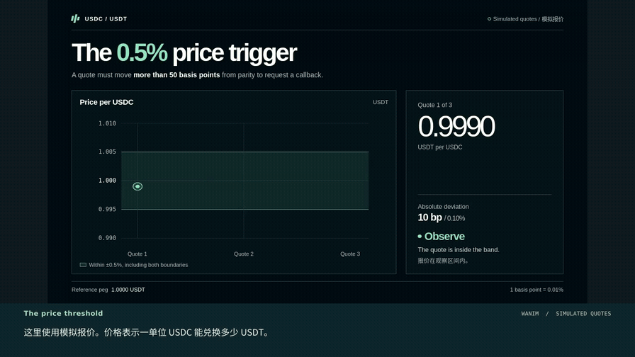

# The 0.5% price trigger

This Wanim scene illustrates the USDC/USDT price gate in `ReactiveAlert.react()`. The green band covers 0.9950 through 1.0050 USDT per USDC, including both endpoints. The chart uses simulated quotes and the readout describes what the price gate would do. The separate receipt evidence demonstrates an actual callback.



[Full captioned demo and narration](../video/README.md) · [Editable Python scene](threshold.py)

| Simulated quote | Absolute deviation from 1.0000 | Price-gate decision |
| --- | --- | --- |
| 0.9990 | 10 bp / 0.10% | Observe |
| 0.9950 | 50 bp / 0.50% | Observe |
| 0.9930 | 70 bp / 0.70% | Request callback |

The Python scene computes the classification with integer units of 0.0001. At either 0.9949 or 1.0051 the deviation is 51 bp and the gate requests a callback. At 0.9951 or 1.0049 the deviation is 49 bp and the gate observes. The transition between two sample points is a visual interpolation.

## Run locally

From the `track3` folder, run this command with Python 3.9 or later.

```sh
python3 visual/serve.py --port 8767
```

Open **http://127.0.0.1:8767/?offline=1**. Select one of the three examples or use the slider to change its price. The first run downloads the official Wanim 0.1.3 and numpy-ts 1.7.0 npm archives and checks their SHA-512 integrity. Subsequent runs use the cache and run without an Internet connection. To use another cache directory, pass `--cache PATH`. Only the loopback interface is exposed.

## Record the opening

Open **http://127.0.0.1:8767/?offline=1&mode=film** at 1280 × 720. Film mode starts when the Wanim canvas is ready. Capture the top 16:9 frame. **Replay three quotes** restarts the sequence. The first move begins at 3.6 seconds and the second at 7.9 seconds. Each move takes 0.65 seconds. The sequence ends at 12.5 seconds and holds the last frame.

视频解说可用这句：“0.999 偏离 10 个基点，继续观察。0.995 恰好偏离 0.5%，仍在观察区间。0.993 偏离 70 个基点，越过阈值，触发回调请求。”

For automated capture, wait for `#stage[data-ready="true"]`, click `#play-film`, then capture `#stage`. The chart is drawn by Wanim from Python. The surrounding HTML supplies accessible controls, bilingual decision captions and units.

## Embed and edit

Serve this folder as static files. Open `index.html` over HTTP or HTTPS. The public version loads the two pinned browser packages from jsDelivr. From a sibling `site/` folder, link to `../visual/index.html` or embed the page with an iframe.

```html
<iframe src="../visual/index.html" title="Simulated USDC/USDT price gate"
        style="width:100%; height:clamp(36rem, 60vw, 58rem); border:0"></iframe>
```

The standalone Python source also runs in the Wanim Playground. Paste `threshold.py`, press **Run**, and drag the slider to adjust the third quote. The page player and the standalone scene share the plotting and decision functions. [Wanim Playground](https://wanim.org/playground/) · [Official embedding guide](https://wanim.org/docs/usage/)
