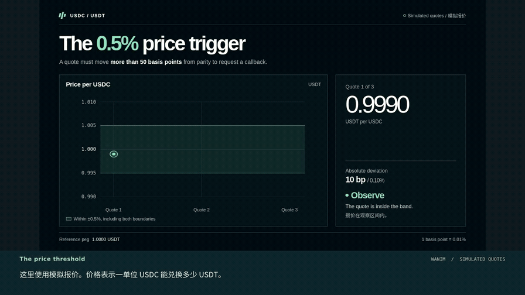

# 0.5% 的报价触发门槛

[English](README.md) · **简体中文**

这段 Wanim 动画展示 `ReactiveAlert.react()` 的 USDC/USDT 判断规则。绿色观察区间是每枚 USDC 可兑换 0.9950 至 1.0050 USDT，两端点均包含在内。画面使用模拟报价说明判断规则，真实回调可在交易回执中核对。



[完整有声演示与字幕](../video/README.zh-CN.md) · [可编辑的 Python 场景](threshold.py)

| 模拟报价 | 与 1.0000 的绝对偏离 | 判断 |
| --- | --- | --- |
| 0.9990 | 10 个基点 / 0.10% | 观察 |
| 0.9950 | 50 个基点 / 0.50% | 观察 |
| 0.9930 | 70 个基点 / 0.70% | 请求回调 |

Python 场景用 0.0001 为单位进行整数运算。0.9949 和 1.0051 都偏离 51 个基点，会请求回调；0.9951 和 1.0049 都偏离 49 个基点，继续观察。示例点之间的运动是视觉插值。

## 本地运行

在 `track3` 目录用 Python 3.9 或更高版本运行以下命令。

```sh
python3 visual/serve.py --port 8767
```

打开 **http://127.0.0.1:8767/?offline=1&lang=zh**，选择预设报价或拖动滑块。首次使用会下载官方 Wanim 0.1.3 与 numpy-ts 1.7.0 的 npm 包，校验 SHA-512。之后可使用缓存离线运行。用 `--cache PATH` 更换目录。服务只监听本机回环地址。

## 录制开场动画

以 1280 × 720 打开 **http://127.0.0.1:8767/?offline=1&mode=film&lang=zh**。Wanim 画布就绪后进入录像模式。截取上方 16:9 画面。点击“重播三笔报价”可重新开始。两次移动分别从 3.6 秒和 7.9 秒开始，每次持续 0.65 秒。12.5 秒时停在最后一帧。

视频解说可用这句：“0.999 偏离 10 个基点，继续观察。0.995 恰好偏离 0.5%，仍在观察区间。0.993 偏离 70 个基点，越过阈值，触发回调请求。”

自动录制时，等待 `#stage[data-ready="true"]`，点击 `#play-film`，再采集 `#stage`。Wanim 从 Python 绘制图形，外围 HTML 提供控件、双语判断说明和单位。

## 嵌入和编辑

以静态文件方式提供本目录，通过 HTTP 或 HTTPS 打开 `index.html`。公开版从 jsDelivr 加载固定版本的两个包。相邻的 `site/` 页面可以链接到 `../visual/index.html`，或用 iframe 嵌入动画。

<iframe src="../visual/index.html?lang=zh" title="USDC/USDT 模拟报价观察区间"
<iframe src="../visual/index.html" title="Simulated USDC/USDT price gate"
        style="width:100%; height:clamp(36rem, 60vw, 58rem); border:0"></iframe>
```

场景源码也可在 Wanim Playground 独立运行。粘贴 `threshold.py`，点击 **Run**，拖动滑块调整第三笔报价。两个版本共用绘图和判断函数。[Wanim Playground](https://wanim.org/playground/) · [官方嵌入说明](https://wanim.org/docs/usage/)

## README 封面如何制作

封面把两笔已发布的测试报价放在同一条基点刻度上。空心圆代表对照样本，实心菱形沿触发报价一直指向 Base 回执。50 个基点处标出阈值，绝对偏离超过该值时 Lasna 才请求回调。图下方保留了这次链下复核的结果。[对照交易和判断规则](../README.md#架构与触发条件) · [公开回执与复核结果](../evidence/public-run.json)

Python 标准库生成桌面和手机两种原生 SVG。从公开运行记录中读取触发价、源日志序号及复核状态。手机图将各阶段纵向排列，沿用同一刻度。从仓库根目录运行以下命令。

```sh
python3 track3/visual/hero/build.py
python3 .agents/skills/design-github-readme-heroes/scripts/check_hero.py track3/visual/hero/desktop.svg --mobile track3/visual/hero/mobile.svg --breakpoint 860 --wide-width 838 --phone-width 324 --out /tmp/pegpulse-hero --export-wide track3/visual/hero/cover.png
```

第二条命令使用 Playwright 和 Chromium，在浅色与深色页面预览两种尺寸并检查文字位置。可用 `python3 -m pip install playwright` 和 `python3 -m playwright install chromium` 安装依赖，也可用 `--browser` 指定已有浏览器。根 README 直接嵌入 SVG。[生成脚本](hero/build.py) · [桌面封面](hero/desktop.svg) · [手机封面](hero/mobile.svg) · [幻灯片 PNG](hero/cover.png) · [可复用的封面设计指南](../../.agents/skills/design-github-readme-heroes/SKILL.md)
